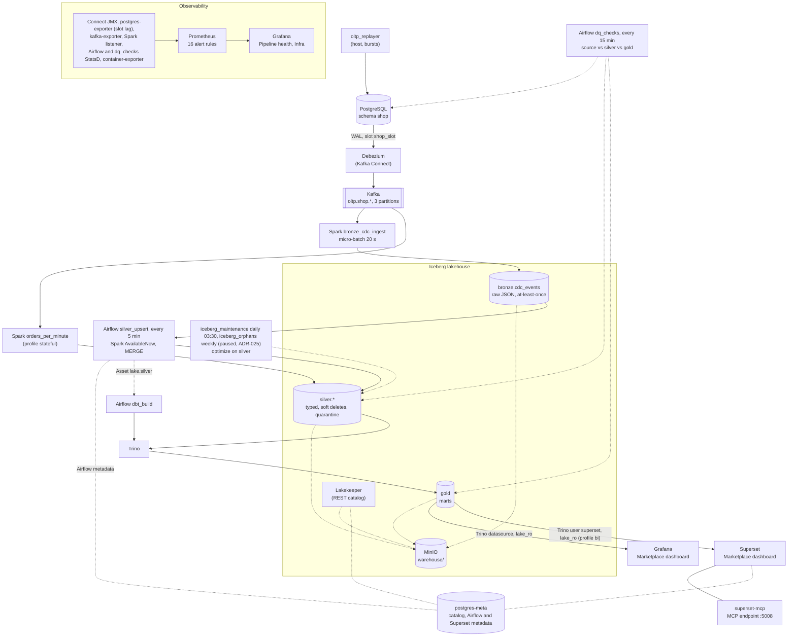

# Architecture

## Goal

Replay real marketplace history through an OLTP database, capture every change with CDC,
land it in an Iceberg lakehouse, and serve tested analytics, on one 16 GB laptop, with
operations, observability and failure recovery treated as first-class.

## Diagram



The same diagram as Mermaid, so GitHub renders it and a diff stays readable. Edit this
block and re-export the SVG; the command is under the block.



Export (Mermaid CLI 11.4.2 in a container; `$T` is a scratch directory holding the block above as
`architecture.mmd`, `pp.json` = `{"executablePath":"/usr/bin/chromium","args":["--no-sandbox"]}` and
`cfg.json` = `{"flowchart":{"htmlLabels":false}}`, so the SVG has plain text labels):

```bash
docker run --rm -v "$T:/in" -v "$PWD/docs/img:/out" minlag/mermaid-cli:11.4.2 \
  -p /in/pp.json -c /in/cfg.json -i /in/architecture.mmd -o /out/architecture.svg -b white
```

## Data flow

1. `oltp_replayer` loads the Olist dataset into PostgreSQL schema `shop` with all timestamps
   shifted so the last day of the dataset is "today". 80% of history is bulk-loaded; the
   remaining 20% is replayed on a virtual clock (`REPLAY_SPEED`, e.g. one day per 30 s) as real
   INSERT / UPDATE / DELETE statements: order created, approved, shipped, delivered, canceled,
   review added or removed. Knobs inject late updates, duplicate updates and a schema change.
2. Debezium (Kafka Connect, PostgreSQL connector, `snapshot.mode=initial`) reads the WAL through
   a logical replication slot and produces one topic per table, `oltp.shop.<table>`, keyed by
   primary key, 3 partitions. Delivery is at-least-once.
3. Spark Structured Streaming job `bronze_cdc_ingest` subscribes to `oltp.shop.*`, runs a
   micro-batch every 20 s and appends raw envelopes to `bronze.cdc_events` (Iceberg). The
   payload stays a JSON string, so schema changes upstream never break bronze. Checkpoint in
   object storage; Iceberg commits are atomic per batch.
4. Spark job `silver_upsert` runs every 5 minutes from Airflow with `Trigger.AvailableNow`.
   It reads bronze incrementally (Iceberg streaming source), parses payloads against contracts,
   keeps one row per key (`_last_lsn` descending with nulls last, then `ts_ms`, then `kafka_offset`), sends
   unparsable rows to `silver.quarantine`, and runs `MERGE INTO silver.<table>` per table in a loop,
   updating only where `(t._last_lsn is null or s._last_lsn > t._last_lsn)`
   (`streaming/spark_jobs/silver_upsert.py:141-158`). Deletes are soft (`_is_deleted = true`).
   Late events never overwrite newer state. Re-running a batch yields the same result. Bronze
   itself is an at-least-once journal: duplicates there are allowed and measured, silver is where
   the no-duplicates guarantee lives.
5. Spark job `orders_per_minute` (profile `stateful`, ADR-024) reads Kafka, keeps a 1-minute
   window with a 5-minute watermark in `update` mode, and upserts into
   `silver.orders_per_minute`. It exists to make watermark, state and late-event behaviour
   observable rather than theoretical.
6. dbt on Trino builds `stg_*` views, `int_*` models and marts (`fct_orders`, `fct_order_items`,
   `dim_*`, `mart_daily_sales` incremental by purchase date, `mart_seller_performance`,
   `mart_delivery_sla`) after every silver merge, triggered by the Asset `lake.silver`. Tests run
   with it; docs are generated on demand (`make dbt-docs`). One catch: Airflow 3.3 queues no Asset
   event for a DAG that is paused and does not replay it on unpause, so a merge that lands while
   `dbt_build` is paused leaves gold behind silver until someone triggers the DAG. `dq_checks` counts
   the runs that find gold older than silver at rest and the alert `GoldStaleAtRest` fires on two in
   a row ([OPERATIONS, Airflow](OPERATIONS.md#airflow)).
7. `dq_checks` (every 15 minutes) fails on a duplicate key in silver and on silver differing from
   Postgres at rest, compares row fingerprints source to silver and silver to gold and GMV per
   day source to `mart_daily_sales` (`reconcile_values`), and logs delivery repeats, source
   no-ops, quarantine growth and freshness. While CDC stands (the source wrote, the slot did not move) it gives no verdict for
   the source-silver pairs and says `in flight` instead of a false red. Its gauges go to
   Prometheus through StatsD. `iceberg_maintenance` (daily 03:30) runs `optimize` on silver;
   snapshot expiry, bronze compaction and orphan removal are manual or per-run parameters, and
   `iceberg_orphans` (weekly) stays paused (ADR-025, OPERATIONS "Maintenance").
8. Prometheus scrapes Kafka, Connect, PostgreSQL (slot lag, retained WAL), the Spark driver
   (custom `StreamingQueryListener` metrics: input rows, batch duration, Kafka lag), Airflow
   (StatsD) and a small `container-exporter` on the Docker API (ADR-023). Grafana shows
   "Pipeline health" and "Infra". 16 alert rules in `observability/prometheus/alerts.yml`, tested
   by promtool (`make alerts-test`); no Alertmanager, alerts are read in Prometheus and Grafana.
9. Superset is the main BI layer (ADR-027, profile `bi`, not needed by `core`): a dashboard
   `Marketplace` of 13 charts: KPI tiles with the previous period, trends of sales, delivery and
   cancellations, top categories, worst states. It reads `lake_ro.gold` as the Trino user
   `superset`, and `superset-mcp` exposes Superset to MCP clients on `127.0.0.1:5008`, checked for
   Host and Origin and running every tool as `admin`
   ([OPERATIONS, Superset](OPERATIONS.md#superset-profile-bi)). Grafana with a Trino datasource
   shows a lighter `Marketplace` view of the same marts. `lake_ro` is a read-only catalog over the
   same warehouse, and Trino file-based access control lets the `grafana` and `superset` users read
   the marts `fct_*`, `dim_*`, `mart_*` and nothing else (ADR-028; probes in
   [docs/evidence.md](docs/evidence.md#trino-access-control)). Trino has no authentication, so the
   user name is only a label: [OPERATIONS, Access control](OPERATIONS.md#access-control) lists the
   residual risk.

## Layers

| Layer | What lives there | Written by | Idempotency key |
|---|---|---|---|
| OLTP `shop` | customers, sellers, products, orders, order_items, payments, reviews | replayer | primary key |
| Kafka `oltp.shop.*` | Debezium JSON envelopes, 3 partitions, key = PK | Debezium | offset |
| bronze | raw CDC events, append-only, at-least-once, schema-flexible | Spark streaming | `(topic, partition, offset)`; checked for no offset twice and no gap between the first and the last offset bronze took per partition; duplicates measured |
| silver | typed current state, soft deletes, one row per key | Spark AvailableNow + MERGE | PK + max(lsn) |
| gold | staging, intermediate, marts | dbt on Trino | rebuilt tables; `mart_daily_sales` replaces whole days (ADR-030) |

## Delivery guarantees: effectively-once

End to end the pipeline is effectively-once: at-least-once delivery plus idempotent sinks, not a
transactional exactly-once. Debezium and Kafka are at-least-once, and Spark can re-run a
micro-batch after a crash. Silver equals the source as long as Kafka retention (24 h or 2 GiB per
partition) and the replication slot outlive any consumer outage, the source has one writer per key
(ADR-021), and a restored Spark checkpoint matches its table. Silver keeps the newest event per
key (highest LSN; a snapshot read without one loses to any streamed change): a repeated streamed
event is a no-op, a repeated snapshot read rewrites its row with the same values. Silver commits
table by table, so a reader can see `order_items` merged before `orders`. Gold marts are rebuilt
tables; `mart_daily_sales` replaces whole purchase dates (`delete+insert`, ADR-030). Bronze is
checked for no offset twice and no gap between the first and the last offset it took; the start of
the topics that Kafka retention removed before bronze existed came back as a snapshot (ADR-019).

Chaos scenario 1 found no repeated or missing offset after a driver kill, and since both live
kills landed before the write stage, the skip of an already committed epoch is reproduced by
`tests/unit/test_iceberg_sink.py`, not by a live run. The measured cases are in
[docs/evidence.md](docs/evidence.md).

## What is deliberately absent

Multi-broker Kafka, Spark cluster, Schema Registry, ClickHouse, Kubernetes, Terraform, Ansible,
Loki, managed cloud: each is outside what one laptop and this project's goals need.
See [DECISIONS.md](DECISIONS.md) (ADR-012, ADR-015) and the next section for what production adds.

## Production gap

| Dimension | In the project | Missing | Laptop stand-in | In production |
|---|---|---|---|---|
| High availability | one instance of every service, restart policies, healthchecks | broker, catalog, metadata DB and object store replicas | `restart: unless-stopped`, chaos drills with measured recovery | 3+ Kafka brokers with RF 3 and `min.insync.replicas` 2; Postgres primary with a standby (Patroni or a managed service); several Lakekeeper replicas; erasure-coded or cloud object storage |
| Scale | `local[2]` Spark, 3 partitions, about 100k orders | cluster execution, autoscaling | profiles that never all run at once (ADR-016) | Spark on Kubernetes or a managed runtime (EMR, Dataproc, Databricks); partitions sized by throughput; Trino cluster with workers |
| Security | loopback only, generated secrets in `.env`, Trino ACL for BI users, read-only catalog | authentication, TLS, per-service credentials, secret store | `BIND_IP=127.0.0.1`, user name as a label | OIDC (Keycloak or the cloud IdP) for Trino, Lakekeeper, Airflow, Superset; TLS everywhere; Vault or a cloud secret manager; per-service S3 roles; Lakekeeper authorization (OpenFGA); no Docker socket in workloads |
| Data governance | JSON Schema contracts, quarantine, dbt tests and descriptions, soft deletes | schema registry, lineage, catalog of owners, PII handling | contracts in git, reconcile against the source | Avro or Protobuf with a schema registry and compatibility rules; OpenLineage into DataHub or OpenMetadata; PII tags and masking; data contracts with owners |
| Environments and deploy | one compose stack, CI with lint, tests, Spark tests and a weekly smoke from a clean clone | dev, staging, prod; deploy pipeline; IaC | `make start`, `make bootstrap` | Terraform for the platform, Helm or a managed service per component, promotion through environments, dbt runs per environment |
| Observability and on-call | Prometheus rules with tests, Grafana, runbooks | alert delivery, log aggregation, SLOs with error budgets | alerts read in the UI (ADR-015) | Alertmanager to PagerDuty or Opsgenie; Loki or a log service; tracing; SLOs on freshness and lag |
| Backup and disaster recovery | Iceberg snapshots 7 days, one manual copy of `warehouse/`, documented restore gaps; no restore from a copy has ever been drilled | regular backups, a tested restore, RPO and RTO | rebuild from the repo and the dataset (`make nuke && make bootstrap`) | scheduled `pg_dump` or PITR of the catalog DB, object store versioning and cross-region replication, Kafka mirroring (MirrorMaker 2), quarterly restore drills |
| Cost | free, one 16 GB laptop | cost tracking | memory limits per service | right-sized clusters, spot workers for batch, storage lifecycle rules, per-team cost tags |

Version status, checked 2026-11-21: Lakekeeper 0.13.6 is behind 0.15.1, Iceberg 1.11.0 behind 1.12.0,
dbt-core 1.10 behind 1.12 and no longer maintained by dbt Labs (deprecated), Kafka 4.3.1 behind
4.4.0, Debezium 3.5 behind 3.7.1, Trino 483 behind 484, Airflow 3.3.2 behind 3.4.0; Superset 6.1.0
is current; Spark 3.5.9 is the last 3.5 release, in security-only extended support until November
2027 ([Spark versioning policy](https://spark.apache.org/versioning-policy.html)); PostgreSQL 17 is
supported until November 2029 ([PostgreSQL versioning](https://www.postgresql.org/support/versioning/)).
dbt: [version policy](https://docs.getdbt.com/docs/dbt-versions).

## Resource model

Compose profiles let the platform run in pieces: `core` always (the REST catalog Lakekeeper
included), `query` almost always, `orchestrate` only while batch work is being developed or demoed, `stateful` for the streaming job `orders_per_minute` (ADR-024), `jobs` for the one-shot `spark-silver` that Airflow launches,
`obs` for monitoring, `bi` (Superset and its MCP endpoint) only for a demo; all but `tools` ran
together on 2026-11-10 under conditions (OPERATIONS "Profiles"). Every long-running service has a
memory limit, log rotation, ports bound to `${BIND_IP}` (`127.0.0.1`; compose refuses to start
without it), a real healthcheck and `restart: unless-stopped`, except `kafka-ui` (no healthcheck).
One-shot jobs (`minio-init`, `lakekeeper-migrate`, `lakekeeper-bootstrap`, `spark-silver`,
`superset-init`) have `restart: "no"` and no healthcheck; `minio-init` also has no memory limit.
WSL2 is capped at 12 GB. Limits per profile: [OPERATIONS.md](OPERATIONS.md).
