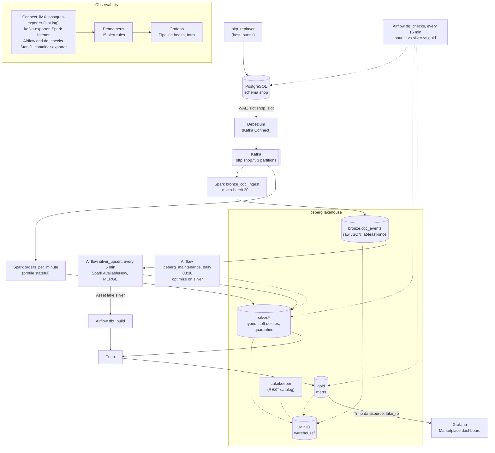

# Architecture

## Goal

Replay real marketplace history through an OLTP database, capture every change with CDC,
land it in an Iceberg lakehouse, and serve tested analytics, on one 16 GB laptop, with
operations, observability and failure recovery treated as first-class.

## Diagram



The same diagram as Mermaid, so GitHub renders it and a diff stays readable (W6-D14). Edit this
block and re-export the SVG; the command is under the block.



Export (Mermaid CLI 11.4.2 in a container; `$T` is a scratch directory holding the block above as
`architecture.mmd`, `pp.json` = `{"executablePath":"/usr/bin/chromium","args":["--no-sandbox"]}` and
`cfg.json` = `{"flowchart":{"htmlLabels":false}}`, so the SVG has plain text labels):

```bash
docker run --rm -v "$T:/in" -v "$PWD/docs/img:/out" minlag/mermaid-cli:11.4.2 \
  -p /in/pp.json -c /in/cfg.json -i /in/architecture.mmd -o /out/architecture.svg -b white
```

## Data flow

1. `oltp_replayer` loads the Olist dataset into PostgreSQL schema `shop` with all timestamps
   shifted so the last day of the dataset is "today". 80% of history is bulk-loaded; the
   remaining 20% is replayed on a virtual clock (`REPLAY_SPEED`, e.g. one day per 30 s) as real
   INSERT / UPDATE / DELETE statements: order created, approved, shipped, delivered, canceled,
   review added or removed. Knobs inject late updates, duplicate updates and a schema change.
2. Debezium (Kafka Connect, PostgreSQL connector, `snapshot.mode=initial`) reads the WAL through
   a logical replication slot and produces one topic per table, `oltp.shop.<table>`, keyed by
   primary key, 3 partitions. Delivery is at-least-once.
3. Spark Structured Streaming job `bronze_cdc_ingest` subscribes to `oltp.shop.*`, runs a
   micro-batch every 20 s and appends raw envelopes to `bronze.cdc_events` (Iceberg). The
   payload stays a JSON string, so schema changes upstream never break bronze. Checkpoint in
   object storage; Iceberg commits are atomic per batch.
4. Spark job `silver_upsert` runs every 5 minutes from Airflow with `Trigger.AvailableNow`.
   It reads bronze incrementally (Iceberg streaming source), parses payloads against contracts,
   deduplicates by `(table, key, lsn)`, sends unparsable rows to `silver.quarantine`, and
   `MERGE INTO silver.<table>` with `WHEN MATCHED AND source.lsn > target._last_lsn`. Deletes are
   soft (`_is_deleted = true`). Late events never overwrite newer state. Re-running a batch yields
   the same result. Bronze itself is an at-least-once journal: duplicates there are allowed and
   measured, silver is where the no-duplicates guarantee lives.
5. Spark job `orders_per_minute` (profile `stateful`, ADR-024) reads Kafka, keeps a 1-minute
   window with a 5-minute watermark in `update` mode, and upserts into
   `silver.orders_per_minute`. It exists to make watermark, state and late-event behaviour
   observable rather than theoretical.
6. dbt on Trino builds `stg_*` views, `int_*` models and marts (`fct_orders`, `fct_order_items`,
   `dim_*`, `mart_daily_sales` incremental by purchase date, `mart_seller_performance`,
   `mart_delivery_sla`) after every silver merge, triggered by the Asset `lake.silver`. Tests run
   with it; docs are generated on demand (`make dbt-docs`).
7. `dq_checks` (every 15 minutes) fails on a duplicate key in silver and on silver differing from
   Postgres at rest, compares row fingerprints source to silver and silver to gold and GMV per
   day source to `mart_daily_sales` (`reconcile_values`), and logs delivery repeats, source
   no-ops, quarantine growth and freshness. While CDC stands (the source wrote, the slot did not move) it gives no verdict for
   the source-silver pairs and says `in flight` instead of a false red (W6-D9). Its gauges go to
   Prometheus through StatsD. `iceberg_maintenance` (daily 03:30) runs `optimize` on silver;
   snapshot expiry, bronze compaction and orphan removal are manual or per-run parameters, and
   `iceberg_orphans` stays paused (ADR-025, OPERATIONS "Maintenance").
8. Prometheus scrapes Kafka, Connect, PostgreSQL (slot lag, retained WAL), the Spark driver
   (custom `StreamingQueryListener` metrics: input rows, batch duration, Kafka lag), Airflow
   (StatsD) and a small `container-exporter` on the Docker API (ADR-023). Grafana shows
   "Pipeline health" and "Infra". 15 alert rules in `observability/prometheus/alerts.yml`, tested
   by promtool (`make alerts-test`); no Alertmanager, alerts are read in Prometheus and Grafana.
9. Grafana with a Trino datasource shows the "Marketplace" dashboard: four panels over
   `lake_ro.gold` (daily sales, GMV by category, delivery SLA by state, cancellations). `lake_ro`
   is a read-only catalog over the same warehouse, and Trino file-based access control lets the
   `grafana` user read nothing else (W6-D17; probes in
   [docs/evidence.md](docs/evidence.md#trino-access-control)). Trino has no authentication, so the
   user name is only a label: [OPERATIONS, Access control](OPERATIONS.md#access-control) lists the
   residual risk. Superset is optional (ADR-014).

## Where exactly-once comes from

No single component is exactly-once. Debezium and Kafka are at-least-once; Spark can re-run a
micro-batch after a crash. The end result is still correct because the sinks that matter are
idempotent: silver applies changes by primary key with an LSN guard, so a replayed or
duplicated event is a no-op; dbt incremental models merge on a unique key. Bronze is treated as
at-least-once by contract; chaos scenario 1 found no repeated or missing offset after a driver
kill, and since both live kills landed before the write stage, the skip of an already committed
epoch is reproduced by `tests/unit/test_iceberg_sink.py`, not by a live run. The measured cases are in
[docs/evidence.md](docs/evidence.md).

## What is deliberately absent

Multi-broker Kafka, Spark cluster, Schema Registry (stretch), Superset (optional), ClickHouse,
Kubernetes, Terraform, Ansible, Loki, managed cloud. Each is either already known to the author or does not close a
skill gap this project targets. See [DECISIONS.md](DECISIONS.md) (ADR-012, ADR-014, ADR-015).

## Resource model

Compose profiles let the platform run in pieces: `core` always (the REST catalog Lakekeeper
included), `query` almost always, `orchestrate` only while batch work is being developed or
demoed, `obs` for monitoring, `bi` only if there is time left (not runnable today, OPERATIONS
"Profiles"). Every long-running service has a memory limit, log rotation, ports bound to
`${BIND_IP}` (`127.0.0.1`; compose refuses to start without it), a real healthcheck and
`restart: unless-stopped`, except `kafka-ui` (no healthcheck). One-shot jobs (`minio-init`,
`lakekeeper-migrate`, `lakekeeper-bootstrap`, `spark-silver`) have `restart: "no"` and no
healthcheck; `minio-init` also has no memory limit. WSL2 is capped at 12 GB. Limits per profile: [OPERATIONS.md](OPERATIONS.md).
