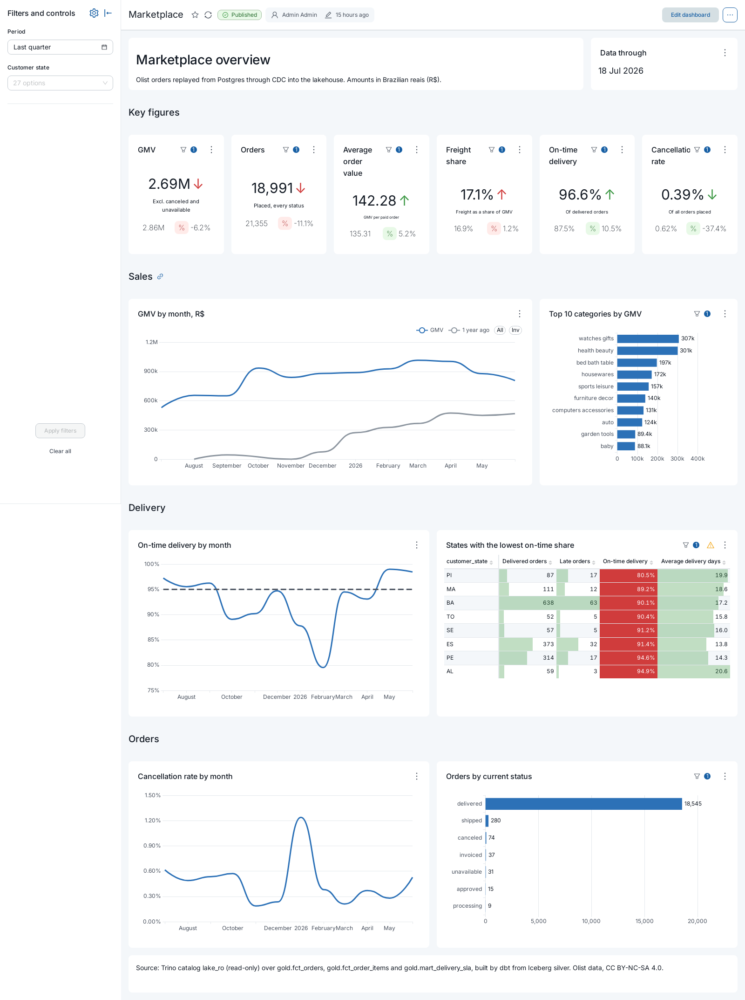

# Marketplace Lakehouse (mini)

[](../../actions/workflows/ci.yml)

A small but real data platform. It replays two years of real marketplace transactions (the public
Olist dataset, about 96 000 orders, 7 tables) through PostgreSQL, captures every change with
Debezium, and streams it through Kafka and Spark into an Iceberg lakehouse. Trino and dbt build
tested marts for Superset and Grafana. After the failure scenarios, silver still equals the source
by rows, keys and decimal sums. It runs on a 16 GB laptop and is meant to be broken
on purpose and explained at a Senior Data Engineer interview.



## What is proven

Status of every component, with dates and sources: [docs/evidence.md](docs/evidence.md#status).

- **Reconciliation:** 7 of 7 tables matched Postgres on rows, keys and decimal sums (2026-10-29),
  and on the values of every column (2026-10-30): [evidence](docs/evidence.md#reconciliation-source-against-silver).
- **Failure scenarios:** 10 chaos scripts (`make chaos-<name>`), each ends in a check of its own
  invariant; seven also check bronze offsets or reconcile silver with Postgres:
  [results](docs/evidence.md#failure-scenarios).
- **Alerts:** 16 rules, 7 shown firing live with the time to fire, the rest by `promtool`.
- **Maintenance:** bronze data files 595 to 30 and `silver.orders` snapshots 38 to 15, row counts
  equal, 2026-10-29.
- **Clean clone:** `smoke.yml` finished green in 9 to 11 minutes on 2026-10-29, last green run
  2026-11-17.
- **BI access:** Superset and Grafana read the gold marts only (`lake_ro`), not silver.
- **Performance:** `silver_upsert` merge of 7 tables median 28.5 s over 23 runs, `dbt build` median
  25.0 s over 26 runs; bronze 559 742 rows in 41.7 MiB (2026-11-21):
  [numbers and queries](docs/evidence.md#performance-on-the-laptop).

## How it was built

The author set the architecture and the ADRs, approved every risky action and accepted each result
against recorded evidence; AI coding agents wrote the code and the documentation under that
process: [the process page](docs/harness.md).

## Architecture

```
PostgreSQL -> Debezium -> Kafka -> Spark Structured Streaming -> Iceberg bronze
Airflow 3 -> Spark AvailableNow MERGE -> Iceberg silver -> dbt on Trino -> Iceberg gold
Superset and Grafana read gold; Prometheus and Grafana watch all of it
```

Bronze is append-only and at-least-once. Silver is typed current state with soft deletes, merged
by key and the highest LSN. Gold is rebuilt by dbt. The diagram, data flow and delivery guarantees
(effectively-once, not transactional): [ARCHITECTURE.md](ARCHITECTURE.md#diagram),
[guarantees](ARCHITECTURE.md#delivery-guarantees-effectively-once).

## Stack

| Component | Version | Job | Rejected alternative |
|---|---|---|---|
| PostgreSQL | 17 | OLTP source; separate metadata instance | one instance for both (ADR-002) |
| Debezium | 3.5 | INSERT, UPDATE, DELETE from the WAL | polling by `updated_at` misses deletes |
| Kafka (KRaft) | 4.3.1 | durable buffer, replay | direct JDBC reads do not replay |
| Spark | 3.5.9, Java 17 | Kafka to Iceberg, silver MERGE | Kafka Connect Iceberg sink teaches nothing about Spark |
| Iceberg | 1.11.0 | ACID tables, snapshots, MERGE | plain Parquet has no atomic commits |
| Lakekeeper | 0.13.6 | Iceberg REST catalog | JDBC catalog, replaced (ADR-005) |
| MinIO | 2025-09-07 release | S3 storage, built from source (ADR-026) | RustFS, Garage, SeaweedFS (ADR-004, ADR-026) |
| Trino | 483 | interactive SQL, dbt engine | Spark SQL is heavy for interactive use |
| dbt | core 1.10.23, trino 1.10.4 | tested analytics layer | hand-written SQL has no tests |
| Airflow | 3.3.2 | batch schedule, retries | cron has no retries or visibility |
| Prometheus, Grafana | 3.14.0, 13.2.2 | lag, freshness, failures | logs cannot answer "how far behind" |
| Superset | 6.1.0 | BI over gold (ADR-027) | Grafana only: no metric layer, no cross-filters |

All ADRs: [DECISIONS.md](DECISIONS.md) (ADR-001 to ADR-030).

## Quick start

Host: `make`, `git`, `curl`, `envsubst` (gettext-base), `timeout`, Python 3.12 and `uv`, Docker.
On Windows 11 use WSL2 with 12 GB (`.wslconfig`); 20 GB disk. From a clean clone, on the committed
2 000-order sample (no Kaggle account):

```bash
make secrets                                          # generates .env from .env.example
sed -i 's/^REPLAY_DATA=.*/REPLAY_DATA=sample/' .env   # the sample slice in data/sample
make bootstrap                                        # start, migrate, connector, load, verify, protect
make replay-burst SECONDS=60                          # about 12 virtual hours of history, then stops
make verify                                           # bronze and silver against Postgres; ends `verify ok`
```

`make bootstrap` took 4 minutes locally with the images built (2026-10-17). MinIO and `mc` build
from source on the first start: [docs/supply-chain.md](docs/supply-chain.md). `make start` brings
up `core` and `query`; add the rest with `make up PROFILE=<name>`. All profiles except `tools` ran
together at 6.0 GiB at rest on 2026-11-10.

| Open | Address | Profile |
|---|---|---|
| Superset | http://127.0.0.1:8088, `admin`, `SUPERSET_ADMIN_PASSWORD` | `bi` |
| Grafana | http://127.0.0.1:3000, `admin`, `GRAFANA_ADMIN_PASSWORD` | `obs` |
| Airflow | http://127.0.0.1:8090, no login | `orchestrate` |
| Trino | `make trino` | `query` |

All ports and profiles: [OPERATIONS.md](OPERATIONS.md#ports-all-on-127001). Full dataset: `make data`.

The quick start ends at silver. Gold and the dashboard are one more step: `make dbt-build` (seed,
run and test `lake.gold` through Trino), then `make up PROFILE=bi` for Superset. Run
`make dbt-build` by hand only with Airflow down, or with `dbt_build` paused and no
`iceberg_maintenance` run in flight: gold takes one writer at a time. With the `orchestrate`
profile the `dbt_build` DAG builds gold after every merge of `silver_upsert` once both DAGs are
unpaused (DAGs start paused); on a stack at rest trigger it once:
[OPERATIONS, Airflow](OPERATIONS.md#airflow). This step is not covered by `smoke.yml` and is not
proven on the sample: the gold runs in [evidence](docs/evidence.md) were on the full dataset. To
stop and start the whole stack, see [OPERATIONS, Daily commands](OPERATIONS.md#daily-commands).

## Business layer

Gold models answer daily sales and GMV, top categories by GMV, delivery SLA by state and
cancellations. The Superset dashboard "Marketplace" has 13 charts over `lake_ro.gold`. Metric
definitions: [dbt/models/docs.md](dbt/models/docs.md); `make dbt-docs` builds the site. Last
`dbt build`, 2026-11-20: 0 errors, 4 warnings.

## Quality, tests and CI

`make verify` checks that bronze took no Kafka offset twice and has no gap between the first and the
last offset bronze took per partition, and that silver matches Postgres per table by row count,
primary keys, decimal sums and a fingerprint of every column. Invalid events land in
`silver.quarantine`. dbt tests run with every gold build; the `dq_checks` DAG runs every 15 minutes
and says `in flight` instead of a false failure while CDC stands.

CI has 6 jobs: `lint-and-test` (`setup-java` Java 17 for the local Spark tests, `ruff`, `mypy`,
`sqlfluff`, `yamllint`, `dbt parse`, `pytest tests/unit`, `gitleaks`), `hadolint`, `alerts-test`,
`spark-tests`, `airflow-image` and `minio-images`; last green run
[44899782065](../../actions/runs/44899782065). `smoke.yml` walks the clean-clone path on the
sample but stops at silver: gold, the Asset chain, `dq_checks` and the dashboards are proven by the
dated manual runs in [evidence](docs/evidence.md#ci-and-smoke), not by CI.

## Limits and security

Not done:

- `iceberg_orphans` on its weekly schedule: not done (paused by decision, ADR-025).
- `rewrite-position-deletes` on `silver.orders`: not done (failed on 2026-10-23, not run live since).
- 24 hour unattended run: not done (cancelled on 2026-11-04).
- Restore from a backup: not done (no restore drill was run).

What production adds: [Production gap](ARCHITECTURE.md#production-gap). What is not verified:
[Not proven yet](docs/evidence.md#not-proven-yet).

### Security model

A local lab, not a hardened system (ADR-029).

- Every port is bound to `127.0.0.1` (`BIND_IP`). Do not change it.
- No login on Kafka, Kafka Connect, Lakekeeper, Trino, Prometheus, Airflow (every visitor is admin)
  and the Superset MCP endpoint.
- Shared accounts: the MinIO root key pair for Spark, Trino, Lakekeeper and the three Airflow
  containers (api-server, scheduler, dag-processor); one `postgres-meta` superuser for Lakekeeper,
  Superset and Airflow; the superuser of the source database (`OLTP_USER`, also the image's
  `POSTGRES_USER`) for the replayer, postgres-exporter and Airflow.
- MinIO and Lakekeeper run as root inside their containers (`docker top`, 2026-11-21). No container
  drops capabilities or sets `no-new-privileges`.
- The Airflow scheduler and container-exporter mount `docker.sock`.
- The Debezium password is visible in plain text through the Kafka Connect REST API.
- MinIO is built without the 2025-10-15 tag that fixes CVE-2025-62506 (accepted, ADR-026).
- The images are not scanned for CVEs.

## Documentation

| Reader | Read |
|---|---|
| Recruiter, 3 min | this page down to Quick start |
| Interviewer, 30 min | [ARCHITECTURE](ARCHITECTURE.md), [evidence](docs/evidence.md), [DECISIONS](DECISIONS.md), [interview notes](docs/interview-notes.md) ([lessons from the failure runs](docs/interview-notes.md#lessons-from-the-failure-runs)) |
| Analyst, 10 min | Business layer, [dbt/README.md](dbt/README.md), [metric definitions](dbt/models/docs.md) |
| New engineer, 1 h | Quick start, [OPERATIONS](OPERATIONS.md), the README in each component directory |
| On call, 5 min | [OPERATIONS, Alerts](OPERATIONS.md#alerts), [runbooks](docs/runbooks) |

Also: [failure scenarios](docs/failure-scenarios.md), [supply chain](docs/supply-chain.md).

Repository:

```
oltp/ connect/ streaming/ contracts/    source, CDC, Spark jobs, JSON Schema
dbt/ airflow/ observability/ docker/    gold models, DAGs, alerts and dashboards, compose
scripts/ tests/ docs/                   chaos and helpers, unit tests, evidence and runbooks
```

## Data

The Brazilian E-Commerce Public Dataset by Olist
([Kaggle](https://www.kaggle.com/datasets/olistbr/brazilian-ecommerce)) is licensed
[CC BY-NC-SA 4.0](https://creativecommons.org/licenses/by-nc-sa/4.0/). The 2 000-order sample in
`data/sample` and the category translation seed in `dbt/seeds` come from it and carry the same
license: attribution to Olist, non-commercial use, share-alike ([data/README.md](data/README.md)).
The full dataset is not in the repository: `make data` downloads it.

## License

The code is under the [MIT License](LICENSE.md). The data keeps its own license (above).
