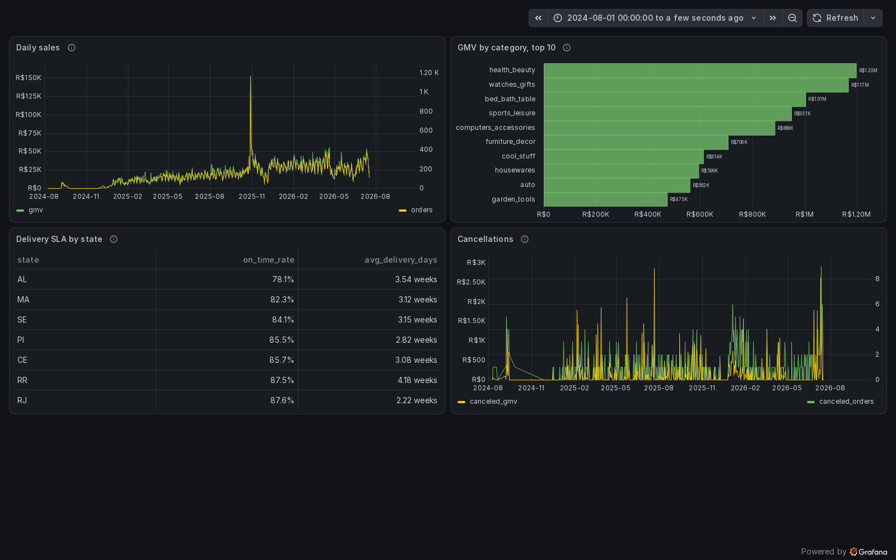

# Marketplace Lakehouse (mini)

A small but real data platform that replays two years of real marketplace transactions
(the public Olist dataset) through PostgreSQL and streams every change into an Iceberg
lakehouse. Built to run on a 16 GB laptop, to be broken on purpose, and to be explained
at a Senior Data Engineer interview.

It answers four business questions from tested gold models: daily sales and GMV, the top categories
by GMV, delivery SLA by state, and cancellations.



How it was built: AI agents wrote the code and the documentation; one engineer decided the
architecture, approved every risky action and accepted the results. The record, with the review
findings: [How it was built](docs/evidence.md#how-it-was-built).

Start here: [ARCHITECTURE.md](ARCHITECTURE.md) (diagram and data flow),
[docs/evidence.md](docs/evidence.md) (what was run, with numbers and dates),
[OPERATIONS.md](OPERATIONS.md) (profiles, runbooks, failure scenarios),
[DECISIONS.md](DECISIONS.md) (ADR-001 to ADR-026),
[docs/interview-notes.md](docs/interview-notes.md) (30 questions with examples from the repository).

## Quick start

From a clean clone, on the committed 2 000-order sample (no Kaggle account), after Docker and
`uv` are installed:

```bash
make secrets                                          # generates .env from .env.example
sed -i 's/^REPLAY_DATA=.*/REPLAY_DATA=sample/' .env   # the sample slice in data/sample
make bootstrap                                        # start, migrate, connector, load, verify, protect
make replay-burst SECONDS=60                          # plays about 12 virtual hours of the remaining history, then stops
make verify                                           # bronze holds every Kafka record once, silver matches Postgres (rows, keys, sums, values)
```

`make bootstrap` is the one command: it starts the stack, migrates the source, registers the
connector, loads the data, runs `make verify` (prints `verify ok`) and protects the bronze and
silver tables in Lakekeeper. The same steps run unattended on GitHub as `smoke.yml` and finished
green in 9 to 11 minutes on 2026-10-29 (cold, images built from scratch, [run
40907438614](../../actions/runs/40907438614)). Locally, from a fresh clone on the sample, `make
bootstrap` took 4 minutes with the images built; the first build of the Spark image adds about 80
seconds with its base image already pulled (2026-10-17, [OPERATIONS](OPERATIONS.md#daily-commands)).

With the full dataset: `make data` downloads it into `data/raw` (Kaggle CLI or manual) and
`REPLAY_DATA=raw` stays in `.env`. `make hooks` installs the pre-commit hooks (ruff, yamllint,
gitleaks). `make psql` opens the source database, `make trino` the Trino CLI.

Requirements: Windows 11 with WSL2 + Docker Desktop (or any Linux with Docker), 12 GB for WSL2
(`.wslconfig`), 20 GB disk, Python 3.12 with `uv`.

MinIO and its `mc` client are built from the source of their last community tags on the first
start (no registry serves the images any more, ADR-026): it needs the network for GitHub and the
Go module proxy. The first build on a laptop (2026-10-27, `--build-arg GOFLAGS=-p=2`, an earlier
revision of the same Dockerfile) took about 4 minutes for MinIO and under half a minute for `mc`
after it; the cold time on a CI runner is not measured. On a host short of memory build them first:
`docker compose --env-file .env -f docker/compose.yaml build --build-arg GOFLAGS=-p=2 minio minio-init`.

`make start` brings up `core` and `query` without the replayer container, which would play the rest
of the history at full speed; `make up` refuses any `PROFILE` that contains `core` (ADR-016). All
profiles except `tools` ran together on 2026-11-10 at 6.0 GiB in `docker stats` at rest under
conditions (`TRINO_XMX=2g`, no parallel Spark tests or builds). Working combinations and conditions:
[OPERATIONS.md](OPERATIONS.md).

| Profile | Services | RAM (sum of limits in `docker/compose.yaml`) |
|---|---|---|
| `core` | postgres-oltp, postgres-meta (Lakekeeper's database), kafka, kafka-connect, minio, lakekeeper (Iceberg REST catalog), spark-bronze; oltp-replayer only through `make replay-live` | ~7.5 GB |
| `query` | trino | 3.5 GB |
| `orchestrate` | airflow api-server / scheduler / dag-processor | ~2.1 GB |
| `obs` | prometheus, grafana, exporters, container-exporter | ~1.1 GB |
| `stateful` | spark-orders-per-minute | 1.75 GB |
| `bi` | superset, superset-mcp, one-shot superset-init (optional; with `orchestrate` only under the conditions in OPERATIONS) | ~1.8 GB running (1280M + 512M), plus 1024M while the one-shot runs |
| `tools` | kafka-ui | 0.4 GB |

## Explore the stack

Every port is bound to `127.0.0.1`. Passwords are generated into `.env` by `make secrets` and are not
printed here. Ports, profiles and the full list: [OPERATIONS, Ports](OPERATIONS.md#ports-all-on-127001).
After pulling an update run `make secrets` again: it appends the keys the new `.env.example` has and
`.env` lacks (for example `SUPERSET_ADMIN_PASSWORD`, which compose requires) and never rewrites an
existing key.

| Service (profile) | URL | Login | What to look at |
|---|---|---|---|
| Grafana (`obs`) | http://127.0.0.1:3000 | `admin`, `GRAFANA_ADMIN_PASSWORD` | dashboards "Marketplace" (business), "Pipeline health", "Infra" |
| Prometheus (`obs`) | http://127.0.0.1:9090 | none | `/alerts` (16 rules), `/targets` |
| Airflow (`orchestrate`) | http://127.0.0.1:8090 | none, every visitor is admin | DAGs `silver_upsert`, `dbt_build`, `dq_checks`, `iceberg_maintenance`; task logs |
| Superset (`bi`) | http://127.0.0.1:8088 | `admin`, `SUPERSET_ADMIN_PASSWORD` | dashboard "Marketplace" (4 charts over `lake_ro.gold`) |
| Superset MCP (`bi`) | http://127.0.0.1:5008/mcp | none, local only | tools for an MCP client, run as `admin`: [OPERATIONS, Superset](OPERATIONS.md#superset-profile-bi) |
| MinIO console (`core`) | http://127.0.0.1:9001 | `S3_ACCESS_KEY`, `S3_SECRET_KEY` | the bucket `S3_BUCKET`: the Iceberg data and metadata files (`:9000` is the S3 API) |
| Lakekeeper UI (`core`) | http://127.0.0.1:8181/ui/ | none | warehouse `lake`, namespaces and tables of the catalog |
| Trino (`query`) | `make trino` (HTTP on 127.0.0.1:8080) | none, the user name is a label | `select` on `lake.silver.*`, `lake.gold.*` |
| Spark UI (`core`) | http://127.0.0.1:4040 | none | the streaming query `bronze_cdc_ingest` |
| Kafka Connect (`core`) | http://127.0.0.1:8083/connectors/shop-connector/status | none | connector and task state (`make connector-status`) |
| Kafka (`core`) | bootstrap `127.0.0.1:9092` from the host | none | `make kafka-topics`; the broker advertises `localhost:9092` to host clients |
| PostgreSQL (`core`) | `make psql` (127.0.0.1:5432) | from `.env` | schema `shop`, the source of truth for `make reconcile` |
| Kafka UI (`tools`) | http://127.0.0.1:8085 | none | topics and messages, for short debugging sessions |

## Pipeline

```
oltp_replayer -> PostgreSQL -> Debezium -> Kafka -> Spark Structured Streaming -> Iceberg bronze
                                                                                      |
                                    Airflow 3 (batch only) -> Spark AvailableNow MERGE -> Iceberg silver
                                                                                      |
                                                     Trino <- dbt -> Iceberg gold -> Grafana
                                                Prometheus + Grafana watch all of it
```

The rendered diagram is in [ARCHITECTURE.md](ARCHITECTURE.md#diagram).

| Layer | What lives there | Written by | Idempotency key |
|---|---|---|---|
| OLTP `shop` | customers, sellers, products, orders, order_items, payments, reviews | replayer | primary key |
| Kafka `oltp.shop.*` | Debezium JSON envelopes, 3 partitions, key = PK | Debezium | offset |
| bronze | raw CDC events, append-only, at-least-once, schema-flexible | Spark streaming | (topic, partition, offset), duplicates measured |
| silver | typed current state, soft deletes, no duplicates | Spark AvailableNow + MERGE | PK + max(lsn) |
| gold | staging -> intermediate -> marts | dbt on Trino | dbt unique_key |

## Why each piece

| Component | Problem it solves | Simpler option rejected |
|---|---|---|
| Debezium | Captures INSERT/UPDATE/DELETE from WAL without touching tables | Polling by `updated_at` misses deletes and intermediate states |
| Kafka | Durable buffer between source and consumers, replay | Direct JDBC reads do not buffer, do not replay |
| Spark Structured Streaming | Kafka -> Iceberg with checkpoints and micro-batches | Kafka Connect Iceberg sink teaches nothing about Spark |
| Iceberg | ACID tables on object storage, snapshots, schema evolution, MERGE | Plain Parquet has no atomic commits, no history |
| Trino | Interactive SQL over the lake, dbt engine | Spark SQL is heavy for interactive use |
| dbt | Tested, documented analytics layer | Hand-written SQL has no tests and no lineage |
| Airflow 3 | Schedules batch steps with retries and asset dependencies | cron has no retries, no visibility |
| Prometheus + Grafana | Lag, freshness, failures | Logs cannot answer "how far behind are we" |

Full reasoning: [ARCHITECTURE.md](ARCHITECTURE.md) and [DECISIONS.md](DECISIONS.md).

## Status

`done`: code and a check exist. `measured`: numbers from a live run, with the date. `planned`:
not done, or not verified. Every row links to its evidence; the numbers are in
[docs/evidence.md](docs/evidence.md).

Components:

| Component | Status | Evidence |
|---|---|---|
| CDC: Postgres, Debezium, Kafka, bronze (at-least-once, resumes from the checkpoint) | measured | Spark kill resumed 28 s after the kill, 0 duplicate or missing offsets in 21 partitions (2026-10-07): [scenario 1](OPERATIONS.md#1-spark-bronze-killed-mid-batch) |
| Silver: typed state, soft deletes, MERGE guarded by LSN | measured | `make reconcile` 7 of 7 tables match Postgres on rows, keys and decimal sums, 2026-10-29: [reconciliation](docs/evidence.md#reconciliation-source-against-silver) |
| Gold: dbt staging, intermediate, marts on Trino | measured | latest `make dbt-build` `PASS=79 WARN=4 ERROR=0`, 2026-11-06 12:19 UTC ([HANDOFF](docs/HANDOFF.md), ru, section "Состояние на 06.11.2026", row "Цикл verify"); earlier `PASS=51 WARN=0 ERROR=0` twice, 2026-10-17 ([session log](docs/planning/archive/HANDOFF-2026-10-24-and-earlier.md), ru); models in [`dbt/models`](dbt/models) |
| Orchestration: Airflow DAGs `silver_upsert`, `dbt_build`, `dq_checks`, `iceberg_maintenance`, `iceberg_orphans` | done | [`airflow/dags`](airflow/dags), `make dags-check` in CI; live runs 2026-10-29 in [maintenance](docs/evidence.md#maintenance-before-and-after) |
| Stateful job `orders_per_minute` (watermark, update mode) | measured | 2026-10-23: per-minute counts against `count(*)` of `silver.orders` over a 60 s burst, 164 windows, 0 differing; `make watermark-live` dropped the late order once (`dropped 0 -> 1`); 495 MiB at rest, 842 MiB while reading 24 h of the topic: [OPERATIONS](OPERATIONS.md#stateful-job), [ADR-024](DECISIONS.md) |
| Data quality: reconcile, `dq_checks`, quarantine | measured | `dq_checks` 2026-10-29 16:45: every `reconcile_*_differing` 0; one poison record, one quarantine row (2026-10-23): [scenario 7](OPERATIONS.md#7-corrupted-event-in-topic) |
| Iceberg maintenance (compaction, expire, orphans) | measured | 2026-10-29: bronze files before today 595 to 30, `silver.orders` 38 to 15 snapshots, row counts equal: [maintenance](docs/evidence.md#maintenance-before-and-after) |
| MinIO and `mc` built from source (ADR-026) | measured | live swap 2026-10-29, 4045 objects and 482 441 040 bytes before and after: [evidence](docs/evidence.md#maintenance-before-and-after) |
| Observability: Prometheus, Grafana "Pipeline health" and "Infra" | done | [`observability`](observability), panels listed in [OPERATIONS](OPERATIONS.md#dashboards), checked by `scripts/obs/check_dashboards.py` |
| Alerts: 16 rules | measured | 7 alerts shown firing live with time to fire, the rest by promtool (`make alerts-test`, `SUCCESS: 16 rules found`, 2026-11-06; `GoldStaleAtRest` is promtool only): [alerts](docs/evidence.md#alerts-and-time-to-fire) |
| Business dashboard "Marketplace" on `lake_ro.gold` | measured | 96 163 orders equal `count(*)` of `fct_orders` (2026-10-29, panels then on `lake.gold`); after the switch to `lake_ro.gold` `check_dashboards.py` prints `queries ok: 39` (all dashboards, 19:16): [dashboard](docs/evidence.md#dashboard) |
| Trino access control: `grafana` reads `lake_ro.gold` only | measured | 2026-10-29 19:15, after a Trino restart: `grafana` selects `lake_ro.gold.fct_orders`; `lake_ro.silver`, catalogs `lake` and `system`, `create table` and `optimize` get Access Denied; `dbt`, `trino`, `airflow` still read `lake.silver.orders`: [evidence](docs/evidence.md#trino-access-control). Residual risks (no authentication): [OPERATIONS](OPERATIONS.md#access-control) |
| CI: six jobs | done | six jobs in `ci.yml` (twelve job runs with the seven-Dockerfile hadolint matrix); a green run, [run 42848376843](../../actions/runs/42848376843) on HEAD `63e5650` (2026-11-10) |
| Clean-clone path (`smoke.yml`) | measured | green on 2026-10-29: [run 40907438614](../../actions/runs/40907438614) (10 min 1 s, HEAD `664a7e6`), [run 40916528470](../../actions/runs/40916528470) (9 min 14 s, HEAD `f71eab2`) and [run 40934001854](../../actions/runs/40934001854) (10 min 52 s, HEAD `6ca7224`) |
| `iceberg_orphans` on its weekly schedule | planned | paused by decision: [not proven yet](docs/evidence.md#not-proven-yet) |
| `rewrite-position-deletes` on `silver.orders` | planned | failed on 2026-10-23, not run live since: [not proven yet](docs/evidence.md#not-proven-yet) |
| 24 hour unattended run | not run | cancelled by the owner on 2026-11-04: [not proven yet](docs/evidence.md#not-proven-yet) |
| Interview notes: 30 questions, each with a project example and a link | done | [interview notes](docs/interview-notes.md), every link and anchor opened by script, stale numbers corrected against OPERATIONS, the ADRs and [evidence](docs/evidence.md), 2026-10-30 |
| Mock interview and learning gates | planned | [LEARNING.md](LEARNING.md) is empty |
| Superset (optional, profile `bi`) with an MCP endpoint | measured | 2026-11-06 15:52 UTC `docker exec lakehouse-superset-1 python /app/check.py`: `Cancellations: 601 rows`, `Daily sales: 601 rows`, `Delivery SLA by state: 27 rows`, `GMV by category, top 10: 10 rows`, exit 0; Trino user `superset` has the rights of `grafana`; MCP rejects a foreign Host (421) and Origin (403): [evidence](docs/evidence.md#superset-and-local-access), [OPERATIONS](OPERATIONS.md#superset-profile-bi), [ADR-014](DECISIONS.md) |

Failure scenarios (`make chaos-<name>`, each ends in a check that fails on any duplicate, missing
offset or difference from Postgres; write-ups in [OPERATIONS.md](OPERATIONS.md#failure-scenarios)):

| # | Scenario | Status | Result |
|---|---|---|---|
| 1 | Spark bronze killed mid-batch | measured, 2026-10-07 | replayed 28 s after the kill, nothing lost or doubled |
| 2a | Kafka Connect restart | measured, 2026-10-07 | 32 s, 0 repeated events |
| 2b | Kafka Connect killed | measured, 2026-10-07 | 253 repeats absorbed, silver matches Postgres (rows, keys, sums) |
| 3 | Duplicate events from the source | measured, 2026-10-07 | 95 no-op repeats in 2267 events, silver matches Postgres (rows, keys, sums) |
| 4 | Late events | measured, 2026-10-07 | older change dropped by the LSN guard |
| 5 | PostgreSQL restart | measured, 2026-10-23 | connector back in 13 s, no failed task |
| 6 | Connector stopped for 30 minutes | measured, 2026-10-23 and 2026-10-29 | `CdcStalledSourceWrites` firing 18:20:04 on 2026-10-29, `dq_checks` said `in flight` during the stall, nothing lost; sources: W6-T07 result in the [closeout spec](docs/planning/14-closeout-spec.md) and [HANDOFF](docs/HANDOFF.md) approval log, 29.10 18:22 (ru) |
| 7 | Corrupted event in topic | measured, 2026-10-23 | one quarantine row, batch carried on |
| 8 | Kafka down for 6 minutes | measured, 2026-10-23 | 15 Spark restarts, nothing lost; `SparkNoBatch5m` stayed silent |
| 9 | Airflow task failure (dbt test) | measured, 2026-10-18 | `AirflowDagFailed` 17 s after the red run, marts untouched |
| 10b | Silver merge killed between two tables | measured, 2026-11-06 | killed after 1 of 4 tables, the Airflow retry brought silver level in about 86 s, `reconcile` 7 of 7 |
| 10 | Partial processing (Trino memory), optional | planned | `make chaos-trino-memory` is not written |

Details and sources for every row: [docs/evidence.md](docs/evidence.md#failure-scenarios).

## Repository

```
oltp/           schema migrations, oltp_replayer (Olist loader + change replayer)
connect/        Debezium connector config and registration script
streaming/      Spark image, bronze_cdc_ingest, silver_upsert, orders_per_minute, metrics listener
contracts/      JSON Schema for CDC envelope and silver tables
dbt/            dbt project (staging, intermediate, marts, seeds, tests)
airflow/        DAGs and Airflow image
observability/  prometheus config, alert rules, grafana provisioning and dashboards
docker/         compose.yaml and per-service configs
scripts/        chaos scenarios, helpers
tests/          unit tests (parsers, dedup logic, MERGE, quarantine, replayer, Makefile)
docs/           evidence, interview notes, runbooks, images, planning (ru)
```

## Data quality

`make verify` checks that bronze holds every Kafka offset exactly once and that silver's live rows
match Postgres per table by row count, set of primary keys, sums of decimal columns and a row
fingerprint of every column. Invalid
events land in `silver.quarantine`. dbt tests run with every gold build, and the `dq_checks` DAG
runs every 15 minutes: duplicate keys, source against silver and silver against gold by row
fingerprint, freshness, and a verdict that stays `in flight` instead of a false failure while CDC
stands. Details: [ARCHITECTURE.md](ARCHITECTURE.md#data-flow), item 7.

## Testing and CI

CI (`.github/workflows/ci.yml`) has six jobs: `lint-and-test` (`uv sync --locked`, `ruff`,
`mypy`, `sqlfluff`, `yamllint`, `dbt parse`, `pytest tests/unit`, `docker compose config`,
`gitleaks`), `hadolint` on the seven Dockerfiles, `alerts-test` (`make alerts-test`: promtool checks
the alert rules and runs their tests), `spark-tests` (builds `lakehouse/spark:ci` and runs
`make test-spark` in it, where the Iceberg jar exists and a skipped test is a failure),
`airflow-image` (builds the Airflow image and imports what the DAGs need) and `minio-images`
(builds MinIO and `mc` from source and runs them, ADR-026). `smoke.yml` (on demand and every Monday
03:00 UTC) walks the clean-clone path on the sample. Runs and what failed along the way:
[CI and smoke](docs/evidence.md#ci-and-smoke).

## What I learned

Filled in as the learning gates close (`planned`): [LEARNING.md](LEARNING.md).

## Data

The Brazilian E-Commerce Public Dataset by Olist
([Kaggle](https://www.kaggle.com/datasets/olistbr/brazilian-ecommerce)) is licensed
[CC BY-NC-SA 4.0](https://creativecommons.org/licenses/by-nc-sa/4.0/). The 2 000-order sample in
`data/sample` and the category translation seed in `dbt/seeds` come from it and carry the same
license: attribution to Olist, non-commercial use, share-alike ([data/README.md](data/README.md)).
The full dataset is not in the repository: `make data` downloads it.

## License

The code is under the [MIT License](LICENSE.md). The data keeps its own license (above).
