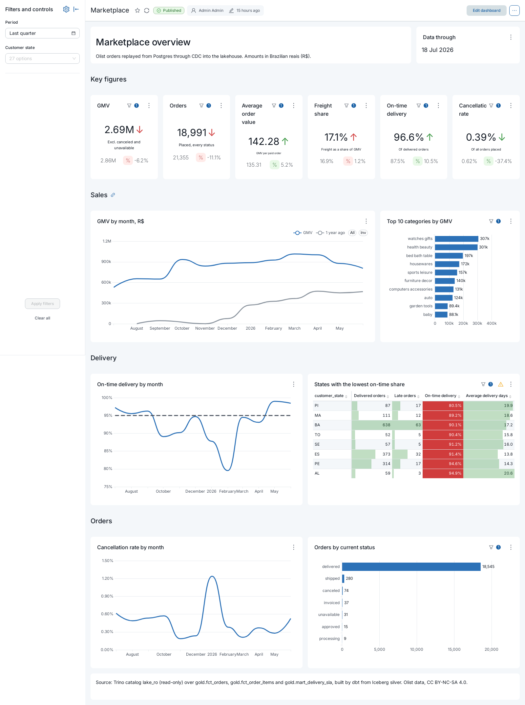
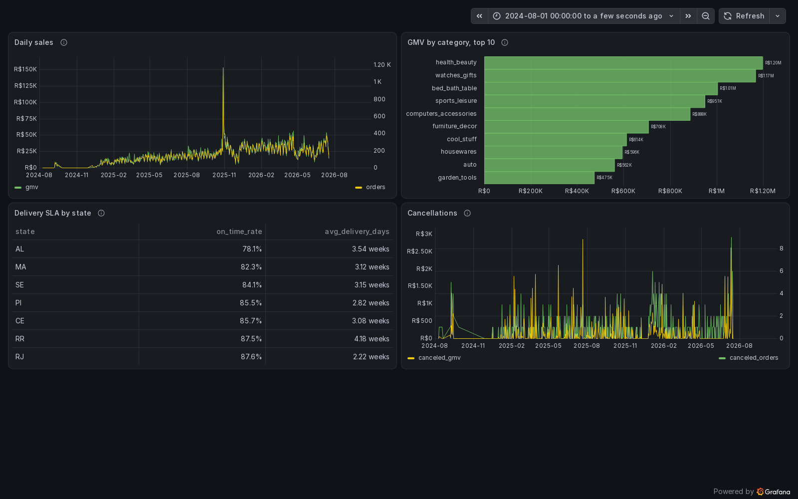

# Evidence

What was run, when, and what it showed. Every number carries a date (UTC unless noted) and a
source: a section of [OPERATIONS.md](../OPERATIONS.md), a file, a GitHub run or a command that
anyone with the stack up can repeat. Anything not run live is marked `not proven`.

Contents: [Status](#status) | [Performance](#performance-on-the-laptop) | [Reconciliation](#reconciliation-source-against-silver) |
[MinIO probe](#probe-minio-stopped) | [Failure scenarios](#failure-scenarios) | [Maintenance](#maintenance-before-and-after) |
[Alerts](#alerts-and-time-to-fire) | [CI and smoke](#ci-and-smoke) | [Dashboard](#dashboard) |
[Trino access control](#trino-access-control) | [Superset and local access](#superset-and-local-access) |
[Decision measurements](#decision-measurements) | [Not proven](#not-proven-yet) | [How it was built](#how-it-was-built)

## Status

`done`: code and a check exist. `measured`: numbers from a live run, with the date. `not done
(<reason>)`: not built or not run, with the reason. Every row links to its evidence. The failure
scenarios are in [their own table](#failure-scenarios); scenario 10, partial processing under Trino
memory pressure, is not done (optional; the `make chaos-trino-memory` target is not written).

| Component | Status | Evidence |
|---|---|---|
| CDC: Postgres, Debezium, Kafka, bronze (at-least-once, resumes from the checkpoint) | measured | Spark kill resumed 28 s after the kill, 0 duplicate or missing offsets in 21 partitions (2026-10-07): [scenario 1](failure-scenarios.md#1-spark-bronze-killed-mid-batch) |
| Silver: typed state, soft deletes, MERGE guarded by LSN | measured | `make reconcile` 7 of 7 tables match Postgres on rows, keys and decimal sums, 2026-10-29: [reconciliation](#reconciliation-source-against-silver) |
| Gold: dbt staging, intermediate, marts on Trino | measured | `dbt build` of 2026-11-20 20:13 UTC (`dbt/target/run_results.json`): pass 61, success 18, warn 4, error 0; models in [`dbt/models`](../dbt/models) |
| Orchestration: Airflow DAGs `silver_upsert`, `dbt_build`, `dq_checks`, `iceberg_maintenance`, `iceberg_orphans` | done | [`airflow/dags`](../airflow/dags), `make dags-check` in CI; live runs 2026-10-29 in [maintenance](#maintenance-before-and-after) |
| Stateful job `orders_per_minute` (watermark, update mode) | measured | 2026-10-23: per-minute counts against `count(*)` of `silver.orders` over a 60 s burst, 164 windows, 0 differing; `make watermark-live` dropped the late order once (`dropped 0 -> 1`); 495 MiB at rest, 842 MiB while reading 24 h of the topic: [OPERATIONS](../OPERATIONS.md#stateful-job), [ADR-024](../DECISIONS.md) |
| Data quality: reconcile, `dq_checks`, quarantine | measured | `dq_checks` 2026-10-29 16:45: every `reconcile_*_differing` 0; one poison record, one quarantine row (2026-10-23): [scenario 7](failure-scenarios.md#7-corrupted-event-in-topic) |
| Iceberg maintenance (compaction, expire, orphans) | measured | 2026-10-29: bronze files before today 595 to 30, `silver.orders` 38 to 15 snapshots, row counts equal: [maintenance](#maintenance-before-and-after) |
| MinIO and `mc` built from source (ADR-026) | measured | live swap 2026-10-29, 4045 objects and 482 441 040 bytes before and after: [maintenance](#maintenance-before-and-after) |
| Observability: Prometheus, Grafana "Pipeline health" and "Infra" | done | [`observability`](../observability), panels listed in [OPERATIONS](../OPERATIONS.md#dashboards), checked by `scripts/obs/check_dashboards.py` |
| Alerts: 16 rules | measured | 7 alerts shown firing live with time to fire, the rest by promtool (`make alerts-test`, `SUCCESS: 16 rules found`, 2026-11-06; `GoldStaleAtRest` is promtool only): [alerts](#alerts-and-time-to-fire) |
| Business dashboard `Marketplace` in Superset (profile `bi`, 13 charts, ADR-027) | measured | `check.py` of 2026-11-13: all 13 charts return rows; KPI tiles of 2026-11-12: [Superset dashboard v2](#superset-dashboard-v2); the view: [dashboard](#dashboard) |
| Grafana dashboard `Marketplace` (4 panels) on `lake_ro.gold` | measured | 96 163 orders equal `count(*)` of `fct_orders` (2026-10-29, panels then on `lake.gold`); after the switch to `lake_ro.gold` `check_dashboards.py` prints `queries ok: 39` (all dashboards, 19:16): [dashboard](#dashboard) |
| Superset MCP endpoint | measured | 2026-11-06 15:52 UTC: the MCP service rejects a foreign Host (421) and Origin (403) and answers on loopback (200): [Superset and local access](#superset-and-local-access), [OPERATIONS](../OPERATIONS.md#superset-profile-bi) |
| Trino access control: `grafana` and `superset` read `lake_ro.gold` only | measured | 2026-10-29 19:15, after a Trino restart: `grafana` selects `lake_ro.gold.fct_orders`; `lake_ro.silver`, catalogs `lake` and `system`, `create table` and `optimize` get Access Denied; `dbt`, `trino`, `airflow` still read `lake.silver.orders`: [Trino access control](#trino-access-control). Residual risks (no authentication): [OPERATIONS](../OPERATIONS.md#access-control) |
| CI: six jobs | done | `lint-and-test`, `hadolint`, `alerts-test`, `spark-tests`, `airflow-image`, `minio-images` in `ci.yml`; green run [ci 44897525916](../../../actions/runs/44897525916) on HEAD `dbf0a72`, 2026-11-21: [CI and smoke](#ci-and-smoke) |
| Clean-clone path (`smoke.yml`) | measured | green on 2026-10-29: [run 40907438614](../../../actions/runs/40907438614) (10 min 1 s, HEAD `664a7e6`), [run 40916528470](../../../actions/runs/40916528470) (9 min 14 s, HEAD `f71eab2`) and [run 40934001854](../../../actions/runs/40934001854) (10 min 52 s, HEAD `6ca7224`); latest run [44176185272](../../../actions/runs/44176185272) green, HEAD `a21020a`, 2026-11-17 |
| Performance numbers | measured | 2026-11-21 11:15 UTC: [Performance on the laptop](#performance-on-the-laptop) |
| `iceberg_orphans` on its weekly schedule | not done (paused by decision, ADR-025) | [not proven yet](#not-proven-yet) |
| `rewrite-position-deletes` on `silver.orders` | not done (failed on 2026-10-23, the scheduled run skipped it since) | [not proven yet](#not-proven-yet) |
| 24 hour unattended run | not done (cancelled by the owner on 2026-11-04) | [not proven yet](#not-proven-yet) |
| Interview notes: 36 questions, each with a project example and a link | done | [interview notes](interview-notes.md) |

## Performance on the laptop

One 16 GB laptop, measured on 2026-11-21 at about 11:15 UTC. These are
durations read from history at the moment of the question, not a load test.

Prometheus keeps 7 days (`--storage.tsdb.retention.time=7d`, `docker/compose.yaml:613`). In the
7-day window ending 2026-11-21 11:15 UTC it shows no `merge` task and one `dbt_build` (2026-11-20, a
new series, so `increase()` reads 0), so these durations come from the Airflow history and not from
Prometheus. The two probes:
`increase(spark_streaming_input_rows_total{query="bronze_cdc_ingest"}[7d])` returned an empty result
(no bronze batch in the window) and
`increase(airflow_task_duration_seconds_count{task_id=~"merge|dbt_build"}[7d])` returned
`dbt_build 0`. The duration of one bronze batch is not measured here: a new batch needs
`make replay-burst`, which spends the replay budget and needs a separate approval.

Airflow history, successful task instances only, all dates in the table are UTC. Run on
2026-11-21 11:15 UTC against the `airflow` database in `postgres-meta`:

```
select dag_id, task_id, count(*),
       percentile_cont(0.5) within group (order by duration),
       percentile_cont(0.9) within group (order by duration),
       max(duration), min(start_date)::date, max(start_date)::date
from task_instance
where state = 'success'
  and (dag_id, task_id) in (('silver_upsert','merge'), ('dbt_build','dbt_build'),
                            ('dq_checks','reconcile_values'))
group by 1, 2;
```

| DAG, task | Runs | Median, s | p90, s | Max, s | Window (first to last day) |
|---|---|---|---|---|---|
| `silver_upsert`, `merge` (one Spark `AvailableNow` container, all 7 tables) | 23 | 28.5 | 65.3 | 75.1 | 2026-10-18 to 2026-11-06 |
| `dbt_build`, `dbt_build` (`dbt build`, all models and tests) | 26 | 25.0 | 36.4 | 40.8 | 2026-10-18 to 2026-11-20 |
| `dq_checks`, `reconcile_values` (fingerprints, source against silver and silver against gold) | 273 | 6.9 | 11.3 | 32.4 | 2026-10-23 to 2026-11-21 |

Volumes, `count(*)` and `sum(file_size_in_bytes)` from `"<table>$files"` in Trino (`make trino`),
2026-11-21 11:15 UTC, current snapshot:

| Table | Rows | Data files | MiB |
|---|---|---|---|
| `bronze.cdc_events` | 559 742 | 68 | 41.7 |
| `silver.orders` | 96 358 | 23 | 5.4 |
| `silver.order_items` | 109 244 | 1 | 3.8 |
| `silver.payments` | 100 727 | 1 | 1.9 |
| `silver.customers` | 99 441 | 1 | 3.5 |
| `silver.products` | 32 951 | 1 | 0.8 |
| `silver.reviews` | 93 516 | 1 | 4.7 |
| `silver.sellers` | 3 095 | 1 | 0.1 |
| `gold.fct_orders` | 96 358 | 1 | 7.9 |
| `gold.mart_daily_sales` | 5 643 | 80 | 0.2 |

Not measured: the delay from a write in Postgres to a row in gold end to end, and the duration of a
bronze batch.

## Reconciliation: source against silver

`make reconcile` compares Postgres with the live rows of silver for all seven tables: row count,
set of primary keys, sum of every decimal column (`scripts/chaos/lib.sh`, `scripts/reconcile_sql.py`),
and since 2026-10-30 the row fingerprint of every contract column that `dq_checks` uses, printed
as a last `values` column (`ok` or `DIFF`). It only reads. Output of 2026-10-29 18:50 UTC, before the fingerprint,
run for this page:

```
customers    postgres    99441  silver    99441  rows ok   keys ok   sums -
order_items  postgres   109081  silver   109081  rows ok   keys ok   sums ok (13173478.80 2182507.96)
orders       postgres    96258  silver    96258  rows ok   keys ok   sums -
payments     postgres   100623  silver   100623  rows ok   keys ok   sums ok (15530922.11)
products     postgres    32951  silver    32951  rows ok   keys ok   sums -
reviews      postgres    93494  silver    93494  rows ok   keys ok   sums -
sellers      postgres     3095  silver     3095  rows ok   keys ok   sums -
```

With the `values` column (the row fingerprint, commit `8164afe`): `make verify-fast` of
2026-10-30 16:37 UTC, HEAD `ea64b6e` (stamp `fast at 2026-10-30T16:37:13Z`). `verify-fast` only
reads: it does not run `make silver`. The block above stays as the record before the fingerprint.
Output as printed:

```
customers    postgres    99441  silver    99441  rows ok   keys ok   sums -  values ok
order_items  postgres   109081  silver   109081  rows ok   keys ok   sums ok (13173478.80 2182507.96)  values ok
orders       postgres    96258  silver    96258  rows ok   keys ok   sums -  values ok
payments     postgres   100623  silver   100623  rows ok   keys ok   sums ok (15530922.11)  values ok
products     postgres    32951  silver    32951  rows ok   keys ok   sums -  values ok
reviews      postgres    93494  silver    93494  rows ok   keys ok   sums -  values ok
sellers      postgres     3095  silver     3095  rows ok   keys ok   sums -  values ok
verify ok
```

Both `verify` targets add the bronze check to `reconcile` (no Kafka offset twice and no gap between the first and the last offset bronze took per partition, all
seven tables present) and end with `verify ok`; `make verify` first runs one silver merge. A full
run that this page records: `verify ok`, 2026-10-29 19:16 UTC, before commit `46f5282` (the access-control check, [Trino access control](#trino-access-control)).
`dq_checks` repeats the comparison every 15 minutes and also compares row fingerprints source to
silver and silver to gold (`reconcile_values`); its run at 16:45 on 2026-10-29 had every
`reconcile_*_differing` at 0 and `reconcile_in_flight` at 0 ([First live run, step 11](#first-live-run-2026-10-29)).

## Probe: MinIO stopped

A live probe of the third `verify` check, not a chaos scenario (commit `2b0fce1`, 2026-11-05).
`docker stop lakehouse-minio-1` at 16:54:53 UTC, then `VERIFY_WAIT=60 timeout -k 5 120 make
verify-fast`: exit 2 after 11.7 s with `verify failed: Trino and catalog lake answer, but the object
store (MinIO) fails: curl: (6) Could not resolve host: minio`. `docker start` at 16:55:15, so MinIO
was down 22 s; healthy at 16:55:27, and `verify-fast` ended `verify ok`. With Lakekeeper stopped
(2026-11-04) the refusal took 11 s, about 9 s of it the Trino REST client giving up; with
`TRINO_PROBE_WAIT` below about 10 the same fault reads as `does not answer within N s`. Why the third probe exists
and what a paused MinIO would read as: [OPERATIONS, Daily commands](../OPERATIONS.md#daily-commands).

## Failure scenarios

Each scenario is `make chaos-<name>` ([`scripts/chaos/`](../scripts/chaos)) and ends in a check that
fails on any duplicate or missing Kafka offset or any difference from Postgres. Full write-ups:
what happened, what monitoring shows, data at risk, recovery, why nothing is lost.

| # | Scenario | Date | Measured | Write-up |
|---|---|---|---|---|
| 1 | Spark bronze killed mid-batch | 2026-10-07 | Kill 18:09:44 during batch 80 (158 records), replayed batch committed 18:10:12, 28 s after the kill, same query id; 0 duplicate or missing offsets in 21 topic partitions, no epoch committed twice | [1](failure-scenarios.md#1-spark-bronze-killed-mid-batch) |
| 2a | Kafka Connect restart | 2026-10-07 | Recovered in about 32 s; 1429 CDC events in the minute before the restart, 1593 after; 0 events repeated with the same LSN; silver matches Postgres (rows, keys, sums) for 7 tables | [2a](failure-scenarios.md#2a-kafka-connect-restart) |
| 2b | Kafka Connect killed | 2026-10-07 | Connector resumed 26 s after `docker start`; 253 events arrived twice (orders 173, order_items 40, payments 39, reviews 1), all absorbed; silver matches Postgres (rows, keys, sums) for 7 tables | [2b](failure-scenarios.md#2b-kafka-connect-killed) |
| 3 | Duplicate events from the source | 2026-10-07 | 2267 CDC events in the window, 95 no-op repeats (9.8% of status UPDATEs, 90 of 926 orders); 0 changes arrived twice with the same LSN; silver matches Postgres (rows, keys, sums); script 3 min 11 s | [3](failure-scenarios.md#3-duplicate-events-from-the-source) |
| 4 | Late events | 2026-10-07 | An old change re-sent after a newer one; silver kept `approved` and `_last_lsn` 1401679552 before and after (the MERGE guard dropped it); bronze kept the copy at a new offset; script 3 min 12.6 s | [4](failure-scenarios.md#4-late-events) |
| 5 | PostgreSQL restart | 2026-10-23 | Postgres healthy in 13 s, connector streamed again 13 s later without a failed task; bronze caught up 28 s after a 30 s burst; `ContainerRestarting` firing 15 s after the restart; `reconcile` 7 of 7 | [5](failure-scenarios.md#5-postgresql-restart) |
| 6 | Connector stopped for 30 minutes (WAL growth) | 2026-10-23, 2026-10-29 | 2026-10-23: `ConnectorNotRunning` 95 s after the stop, `SlotWalRetainedHigh` 326 s after it, 80.9 MB held. 2026-10-29 (committed script, full hold): connector stopped 17:47:02 to 18:17:06, `dq_checks` at 18:00 and 18:15 green with `in flight: CDC stands, no verdict`, `CdcStalledSourceWrites` firing 18:20:04, then silver matches Postgres (rows, keys, sums) 7 of 7, exit 0. Sources for the 2026-10-29 run: the closeout spec, result of the connector-stall check, and the approval log entry of 29.10 18:22 in HANDOFF (records in Russian: [spec](planning/14-closeout-spec.md), [HANDOFF](HANDOFF.md)) | [6](failure-scenarios.md#6-connector-stopped-for-30-minutes-wal-growth) |
| 7 | Corrupted event in topic | 2026-10-23 | One non-envelope record: one `silver.quarantine` row after the first merge, still one after the second; the rest of the batch merged | [7](failure-scenarios.md#7-corrupted-event-in-topic) |
| 8 | Kafka down for 6 minutes | 2026-10-23 | Kafka healthy 20 s after the start, connector `RUNNING` after 20 s, bronze caught up after 25 s; `spark-bronze` restarted 15 times, resumed from the checkpoint each time; 21 partitions without duplicate or missing offset; silver matches Postgres (rows, keys, sums) 7 of 7; `SparkNoBatch5m` did not fire (see Alerts) | [8](failure-scenarios.md#8-kafka-down-for-6-minutes) |
| 9 | Airflow task failure (dbt test) | 2026-10-18 (run), 2026-10-23 (alert) | `dbt_build` red on a broken test, children skipped, `mart_daily_sales` kept its 9 snapshots; `AirflowDagFailed` 17 s after the red run ended | [9](failure-scenarios.md#9-airflow-task-failure-dbt-test) |
| 10b | Silver merge killed between two tables | 2026-11-06 | `lakehouse-silver-merge` killed 12:10:23 after the first of 4 tables (`order_items`, 97 events); 3 tables differed from Postgres right after; the Airflow retry (`merge` try 2, 12:11:24 to 12:11:49) brought silver level about 86 s after the kill; run `success` 12:11:50 (REST), so `AirflowDagFailed` did not fire; `ContainerRestarting` firing (`activeAt` 12:11:34); `reconcile` 7 of 7 | [10b](failure-scenarios.md#10b-silver-merge-killed-between-two-tables) |

The 2026-10-23 run of
scenario 6 used an uncommitted script version whose logical-message padding of the WAL stopped CDC for about 8 minutes
with no loss; it is described in the write-up, together with the fix.

## Maintenance, before and after

Design of the procedures: ADR-025 in [DECISIONS.md](../DECISIONS.md).

The MinIO image swap of the same day (the images are built from source, ADR-026): bucket 4045
objects and 482 441 040 bytes before and after (`mc du --json`), `mc admin info` version
2025-09-07T16:13:09Z before and after, `make verify-fast` `verify ok`
(record in Russian: [closeout spec](planning/14-closeout-spec.md)).

### First live run, 2026-10-29

Everything below is UTC and comes from the command output of that day. The image
`lakehouse/spark:dev` (72e423bd) was built at 16:05 from a clean HEAD (3a213c6); its code is the
same as `streaming/spark_jobs` (sha256 diff). Steps 5 to 10 ran as manual writes: `silver_upsert`
and `dbt_build` paused and finished, scheduler stopped, one command, scheduler started (windows
16:21-16:26, 16:28-16:30 and 16:33). Order of the steps:

1. Baseline (16:07): `bronze_caught_up` and `bronze_offsets_ok` exit 0; 4821 objects,
   877 765 423 bytes under `warehouse/`.
2. Copy (16:12): `mc mirror` of `warehouse/` to `/mnt/d/lakehouse-backup/warehouse-20261029`
   (outside the repo). The host holds 4821 files and 877 765 423 bytes (`find`, `du -sb
   --apparent-size`), equal to `mc du --json` and `mc ls --json`. This is a one-off copy before the
   first deletion, not a regular backup.
3. Demo (16:13-16:15): `iceberg_demo` compacted `lake.demo.orders` from 21 files to 1
   (156 027 to 77 927 bytes); its expire deleted 22 data files, 43 manifests and 22 manifest lists
   and left 1 snapshot. Then `maintenance expire --days 7 demo.orders` exited 0 with all counts 0.
4. `spark-bronze` recreated alone (16:17): the 20 other containers kept their `Created` time;
   healthy after 26 s, 0 restarts, log `Resuming at batch 171`, and `bronze."cdc_events$properties"`
   has `write.metadata.delete-after-commit.enabled = true`. Rows (558 629) and `max(kafka_offset)`
   (77 659) did not move.
5. Bronze compaction (`rewrite-data --before-today`).
6. `silver.sellers` expire.
7. Expire of the other eight silver tables, one run.
8. Expire of the nine gold tables, one run.
9. Orphans dry runs, four runs: `demo`, silver, gold, bronze with `--location-suffix metadata`.
10. Review of the candidates (below), then the real orphans run on bronze `metadata/` only.
11. `make replay-burst SECONDS=60` (virtual time 2026-07-16 21:33:42 to 2026-07-17 09:29:04, 233
    events, 76 858 to 77 091 emitted, 22 060 pending), then the normal pipeline: `silver_upsert`
    (16:40 and 16:45) and `dbt_build` (16:40) success, `dq_checks` (16:45) success with
    `reconcile_in_flight` 0, every `reconcile_*_differing` 0 and `tables_differing{at_rest=true}` 0.
12. `iceberg_maintenance` unpaused (16:46). First scheduled run `scheduled__2026-10-29T03:30`
    success: `expire_and_compact=False`, so `expire_silver`, `gold_expire_commands`, `expire_gold`,
    `compact_bronze` and `rewrite_position_deletes` were skipped and `optimize` ran for 8 tables.
    `make reconcile` 7/7 afterwards. `iceberg_orphans` stays paused.

Before and after. The row count of every table was equal before and after, and `make reconcile`
passed 7/7 after the silver expire.

| Table | Snapshots | Data files deleted | Manifests deleted | Manifest lists deleted |
|---|---|---|---|---|
| `bronze.cdc_events` (compaction) | 171 to 172 (one `replace`) | 589 rewritten (46 048 268 bytes) into 24 | not run | not run |
| `silver.sellers` | 2 to 1 | 4 | 1 | 1 |
| `silver.customers` | 4 to 1 | 12 | 3 | 3 |
| `silver.order_items` | 31 to 13 | 68 | 40 | 18 |
| `silver.orders` | 38 to 15 | 51 (and 111 position-delete files) | 69 | 23 |
| `silver.payments` | 31 to 13 | 68 | 34 | 18 |
| `silver.products` | 4 to 1 | 12 | 3 | 3 |
| `silver.reviews` | 23 to 7 | 54 | 38 | 16 |
| `silver.quarantine` | 5 to 1 | 3 | 6 | 4 |
| `silver.orders_per_minute` | 15 to 15 | 0 | 0 | 0 |
| `gold.category_translation` | 82 to 32 | 25 | 49 | 50 |
| `gold.dim_customers` | 41 to 16 | 25 | 25 | 25 |
| `gold.dim_products` | 41 to 16 | 25 | 25 | 25 |
| `gold.dim_sellers` | 41 to 16 | 25 | 25 | 25 |
| `gold.fct_order_items` | 38 to 15 | 23 | 23 | 23 |
| `gold.fct_orders` | 41 to 16 | 25 | 25 | 25 |
| `gold.mart_daily_sales` | 33 to 24 | 0 | 0 | 9 |
| `gold.mart_delivery_sla` | 36 to 15 | 21 | 21 | 21 |
| `gold.mart_seller_performance` | 36 to 15 | 21 | 21 | 21 |

Only `silver.orders` had position-delete files to delete; every other silver table reported 0.
After the expire, no table has more than 1 snapshot older than 7 days in silver (`customers`,
`products` and `sellers`: their only snapshot), and none in gold. `silver.orders_per_minute` kept all
15 snapshots; its last commit was 2026-10-23 19:23:02 before and after.

Bronze, before and after the compaction and the real orphans run:

| Measure | Before | After |
|---|---|---|
| Data files in partitions before today (`$files`) | 595 in 27 partitions | 30 |
| Rows, `max(kafka_offset)` | 558 629, 77 659 | equal |
| Kafka end offsets (md5) | | equal, `bronze_offsets_ok` 0 |
| Objects in `bronze/data/` | 619 | 619 |
| Objects in `bronze/metadata/` | 465 | 444 |
| `metadata.json` objects | 122 | 101 |

Orphans. Dry runs found 0 candidates for `demo`, 0 for the 9 silver tables, 0 for the 9 gold tables,
and 21 for bronze `metadata/` (`files_truncated` false). The review before the real run: all 21 are
`metadata/00000` to `00020` `*.metadata.json` files written 2026-09-22 19:22-19:43; none appears in
`$metadata_log_entries` (101 rows), `$snapshots.manifest_list` (172) or `$all_manifests` (171); the
JDBC pointer of bronze is `00121`, which is not a candidate. The real run removed 21 files, the same
set as the dry run, and left `bronze/data/` at 619 objects.

Time of each procedure, read from the first Spark log line to the end of the command, so the
figures are approximate. No separate time was recorded for `mc mirror` and the demo; their windows
are in the list above.

| Procedure | Time |
|---|---|
| `spark-bronze` recreate to healthy | 26 s |
| Bronze compaction (`rewrite-data --before-today`) | about 16 s from the first Spark log line |
| `silver.sellers` expire | about 10 s from the first Spark log line |
| Expire of the other eight silver tables, one run | about 34 s from the first Spark log line |
| Expire of the nine gold tables, one run | about 40 s from the first Spark log line |
| Orphans dry run (each of four runs) | 9 to 23 s |
| Real orphans run, bronze `metadata/` | about 13 s from the first Spark log line |

Rollback point. The owner released the JDBC rollback point on 2026-10-29; the rows of `iceberg_catalog` were not deleted.

### Orphans next to orders_per_minute, 2026-10-30

The table location `s3a://lakehouse/warehouse/silver/orders` is a string prefix of
`silver/orders_per_minute-01a169dd-...`, so a listing by prefix would see the files of the other
table. `$C maintenance orphans silver.orders` (dry run) at 17:48 UTC, `older_than` 2026-10-23
17:48:44: `{"candidates":0,"dry_run":true,"files":[],"files_truncated":false}`. The first snapshot
of `orders_per_minute` (2026-10-23 17:45:11, `append`, 3 data files) is older than that and still
live, so its files were old enough to show up: the procedure lists the table directory, not the
string prefix.

## Alerts and time to fire

16 rules in [`observability/prometheus/alerts.yml`](../observability/prometheus/alerts.yml) (13 named
alerts, three of them with two expressions), tested by `make alerts-test` (promtool; `SUCCESS: 16 rules found`, 2026-11-06; it was 15 rules on 2026-10-30, before `GoldStaleAtRest`; failure cases first). No Alertmanager
(ADR-023): the alerts are read in Prometheus and in the Grafana "Firing alerts" panel. The table is
in [OPERATIONS, Alerts](../OPERATIONS.md#alerts).

| Alert | Shown how | Time to fire |
|---|---|---|
| `ConnectorNotRunning` | live, scenario 6 (2026-10-23) | 95 s after the connector stop |
| `SlotWalRetainedHigh` | live, scenario 6 (2026-10-23) | 326 s after the stop, 80 MB held |
| `SparkNoBatch5m` | live, `spark-bronze` stopped (2026-10-23) | 315 s after the stop (`cause="gone"`) |
| `FreshnessAbove15m` | live, `silver_upsert` paused, burst (2026-10-23) | 1561 s after bronze caught up (900 s plus up to 15 min until the next `dq_checks`) |
| `AirflowDagFailed` | live, scenario 9 (2026-10-23) | 17 s after the red run ended |
| `ContainerRestarting` | live, scenarios 5 and 8 (2026-10-23) | 15 s after the restart |
| `CdcStalledSourceWrites` | promtool (two runs, one run, short history); live, scenario 6 (2026-10-29) | firing 18:20:04, 33 min after the stop (17:47:02 to 18:20:04): two `dq_checks` runs with stalled 1, then the 20 min window; `cdc_stalled` was 1 from 18:01 (records in Russian: [closeout spec](planning/14-closeout-spec.md), [HANDOFF](HANDOFF.md) log 29.10 18:22) |
| `SparkRestartLoop` | rule run over the stored data of scenario 8 (TSDB replay), not a live firing | true from 17:11:15, 51 s after the first restart (17:10:24); the 2026-10-23 rule was not loaded then |
| `FreshnessAbove15m` with `cause="unknown"`, `SlotWalHeldIdle`, `DqChecksStale`, `ScrapeTargetDown`, `SilverGoldNotCompared`, `GoldStaleAtRest` | promtool only | not shown live |

`GoldStaleAtRest` (audit of 2026-11-06) exists because of a finding that was live: Airflow 3.3 queues
no Asset event for a paused DAG (`airflow/assets/manager.py:354` in the image), so the `lake.silver`
event of 12:11:49 UTC on 2026-11-06, which came while `dbt_build` was paused during chaos 10b, created
no `dbt_build` run and gold stayed behind silver. The rule fires when `dq_checks` finds that state at
rest on two runs in a row. It compares commit times of Iceberg snapshots, not the snapshot dbt read,
and `expire_silver` after `optimize` can remove the newest data snapshot; both only miss an alert.

`SparkNoBatch5m` did not fire in scenario 8: a crash-looping driver dies before its first batch and
Kafka came back inside the 5 minutes of the `gone` rule. That gap is why `SparkRestartLoop` exists
([failure scenario 8](failure-scenarios.md#8-kafka-down-for-6-minutes)).

## CI and smoke

| Run | What | Result |
|---|---|---|
| [ci 44897525916](../../../actions/runs/44897525916) | HEAD `dbf0a72`, 2026-11-21, six jobs | success |
| [smoke 44176185272](../../../actions/runs/44176185272) | HEAD `a21020a`, 2026-11-17 | success |
| [ci 40934002684](../../../actions/runs/40934002684) | push to `main`, HEAD `6ca7224`, 2026-10-29 | success |
| [ci 40924192138](../../../actions/runs/40924192138) | push, `649cb68`, 2026-10-29 | success |
| [smoke 40907438614](../../../actions/runs/40907438614) | `workflow_dispatch`, `664a7e6`, 2026-10-29, first green run on the source-built MinIO images | success, 10 min 1 s |
| [smoke 40916528470](../../../actions/runs/40916528470) | `workflow_dispatch`, `f71eab2`, 2026-10-29 | success, 9 min 14 s |
| [smoke 40934001854](../../../actions/runs/40934001854) | `workflow_dispatch`, `6ca7224`, 2026-10-29 | success, 10 min 52 s |
| [ci 40897412910](../../../actions/runs/40897412910) | push, `f206596`, 2026-10-29 | failure, job `spark-tests` only (below) |
| [smoke 40290595866](../../../actions/runs/40290595866) | Monday schedule, 2026-10-26 | failure at `make start`: the MinIO images were gone from quay.io and Docker Hub |

`ci.yml` has six jobs: `lint-and-test`, `hadolint`, `alerts-test`, `spark-tests`, `airflow-image` and
`minio-images` ([OPERATIONS, CI](../OPERATIONS.md#ci) says what each runs). CI runs `dbt parse` and
static checks of the SQL; `dbt build`, DAG runs, chaos and the dashboards are proven on the live stack
only.

`smoke.yml` walks the clean-clone path on the committed sample: `make secrets`, `make bootstrap`, a
60 s `make replay-burst`, `make verify`, and a second `make bootstrap` that must say `replay state
exists, load skipped` and end `verify ok`. It builds the Spark, Connect, MinIO and `mc` images from
scratch, so it is cold every time. Smoke stops at silver; gold, the Asset chain, `dq_checks` and the dashboards are proven by the dated manual runs above.

Schedule: `.github/workflows/smoke.yml` runs on `workflow_dispatch` and on the cron `0 3 * * 1`
(Monday 03:00 UTC), back since the first green run. Weekly while the repository is active: GitHub
pauses scheduled workflows in a public repository after 60 days without activity (GitHub docs,
"Disabling and enabling a workflow"), so after the freeze the schedule stops by itself and the last
green run stays the record: [smoke 44176185272](../../../actions/runs/44176185272), 2026-11-17. Its
scheduled runs were green: [smoke 41430931906](../../../actions/runs/41430931906) on 2026-11-02 (HEAD
`4b65cd7`) and [smoke 42606043447](../../../actions/runs/42606043447) on 2026-11-09 (HEAD `4169df6`).

The red `spark-tests` run is a defect that CI caught and local checks did not: a test held a fixed
clock (`2026-10-23 03:30 UTC`) and failed on every run after 2026-10-24 03:30 UTC. The fix (the
real clock) is in `eebb639`, green in [ci 40901323188](../../../actions/runs/40901323188).

Test counts are not kept on this page, they go stale; the record is the green run of 2026-11-21 above.
The Spark tests need Java 17 and skip on a host without it; in the image (`make test-spark`) a skip is
a failure.

## Dashboard

The business dashboard `Marketplace` is in Superset: 13 charts over the `lake_ro.gold` marts as
Trino user `superset` (ADR-027, [checks below](#superset-dashboard-v2)). The current view:



The Grafana dashboard `Marketplace` stays as a lighter view of the same marts: four panels over
gold only (daily sales, GMV by category, delivery SLA by state, cancellations), Trino datasource
plugin 1.4.1. Its panels read `lake_ro.gold` since the access-control change (commit `46f5282`,
[below](#trino-access-control)); the screenshot of 2026-10-29 18:44 UTC and the checks below were
taken before that switch, when they read `lake.gold`:



Checks of 2026-10-29 of the Grafana dashboard, before the switch ([OPERATIONS, Dashboards](../OPERATIONS.md#dashboards); record in Russian: [closeout spec](planning/14-closeout-spec.md)):

- `uv run python scripts/obs/check_dashboards.py observability/grafana/dashboards/marketplace.json`
  prints `queries ok: 4`; through `/api/ds/query` the panels returned 600, 10, 27 and 600 rows.
- The orders panel shows 96 163 orders and `select count(*)` on `fct_orders` gives 96 163. Summing
  `orders_count` of `mart_daily_sales` would give 96 650, because the mart counts an order in each
  of its states per seller state; the reviewer found this double count before the dashboard was
  accepted.
- GMV by category adds up to 13 086 460.39, equal to `sum(gmv)` of the mart.
- Grafana used 276.7 MiB of its 384 MiB limit.
- After the switch to `lake_ro.gold`, `uv run python scripts/obs/check_dashboards.py` (all
  dashboards) prints `queries ok: 39` (2026-10-29, 19:16).

## Trino access control

Commit `46f5282`. Trino has file-based access control
(`docker/trino/etc/access-control.properties`, `docker/trino/etc/rules.json`) and a second catalog
`lake_ro` (`docker/trino/etc/catalog/lake_ro.properties`, `iceberg.security=read_only`) over the
same warehouse. The `grafana` user (since 2026-11-06 `superset` too, [below](#superset-and-local-access)), used by the Grafana datasource and by `check_dashboards.py`,
reads `lake_ro.gold` only. Live probes of 2026-10-29 after `docker restart lakehouse-trino-1` at
19:15, run as the user named:

| User | Statement | Result |
|---|---|---|
| `grafana` | `select` from `lake_ro.gold.fct_orders` | 96 258 |
| `grafana` | `select` from `lake_ro.silver` | Access Denied |
| `grafana` | any query on catalog `lake` or `system` | Access Denied |
| `grafana` | `create table` | Access Denied |
| `grafana`, `dbt` (through `lake_ro`) | `optimize` on a gold table | `Cannot execute table procedure OPTIMIZE` |
| `dbt`, `trino`, `airflow` | `select` from `lake.silver.orders` | 96 258 |

Afterwards: `make dbt-build` `PASS=68 WARN=4 ERROR=0` (19:16), `check_dashboards.py` `queries ok: 39`,
`make verify` `verify ok` (19:16, before the commit). Residual risk, recorded in
[OPERATIONS, Access control](../OPERATIONS.md#access-control): Trino has no authentication, so the
user name is only a label; a Grafana admin who adds a datasource with another user, or a client
that reaches port 8080, gets that user's rights. The rules protect the provisioned datasource,
not a person with an admin login, a shell or network access.

## Superset and local access

Profile `bi` (2026-11-06): `superset-init` (one-shot: migration, `admin`, import of the bundle in
[`docker/superset/dashboards`](../docker/superset/dashboards)), `superset` and `superset-mcp`
([OPERATIONS, Superset](../OPERATIONS.md#superset-profile-bi)). Checks on the running stack:

| Check | Result |
|---|---|
| `docker exec lakehouse-superset-1 python /app/check.py` (15:52 UTC), every chart of the dashboard `Marketplace` through the REST API | `Cancellations: 601 rows`, `Daily sales: 601 rows`, `Delivery SLA by state: 27 rows`, `GMV by category, top 10: 10 rows`, exit code 0 |
| Trino user `superset` (after the Trino restart, 15:02 UTC) | the rules of `grafana` (`docker/trino/etc/rules.json`, `grafana\|superset`): `select count(*) from lake_ro.gold.fct_orders` 96346; `lake_ro.silver.orders`, catalog `lake`, `lake_ro.gold.stg_orders` and `create table lake_ro.gold.x` get `Access Denied`; `grafana` and `dbt` read as before. The database is imported with `allow_dml: false` |
| `superset-mcp` with `FASTMCP_HTTP_HOST_ORIGIN_PROTECTION` (15:52 UTC) | `POST /mcp initialize`: `Host: evil.example:5008` 421, `Origin: http://evil.example` 403, loopback 200; every tool runs as `admin` (`MCP_DEV_USERNAME`), so a deployment beyond loopback needs a JWT provider |
| MCP client session | server `Superset MCP Server 3.4.11`; `tools/list`: `get_instance_info`, `health_check`, `search_tools`, `call_tool`; `tools/call get_instance_info`: 1 dashboard, 4 charts, 4 datasets, 1 database (trino); `claude mcp list` (client registered with `--scope local`, no client settings in the repository): `superset ... Connected` |
| Rerun of `superset-init` on an initialized metadata database (15:51 UTC) | `admin exists`, exit 0; then `check.py` as above. By the import flags (the comment above `superset-mcp` in `docker/compose.yaml`) the database, datasets and charts are kept (`overwrite=False`) and the dashboard `Marketplace` is replaced |
| `GET http://127.0.0.1:8088/health` | 200 |

Other web entries checked by `GET` on 2026-11-06: the MinIO console on `http://127.0.0.1:9001` answers
200 (port 9000 redirects there from a browser), the Lakekeeper UI on `http://127.0.0.1:8181/ui/`
answers 200. Kafka from the host (15:01 UTC): a `confluent-kafka` admin client with bootstrap
`127.0.0.1:9092` lists broker `1: localhost:9092` and the seven `oltp.shop.*` topics; the broker
advertises `localhost:9092` (`docker/compose.yaml:76`); before the fix it advertised
`localhost:29092`, which nothing listened on. Not proven: `bi` together with the other profiles under
the 16 GB limit (on 2026-11-06 it ran beside core, query, orchestrate, obs and stateful, but the
peak was not measured).

### Superset dashboard v2

The dashboard `Marketplace` in Superset has 13 charts in the Harbor palette (bundle in
[`docker/superset/dashboards`](../docker/superset/dashboards), notes in
[OPERATIONS, Superset](../OPERATIONS.md#superset-profile-bi)). KPI tiles of 2026-11-12, read through
`/api/v1/chart/data` with `SUPERSET_DATA_ANCHOR=2026-07-01`, "Last quarter" (2026-04-01 to
2026-06-30) against the previous 91 days (2025-12-31 to 2026-03-31):

| KPI | Last quarter | Previous 91 days |
|---|---|---|
| GMV | 2 687 103.87 | 2 863 849.49 |
| Orders | 18 991 | 21 355 |
| On-time delivery | 96.6% | 87.5% |

`docker exec lakehouse-superset-1 python /app/check.py` on 2026-11-13: all 13 charts return rows.
The tile "Data through" shows 18 Jul 2026. The view of the dashboard: [Dashboard](#dashboard).

## Decision measurements

Measurements and checks that the ADRs in [DECISIONS.md](../DECISIONS.md) stand on, moved here from the ADRs on 2026-11-21; each ADR there links to its subsection.

### ADR-004 Image source check

Checked on 2026-09-21: the Docker Hub repository `minio/minio` is gone (the registry denies access
and the Hub API returns 404 for the repository), but `quay.io/minio/minio` still serves the last
community release `RELEASE.2025-09-07T16-13-09Z` (2025-09-07), and quay additionally carries
`.hotfix.*` rebuilds of that same release into 2026.

### ADR-005 Catalog, side by side and cutover

Verified on 2026-09-23: `trinodb/trino:483` ships `postgresql-42.7.13.jar` in
`plugin/iceberg`, so Trino needs no custom image. `iceberg.jdbc-catalog.catalog-name` must be
`lake`, the Spark catalog name, because JdbcCatalog keys every table row by it; with any other
value Trino sees an empty catalog. The native S3 file system (`fs.s3.enabled`; the older
`fs.native-s3.enabled` still works but logs a replacement warning) reads the `s3a://` locations
Spark records in the metadata.

Side effect, found after the fact: Spark's JdbcCatalog creates `iceberg_tables` in the V0 layout,
while Trino defaults to `iceberg.jdbc-catalog.schema-version=V1` and on its first query ran
`ALTER TABLE iceberg_tables ADD COLUMN iceberg_type` in `iceberg_catalog`. The change is
additive, Iceberg detects the column and switches Spark to V1 on its next start, and V1 is what
lets Trino create views, which dbt needs in week 3. Pinning V0 would avoid the DDL but refuse
`CREATE VIEW`, so V1 stays.

**Side by side, verified 2026-10-08**

The check runs Lakekeeper next to the JDBC catalog, not instead of it: compose profile `rest`, the
bronze and silver tables registered at their current metadata files, and Spark and Trino still on
JDBC. Six decisions came out of it.

(a) Paths of new tables. Lakekeeper gives new tables `s3://` locations in the `full-hierarchy`
layout, `warehouse/<namespace>/<table>-<uuid>/`; the 9 registered tables stay on `s3a://` for
good. Lakekeeper accepts `s3a://` only with `allow-alternative-protocols`, which the vendor advises
solely for registering existing Hadoop tables, and Trino and dbt tables get `s3://` anyway, so Spark
maps `fs.s3.impl` to S3A and pins `io-impl` to HadoopFileIO: the REST client would pick S3FileIO,
and the image has no AWS SDK v2. Both keys sit in the part of `catalog_conf` shared by both catalog
types, so a rollback to JDBC still reads `s3://` tables; for JdbcCatalog HadoopFileIO is the default
already. A soft-deleted table keeps its location taken for 7 days, so the `{uuid}` gives a
re-created table of the same name a fresh path instead of `LocationAlreadyTaken`. The vendor also
advises `{uuid}` in the namespace template, against renames; ours is `{name}`, because `bronze`,
`silver`, `gold` and `demo` are fixed by contract and never renamed, and MinIO then shows
`warehouse/demo/orders-<uuid>/` next to the JDBC sandbox's `warehouse/demo/orders/`. Lakekeeper
compares locations by whole path segments, so a new `silver/orders-<uuid>/` would not collide with
the registered `silver/orders/`.

(b) Delete profile and protection. Soft delete for 7 days: a dropped table can be undropped for a
week before Lakekeeper deletes its location (a drop with `purgeRequested=false` keeps the files).
`push-s3-delete-disabled` is `false` on purpose: its default `true` hands S3FileIO clients
`s3.delete-enabled=false` under soft delete, which would silently turn `expire_snapshots` and
`remove_orphan_files` into no-ops after a move to S3FileIO (HadoopFileIO does not read it). Soft
delete does not cover Spark `DROP ... PURGE`, which deletes the files on the client. Only table
protection stops that, because Lakekeeper refuses the drop with 409 before Spark deletes anything.
Protection goes on every bronze and silver table after the cutover checks, not at registration,
where it would make a repeated `register` fail with 409 and complicate rolling back a failed
cutover. Namespaces stay unprotected: dropping a namespace that holds a protected table is refused
anyway unless forced. Bronze cannot be rebuilt once Kafka's 24 h are gone, which is why this
matters.

(c) Encryption key. Lakekeeper encrypts the warehouse's S3 keys inside its database
(`pgp_sym_encrypt`, aes256) with `LAKEKEEPER_ENCRYPTION_KEY`, a new `.env` variable, instead of
`META_PASSWORD` as in the compose skeleton: a key equal to that database's password protects
nothing when the database leaks, and a password change would silently cut the catalog off from
MinIO. `make secrets` generates it for a fresh `.env`; an existing `.env` first got it from one
command in OPERATIONS, and since 2026-11-06 `make secrets` appends it there too (it appends every
missing key of `.env.example` and never changes a value). Compose
refuses every command without it (`:?`), whatever the profile. The key never changes once a
warehouse exists.

(d) Blast radius. On JDBC, Spark `DROP TABLE` without `PURGE` and Trino `unregister_table` remove
only the catalog row. On Lakekeeper both delete the files: Lakekeeper reads a REST `DELETE` without
`purgeRequested` as a purge, while the Iceberg REST spec defaults it to `false`. `unregister_table`
or a plain REST `DELETE` looks like the safe way to undo a registration, and the registered tables
share their files with the JDBC catalog. Hence a "what deletes files" table in OPERATIONS, and a
matching item in the blast-radius list.

(e) Cutover. Full cutover of Spark and Trino to Lakekeeper, behind two gates: a green side by side
check (below) and the owner's approval of a cutover runbook. Side by side is a check, not an end
state: the REST pointers go stale with bronze's next commit, and a drop through either catalog
hits files both share. Gold is then built on the final catalog, with no second migration. The
work is split into two commits at that approval: this one keeps the verified state as a free
rollback point, the cutover gets its own. After the cutover, rollback stays free until bronze's
first commit through Lakekeeper; from then on it is DML on `iceberg_tables` (blast radius).

(f) Version. `quay.io/lakekeeper/catalog:v0.13.6`, pinned by the digest of its multi-arch manifest
list, `sha256:d6829722cac0d00dfc5665b0955766387b93ccadd8b1e70e679b49619bc30ea5`; after the pull
`docker inspect` returned the same RepoDigest. It was the latest release on 2026-10-07 (released
2026-09-22); newer is only `latest-main`, with a breaking authentication change. The pin matters
more than usual: an older image refuses a schema that a newer one migrated, so the image cannot be
rolled back. 0.14 is its own task, with a backup of the `lakekeeper` database first.

Verified on the live stack, with JDBC the live catalog throughout:
- `lakekeeper-migrate` exited 0 and `lakekeeper` turned healthy. The one-shot
  `lakekeeper-bootstrap` printed `warehouse lake created`, a second run `warehouse lake exists`.
  The warehouse came back with the soft profile, the layout and `push-s3-delete-disabled: false`,
  and `/catalog/v1/config?warehouse=lake` returns its id as `defaults.prefix`, with no `io-impl`
  and no `s3.delete-enabled`.
- The Spark image was rebuilt with `catalog_conf`, and bronze, recreated on `CATALOG_TYPE=jdbc`,
  logged `Resuming at batch 120`; its Spark UI listed `io-impl` HadoopFileIO and `fs.s3.impl` S3A.
- With bronze stopped and no silver run, `scripts/lakekeeper/register.sh` registered 9 tables
  (`bronze.cdc_events` and 8 silver tables) and read back the same metadata file from both
  catalogs for each. A temporary read-only Trino catalog on Lakekeeper (not committed, removed
  after the check) then matched `lake` on `count(*)` and the current `main` snapshot id for all 9,
  for example 543 862 rows in `bronze.cdc_events` and 94 113 in `silver.orders`. Bronze was stopped
  twice, about 3 s each (the first comparison script failed on its own SQL and was re-run), and
  resumed at batch 120 both times.
- Decision (a) in the sandbox: the Iceberg demo, run with `CATALOG_TYPE=rest`, created
  `demo.orders` in Lakekeeper under `s3://lakehouse/warehouse/demo/orders-<uuid>/`, wrote and read
  it through S3A, rolled it back, compacted 21 files into 1, and `expire_snapshots` deleted 22 data
  files, 43 manifests and 22 manifest lists. `silver.orders`, the demo's source, kept its snapshot
  and metadata file, and the JDBC `lake.demo.orders` was not touched: `lake.demo` is not
  registered, because the demo starts with `drop ... purge`, which on Lakekeeper would delete the
  JDBC sandbox's files.
- Lakekeeper used 67 MiB after bootstrap and 88 MiB after registration and the demo, of a 256 MiB
  limit.

**Cutover, 2026-10-08**

Spark and Trino read and write through Lakekeeper; nothing reads or writes the JDBC catalog any
more. The cutover followed `docs/planning/archive/catalog-cutover-2026-10-08.md` on the live stack. Profile `rest`
is gone: `lakekeeper-migrate`, `lakekeeper` and `lakekeeper-bootstrap` are in `core`, and
`spark-bronze`, `spark-silver` and `trino` wait for `lakekeeper-bootstrap`. `CATALOG_TYPE` is
`rest` in `.env.example` and as the code default, and an empty value is refused. Trino's
`lake.properties` is on REST with vended credentials off; the JDBC version is the one in
`5cf0fec`.

Verified on the live stack:
- Bronze stopped with batch 119 committed, then `register.sh` printed `same` for all 9 tables and
  exited 0. Those lines are the rollback point in readable form.
- The switch recreated only `spark-bronze`, and the one-shots `minio-init`, `lakekeeper-migrate`
  and `lakekeeper-bootstrap` exited 0. Trino needed an explicit restart: compose does not see a
  change in a bind-mounted file.
- Before any write through Lakekeeper: bronze turned healthy and logged `Resuming at batch 120`
  and no error, Trino's log showed catalog `lake` on REST, and row count and current `main`
  snapshot of all 9 tables read through Lakekeeper equalled those read through JDBC at the stop.
  `make silver` ran and Lakekeeper's pointers did not move.
- The first commits through Lakekeeper came from one virtual day of replay (`replay_burst 120` at
  speed 720). The pointer of `bronze.cdc_events` moved from `00121-d40d030c-...metadata.json` to
  `00128-01a119cb-...gz.metadata.json`: Lakekeeper commits into an `s3a://` table and writes the
  metadata file itself, gzip-compressed. The JDBC pointers stayed where they were. `make silver`
  merged batch 16, 1275 input rows, through Lakekeeper. `bronze_offsets_report` found 0 duplicates
  and 0 missing in all 21 partitions, and `reconcile` was ok on all 7 tables (orders 94 406,
  order_items 106 994, payments 98 716, reviews 91 600, customers 99 441, products 32 951,
  sellers 3 095).
- `protect.sh` protected all 9 tables; a second run printed `already protected` for each.
- Lakekeeper used 90.95 MiB of its 256 MiB limit, and the `lakekeeper` database is 12 MB.

What changes with Lakekeeper as the live catalog:
- Drops. Lakekeeper's reading of a `DELETE` without `purgeRequested` as a purge, against the REST
  spec's default `false` (d), now applies to every engine: any `DROP TABLE` from Spark, Trino or
  dbt deletes files. Soft delete keeps them 7 days, except after Spark `DROP ... PURGE`, and
  protection makes Lakekeeper refuse the drop with 409 on the 9 bronze and silver tables; `demo`
  and the coming `gold` stay unprotected. The blast-radius list names these
  drops, `unregister_table`, a REST `DELETE`, removing protection, `force=true`, a new delete
  profile, and deleting a warehouse or a namespace recursively.
- Two schemes for good (a): the 9 registered tables on `s3a://`, every table Lakekeeper creates on
  `s3://`. Bronze and silver commits now exercise the first, the side by side sandbox proved the
  second.
- File IO. Clients keep their own S3 keys: Spark through HadoopFileIO and S3A, Trino through its
  native S3 file system with vended credentials off. Vended credentials are the next step and need
  S3FileIO, because HadoopFileIO in Iceberg 1.11 does not implement `SupportsStorageCredentials`
  and ignores any credential the catalog hands out. S3FileIO needs AWS SDK v2 in the Spark image,
  and from then on `push-s3-delete-disabled: false` (b) is what keeps `expire_snapshots` and
  `remove_orphan_files` working. A task of its own.
- The key from (c), which never rotates, now sits on every commit, not only on Lakekeeper's own
  deletes: Lakekeeper writes each new metadata file with the S3 credential it keeps encrypted
  under `LAKEKEEPER_ENCRYPTION_KEY`, and it has no other S3 keys.
- No authentication. Lakekeeper still runs `allow-all`, now as the catalog of every table. The
  port stays on 127.0.0.1 and protection covers the tables that cannot be rebuilt: enough for a
  one-user laptop, not for anything shared.
- Idempotent commits. Idempotency keys are on by default in Lakekeeper and kept 30 minutes.
  #1952, one of the two fixes that moved the pin from 0.13.1 to 0.13.6, advertises
  `idempotency-key-lifetime` at the top level of `/v1/config`, the only place the Iceberg 1.11
  client looks. With it the client sends an `Idempotency-Key` on every commit, so a commit retried
  after a timeout gets the first attempt's answer instead of conflicting with its own change.
  Whether the live config response carries the field was not checked.
- The digest pin (f) holds, and with Lakekeeper in `core` an image change touches the critical
  path: 0.14 waits for its own task and a backup of the `lakekeeper` database.

Rollback: the free one ended with bronze's first commit through Lakekeeper. The JDBC rows in
`iceberg_catalog` kept the pre-cutover pointers as the paid rollback point (DML on
`iceberg_tables`, which only the owner runs; runbook, "Rollback") until the first maintenance run
of 2026-10-29 deleted files those snapshots read (ADR-025); since then a rollback starts
from the copy of `warehouse/` taken before that run ([OPERATIONS.md, "Lakekeeper"](../OPERATIONS.md#lakekeeper-rest-catalog)). Outside
that procedure no Spark job runs with `CATALOG_TYPE=jdbc` and Trino does not get the JDBC
`lake.properties` back: the two histories would fork, and maintenance on one side would delete
files the other still reads. `register.sh` refuses now that `CATALOG_TYPE` is `rest`.

Removed, 2026-11-20: the JDBC catalog path of the code and its settings (`CATALOG_TYPE`,
`CATALOG_JDBC_*`, `CATALOG_DB`, the PostgreSQL driver in the Spark image, the `postgres-meta`
credentials of Spark, Trino and the Spark environment of Airflow) and
`scripts/lakekeeper/register.sh`; the cutover runbook moved to `docs/planning/archive/`. The
rows in `iceberg_catalog` stay as data; a new `postgres-meta` volume no longer creates it.


### ADR-007 Duplicates across restarts

Verified on 2026-09-26, re-run on 2026-10-07 with a script that asserts the result. Iceberg 1.11
`SparkWrite` skips an epoch when the last snapshot of the same query id already carries an equal
or higher `epochId`. `tests/unit/test_iceberg_sink.py` reproduces the crash window by deleting
`commits/N` of a checkpoint: Spark re-runs batch N, the re-run adds no rows and no snapshot, and a
new checkpoint (new query id) appends every file again. On the live stack `make chaos-spark-kill`
killed the driver during batch 80 on 2026-10-07 (batch 47 on 2026-09-26), both times before the
write stage; after `docker start` Spark replayed the batch, and the script found every Kafka
offset in bronze exactly once, with no gaps, and no epoch committed twice.
So bronze has no offset twice and no gap across Spark restarts that keep the checkpoint, and is
at-least-once across Debezium re-sends and checkpoint loss.

In the runs measured so far Debezium re-sent events only after a hard stop. A `docker restart` of
Connect (SIGTERM) waits up to `offset.flush.timeout.ms` (5 s) for producer acks, stores the offset
of the last acked record and flushes that offset's commit LSN to the slot; on resume Debezium drops
what Postgres re-sends up to the stored offset. The shutdown took about 1.3 s and gave 0 repeats
on 2026-10-07 (about 2 s and 0 repeats on 2026-09-26). That holds only while the stop fits
Docker's 10 s stop timeout (no `stop_grace_period`) and the final commit fits 5 s; records still
unacked then, or a timed-out commit, are sent again as after a kill. A `docker kill` skips the
final commit, and everything since the last offset flush (at most `offset.flush.interval.ms`,
60 s) arrives again with the same LSN: 253 events for a kill about 9 s after the flush on
2026-10-07 (11 events about 2 s after it on 2026-09-26), and silver live row counts still matched
Postgres both times. A Postgres restart (chaos 5, 2026-10-23) needed no manual step: the
Debezium task retried by itself and streamed again 13 s after the restart, and `reconcile` gave 7
of 7 tables ([failure-scenarios.md, scenario 5](failure-scenarios.md#5-postgresql-restart)).

### ADR-010 Merge-on-read against copy-on-write

Measured on 2026-09-26 on the live table (91 k orders), one replay burst each:

| | copy-on-write | merge-on-read |
|---|---|---|
| orders events in the batch | 1 174 | 1 405 |
| data files rewritten | 4 of 4 | 0 |
| rows written | 90 950 | 1 115 new rows + 842 position deletes |
| bytes written (`added-files-size`) | 5 735 311 | 77 891 (70 316 data + 7 575 deletes) |
| orders step, between log lines | 4.2 s | 2.9 s, of which the MERGE statement 2.1 s |

Write amplification drops from about 4.9 KB to about 55 bytes per event. The cost moves to
reads: every scan applies the position deletes (one delete file per touched data file with
`file` granularity), and each MERGE adds small files per touched month. `ALTER TABLE
silver.orders EXECUTE optimize` in Trino folds the deletes and rewrites files of the old
unpartitioned spec into the monthly one: on 2026-09-26 it turned 6 data files and 4 delete
files into 22 files, one per month, with the row count unchanged.

### ADR-011 Scheduler memory

Context of ADR-011: the Airflow scheduler limit. The first limit, 600 MB, left too little room: `dbt build` alone peaked the scheduler at 579 MiB (2026-10-18).

### ADR-013 Kafka lag of the Spark stream

2026-10-23: the lag is `spark_streaming_kafka_lag{query,topic,partition}`, one row per
topic and partition (21 for bronze), computed from the last progress as `latestOffset` minus
`endOffset` (`spark_jobs/offsets.py`; a partition missing from `endOffset` counts from 0, the
value is never negative, a `null` `latestOffset` gives no rows). `latestOffset` is the broker's
end at planning time, not the end limited by `maxOffsetsPerTrigger` (the Kafka source reports it
through `reportLatestOffset`). An idle event means no new data, so it sets every known row of the
query to 0; otherwise the last value would hang on the dashboard. Rows appear with the first
progress after a start. kafka-exporter was rejected for the lag: it needs the processed offsets
joined by labels in PromQL, and it keeps growing when Spark is down, which `SparkNoBatch5m`
already catches. The lag is above 0 only while a backlog exceeds one trigger
(`BRONZE_MAX_OFFSETS_PER_TRIGGER`, 20000 rows); a 60 s replay burst (579 events, 890 bronze rows)
stays at 0, so the above-zero path is covered by unit tests, not yet by a live backlog.

### ADR-019 Incremental snapshots

Verified by running it, not by the docs, which say neither:
- Debezium publishes the signal table like any captured table, watermarks included, to
  `oltp.cdc.debezium_signal`. With broker auto-creation off the producer blocked and the whole
  change stream stalled until the topic existed; `register.sh` now creates it. The separate
  schema keeps those rows out of bronze.
- Incremental snapshot events carry `op = "r"`, `source.snapshot = "incremental"` and
  `source.lsn = null`. The envelope contract now allows a null `lsn`, and silver's LSN guard
  must treat null as older than any streamed change, otherwise a snapshot row either
  never lands or overwrites a newer state.

### ADR-020 Row fingerprints

`dq_checks` compares values through a row fingerprint at millisecond precision for
timestamps and at the contract scale for decimals; the fingerprints from Postgres and Trino were
equal on all seven tables on 2026-10-23, which confirms the wire (doubles) and the casts lose
nothing at two decimals.

### ADR-023 Connect, StatsD and WAL

Kafka Connect: the Debezium image's entrypoint loads the JMX exporter agent when
`ENABLE_JMX_EXPORTER=true`, but ships no jar. An own layer (`docker/connect/Dockerfile`, image
`lakehouse/connect:dev`) adds `jmx_prometheus_javaagent-1.6.0.jar` from the GitHub release with
the release's sha256; Maven Central stops at 1.0.1. A bind-mounted jar was rejected: a missing
file becomes a root-owned directory and the JVM of a `core` service does not start. The rules
file is bind-mounted, because `/kafka/config` is an anonymous volume that a recreated container
keeps. Connector and task status are string attributes and become a `status` label.

Airflow and `dq_checks`: Airflow's own StatsD client, mapped to labelled names by
statsd-exporter; `dq_checks` sends DogStatsD gauges with tags to the same exporter. UDP loses
packets silently while `obs` is down; the `dq_checks` gauges get a TTL in the mapping,
so their series disappear instead of freezing. Airflow's own counters have no TTL.
A Pushgateway would be one more service for the same job.

WAL of a replay burst (2026-10-23): 60 s of `make replay-burst` (579 events, 11 h 54 min
of virtual time) wrote 13 589 336 bytes (`0/59AEAC70` to `0/5A7E07C8`), so a 64 MiB threshold
needs about five such bursts with an inactive slot (chaos 6 must run longer than one burst).

Incident of 2026-10-23 (chaos 6): Debezium decodes `pg_logical_emit_message` records and publishes them
to `<prefix>.message` (`oltp.message`). That topic does not exist (topic auto-creation is off, ADR-019),
so the first padding run, which wrote 4 MB messages, left the task blocked on an unknown topic, and
once the topic existed it failed on the 1 MB `max.request.size` of the Connect producer. No loss: the
topic `oltp.message` (max message 8 MB, retention 1 hour) and `CONNECT_PRODUCER_MAX_REQUEST_SIZE=8388608`
let the connector drain the slot. The producer setting stays, and `connect/register.sh` creates the
topic since the review of weeks 4 and 5 (on 2026-10-23 it existed only as created by hand). The
guard is partial: the converter writes the bytes as base64, so a message over about 6.3 MB still
fails the task. The scenario now pads the WAL with a transaction and `pg_switch_wal()`, which
Debezium does not forward. The connector setting
`message.prefix.exclude.list` would silence the topic but changes the connector: the owner's decision.

### ADR-024 orders_per_minute facts

Facts measured on 2026-10-23 (Spark 3.5.9):
- Spark drops a late row against the watermark of the **previous** batch. The batch that moves the
  watermark still accepts the late event; the next one drops it. The demo therefore uses three
  runs: orders, an order inside the watermark, then the late order and a resend.
- `collect_set` works in a streaming aggregation in `update` mode.
- The `foreachBatch` frame must be persisted. On the Kafka source of the first demo, every action
  on it re-ran the aggregation and inflated the counters (dropped 3 for one late row, state rows 8
  for 3 windows); persisted, the demo reports `dropped=1`, `state_rows=3`, then 2.
- `numRowsDroppedByWatermark` counts rows dropped in that batch; the listener adds it to a counter
  (`spark_streaming_late_rows_dropped_total`).

Consequences: one more service (495 MiB at rest, 842 MiB while reading the topic from the start), one more checkpoint to
reset by hand if the job is down longer than Kafka retention (24 h; the table is derived and the
count is protected by the MERGE). The watermark is in event time; at a replay speed of 720x five
minutes are 0.4 s of real time, so a partition skew between topic partitions can drop rows that
are not late in the data's own time. Measured after a 60 s burst (12 virtual hours): 164 windows equal
to `count(*)` of `silver.orders` per minute, 0 rows dropped.

### ADR-025 Maintenance probe and first runs

Checked on `lake.demo.meta_probe` through Lakekeeper (2026-10-23): with
`previous-versions-max` 5 and 12 commits, `metadata_log_entries` 6 and 6 `metadata.json` files in
MinIO, so Lakekeeper does remove the files that left the log. Gold tables are written by dbt-trino,
which cannot set the property: their metadata is cleaned by the weekly orphan run.

**Order of first runs:** the sandbox first, then the smallest silver table, then the
rest of silver and gold, then a dry run of orphans over everything, then the real orphan run. `iceberg_maintenance` and `iceberg_orphans` are created paused; the real
orphan run needs `{"dry_run": false}` in the trigger conf. `iceberg_maintenance` existed before
its Spark steps, so they also wait for `{"expire_and_compact": true}` (param, default false).

First live run, 2026-10-29 (numbers in [Maintenance, before and after](#maintenance-before-and-after)). Bronze compaction
rewrote 589 files into 24: files in partitions before the run day 595 to 30, rows 558 629 and max
offset 77 659 equal. Expire removed only snapshots older than 7 days (silver 2 to 38 snapshots per
table down to 1 to 15, gold 33 to 82 down to 15 to 32), row counts equal, reconcile 7 of 7. The
orphan dry run found nothing in silver, gold and demo, and 21 `metadata.json` of bronze (versions
0 to 20 of 22.09, outside the metadata log); the real run removed exactly that set. After the
`spark-bronze` recreate the property is on and bronze keeps 101 `metadata.json` (log 100 plus the
current one). Bronze data is never deleted: before the run `data/` held 595 objects and the
current snapshot 595 data files, so the 7 extra parquet files counted on 23.10 (534 against 527) no
longer show as a difference (not traced further); after the compaction `data/` held 619 objects,
before and after the orphan run. A copy of `warehouse/` was taken before the first delete, and the JDBC rollback point
(`iceberg_catalog`) was given up by the owner. Not proven live: `rewrite-position-deletes`
on `silver.orders`.

### ADR-026 MinIO built from source

Context of ADR-026, checked 2026-10-27:

- `quay.io/minio/minio` and `quay.io/minio/mc` no longer pull in CI: the weekly smoke of 2026-10-26
  (run 40290595866) stopped at `minio Error unauthorized`, and `make bootstrap` with it. The Docker
  Hub repositories were already gone (ADR-004), the `dl.min.io` archive answers 410.
- `minio/minio` and `minio/mc` are archived on GitHub (AGPL-3.0) but the tags still resolve:
  `RELEASE.2025-09-07T16-13-09Z` is commit `07c3a429bfed433e49018cb0f78a52145d4bedeb`, mc
  `RELEASE.2025-08-13T08-35-41Z` is `7394ce0dd2a80935aded936b09fa12cbb3cb8096` (`git ls-remote`, the
  `^{}` line; the shorter hashes of the tag objects, `01ce918` and `d6541ea`, are not commits).
- The images of ADR-004 exist only in the local Docker store and in a tar copy: a clean clone
  cannot start, and neither can the CI runner.
- The Dockerfile of the tag starts from `FROM minio/minio:latest` and `Dockerfile.release` of mc
  downloads a binary from the dead archive: neither builds the tag from source.

Decision details:

- **Source:** `git clone --branch <tag>` and a check that `git rev-parse HEAD` equals the commit
  SHA written in the Dockerfile, so a moved tag fails the build.
- **Flags** as in the `Makefile` of each tag (`CGO_ENABLED=0`, `-tags kqueue`, `-trimpath`), with
  `-ldflags` given explicitly: upstream `gen-ldflags.go` takes the version from `git log` and
  calls the result `DEVELOPMENT.<date>` unless `MINIO_RELEASE` is set, and the tests of this repo
  must not depend on git history. `Version`, `CopyrightYear`, `ReleaseTag`, `CommitID` and
  `ShortCommitID` are set, so `--version` prints what the official image printed.
- **Go:** `golang:1.24.6-bookworm` by digest for both. The official binaries report
  `Runtime: go1.24.6` (probed on the local images); `toolchain go1.24.2` and `go1.23.10` in `go.mod`
  are only floors, and a newer standard library is the safer side of them.
- **Runtime:** `alpine:3.22` by digest, the binary as `ENTRYPOINT`, `CMD ["server", "/data"]`
  for MinIO, so `command: server /data` of compose is unchanged. What the upstream image has and
  this one has not: the wrapper `docker-entrypoint.sh` (puts `minio` before a first argument that
  is not `minio`, and switches user when `MINIO_USERNAME` and `MINIO_GROUPNAME` are set); the
  variables `MINIO_ACCESS_KEY_FILE`, `MINIO_SECRET_KEY_FILE`, `MINIO_ROOT_USER_FILE`,
  `MINIO_ROOT_PASSWORD_FILE` and `MINIO_KMS_SECRET_KEY_FILE` that make the binary read Docker
  secrets from `/run/secrets` (compose passes plain variables, and a missing secret file is
  ignored; `MINIO_CONFIG_ENV_FILE` is kept); `MINIO_UPDATE_MINISIGN_PUBKEY`
  and `MC_CONFIG_DIR`; `mc` and `curl` inside the minio image (nothing in the repo runs them in that container).
  There is no `curl` here: `apk add curl` cannot be pinned (the
  mirror keeps the current version only, and hadolint fails CI on an unpinned one), so the
  healthcheck is `wget -q --spider` of busybox against the same `/minio/health/live`; `mc` needs
  only `sh` for `create-bucket.sh`.
- **Never pulled:** `pull_policy: never` on `minio` and `minio-init`. `lakehouse` on Docker Hub is
  somebody else's namespace (it holds `lakehouse/osmosis`; `lakehouse/minio` and `lakehouse/mc`
  answer 404 today), and compose tries the registry before it builds when the image is absent and
  the command has no `--build` (a plain `compose up`, `make lakekeeper-bootstrap`; `make start`
  has `--build`). A tag published there later would run with the S3 root keys in its environment.
- **Not done:** no image is published anywhere (AGPL: nothing is distributed), no fork, no change
  of S3 layer. The licence text of the tag goes to `/licenses/` in both images.

## Not proven yet

- `rewrite-position-deletes silver.orders` did not run live; the scheduled run skipped it.
- `iceberg_orphans` stays paused; running it weekly is the owner's decision.
- Scenario 8 live against `CdcStalledSourceWrites` (it is shorter than the alert window) and
  `SparkRestartLoop` as a live firing.
- The offline start of Grafana with a new `grafana` volume (the plugin install is synchronous).
- The 24 hour unattended window: not run, cancelled by the owner on 2026-11-04.
- Live loss of the silver checkpoint: covered by a Spark unit test only. A live run with an empty
  checkpoint on the live tables would rewrite about 506 thousand rows without an LSN (owner
  decision, 2026-11-04).
- A live schema change (migration 003, `sales_channel`): the owner's Modify gate, not done.
- Trino authentication: not done. Access control limits the `grafana` user, but the user
  name is only a label ([OPERATIONS, Access control](../OPERATIONS.md#access-control)).

## How it was built

AI agents wrote the code, tests and documents; one owner decided the architecture, approved every
risky action and accepted each result. [docs/harness.md](harness.md) describes the roles, hooks,
stamps and approvals, what review caught and what did not work. As of 2026-11-21 (commit `3bd4633`):
180 commits from 2026-09-19 (`git rev-list --count HEAD`), 0 attribution lines in commit messages
(`git log --format=%B | grep -ci 'co-authored-by'`), 126 owner approval rows (`grep -chE '^\| [0-9]{2}\.[0-9]{2}' docs/HANDOFF.md docs/planning/archive/HANDOFF-*.md`)
and 893 hook tests passed (`uv run pytest tests/unit/test_agent_hooks.py -q | tail -1`).
