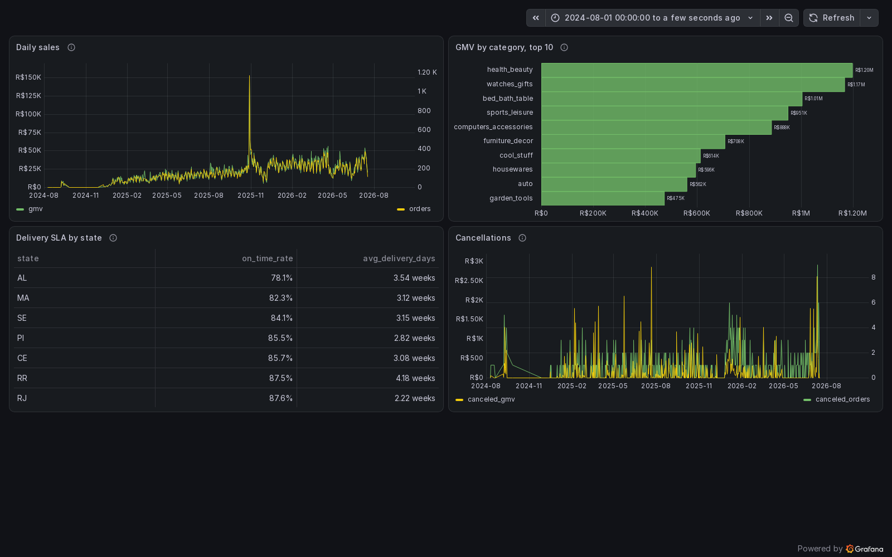

# Evidence

What was run, when, and what it showed. Every number carries a date (UTC unless noted) and a
source: a section of [OPERATIONS.md](../OPERATIONS.md), a file, a GitHub run or a command that
anyone with the stack up can repeat. Anything not run live is marked `not proven`.

Contents: [Reconciliation](#reconciliation-source-against-silver) |
[Failure scenarios](#failure-scenarios-1-to-9) | [Maintenance](#maintenance-before-and-after) |
[Alerts](#alerts-and-time-to-fire) | [CI and smoke](#ci-and-smoke) | [Dashboard](#dashboard) |
[Trino access control](#trino-access-control) |
[Not proven](#not-proven-yet) | [How it was built](#how-it-was-built)

## Reconciliation: source against silver

`make reconcile` compares Postgres with the live rows of silver for all seven tables: row count,
set of primary keys, sum of every decimal column (`scripts/chaos/lib.sh`, `scripts/reconcile_sql.py`),
and since 2026-10-30 the row fingerprint of every contract column that `dq_checks` uses, printed
as a last `values` column (`ok` or `DIFF`). It only reads. Output of 2026-10-29 18:50 UTC, before the fingerprint,
run for this page:

```
customers    postgres    99441  silver    99441  rows ok   keys ok   sums -
order_items  postgres   109081  silver   109081  rows ok   keys ok   sums ok (13173478.80 2182507.96)
orders       postgres    96258  silver    96258  rows ok   keys ok   sums -
payments     postgres   100623  silver   100623  rows ok   keys ok   sums ok (15530922.11)
products     postgres    32951  silver    32951  rows ok   keys ok   sums -
reviews      postgres    93494  silver    93494  rows ok   keys ok   sums -
sellers      postgres     3095  silver     3095  rows ok   keys ok   sums -
```

With the `values` column (the row fingerprint, commit `8164afe`, audit B2): `make verify-fast` of
2026-10-30 16:37 UTC, HEAD `ea64b6e` (stamp `fast at 2026-10-30T16:37:13Z`). `verify-fast` only
reads: it does not run `make silver`. The block above stays as the record before the fingerprint.
Output as printed:

```
customers    postgres    99441  silver    99441  rows ok   keys ok   sums -  values ok
order_items  postgres   109081  silver   109081  rows ok   keys ok   sums ok (13173478.80 2182507.96)  values ok
orders       postgres    96258  silver    96258  rows ok   keys ok   sums -  values ok
payments     postgres   100623  silver   100623  rows ok   keys ok   sums ok (15530922.11)  values ok
products     postgres    32951  silver    32951  rows ok   keys ok   sums -  values ok
reviews      postgres    93494  silver    93494  rows ok   keys ok   sums -  values ok
sellers      postgres     3095  silver     3095  rows ok   keys ok   sums -  values ok
verify ok
```

Both `verify` targets add the bronze check to `reconcile` (every Kafka offset exactly once, all
seven tables present) and end with `verify ok`; `make verify` first runs one silver merge. A full
run that this page records: `verify ok`, 2026-10-29 19:16 UTC, before commit `46f5282` (the W6-T11 check, [Trino access control](#trino-access-control)).
`dq_checks` repeats the comparison every 15 minutes and also compares row fingerprints source to
silver and silver to gold (`reconcile_values`); its run at 16:45 on 2026-10-29 had every
`reconcile_*_differing` at 0 and `reconcile_in_flight` at 0 ([OPERATIONS, Maintenance step 11](../OPERATIONS.md#first-live-run-2026-10-29)).

## Failure scenarios 1 to 9

Each scenario is `make chaos-<name>` ([`scripts/chaos/`](../scripts/chaos)) and ends in a check that
fails on any duplicate or missing Kafka offset or any difference from Postgres. Full write-ups:
what happened, what monitoring shows, data at risk, recovery, why nothing is lost.

| # | Scenario | Date | Measured | Write-up |
|---|---|---|---|---|
| 1 | Spark bronze killed mid-batch | 2026-10-07 | Kill 18:09:44 during batch 80 (158 records), replayed batch committed 18:10:12, 28 s after the kill, same query id; 0 duplicate or missing offsets in 21 topic partitions, no epoch committed twice | [1](../OPERATIONS.md#1-spark-bronze-killed-mid-batch) |
| 2a | Kafka Connect restart | 2026-10-07 | Recovered in about 32 s; 1429 CDC events in the minute before the restart, 1593 after; 0 events repeated with the same LSN; silver matches Postgres (rows, keys, sums) for 7 tables | [2a](../OPERATIONS.md#2a-kafka-connect-restart) |
| 2b | Kafka Connect killed | 2026-10-07 | Connector resumed 26 s after `docker start`; 253 events arrived twice (orders 173, order_items 40, payments 39, reviews 1), all absorbed; silver matches Postgres (rows, keys, sums) for 7 tables | [2b](../OPERATIONS.md#2b-kafka-connect-killed) |
| 3 | Duplicate events from the source | 2026-10-07 | 2267 CDC events in the window, 95 no-op repeats (9.8% of status UPDATEs, 90 of 926 orders); 0 changes arrived twice with the same LSN; silver matches Postgres (rows, keys, sums); script 3 min 11 s | [3](../OPERATIONS.md#3-duplicate-events-from-the-source) |
| 4 | Late events | 2026-10-07 | An old change re-sent after a newer one; silver kept `approved` and `_last_lsn` 1401679552 before and after (the MERGE guard dropped it); bronze kept the copy at a new offset; script 3 min 12.6 s | [4](../OPERATIONS.md#4-late-events) |
| 5 | PostgreSQL restart | 2026-10-23 | Postgres healthy in 13 s, connector streamed again 13 s later without a failed task; bronze caught up 28 s after a 30 s burst; `ContainerRestarting` firing 15 s after the restart; `reconcile` 7 of 7 | [5](../OPERATIONS.md#5-postgresql-restart) |
| 6 | Connector stopped for 30 minutes (WAL growth) | 2026-10-23, 2026-10-29 | 2026-10-23: `ConnectorNotRunning` 95 s after the stop, `SlotWalRetainedHigh` 326 s after it, 80.9 MB held. 2026-10-29 (committed script, full hold): connector stopped 17:47:02 to 18:17:06, `dq_checks` at 18:00 and 18:15 green with `in flight: CDC stands, no verdict`, `CdcStalledSourceWrites` firing 18:20:04, then silver matches Postgres (rows, keys, sums) 7 of 7, exit 0. Sources for the 2026-10-29 run: the result of W6-T07 in [the W6 spec](planning/14-closeout-spec.md) and the approval log entry of 29.10 18:22 in [HANDOFF](HANDOFF.md) (ru) | [6](../OPERATIONS.md#6-connector-stopped-for-30-minutes-wal-growth) |
| 7 | Corrupted event in topic | 2026-10-23 | One non-envelope record: one `silver.quarantine` row after the first merge, still one after the second; the rest of the batch merged | [7](../OPERATIONS.md#7-corrupted-event-in-topic) |
| 8 | Kafka down for 6 minutes | 2026-10-23 | Kafka healthy 20 s after the start, connector `RUNNING` after 20 s, bronze caught up after 25 s; `spark-bronze` restarted 15 times, resumed from the checkpoint each time; 21 partitions without duplicate or missing offset; silver matches Postgres (rows, keys, sums) 7 of 7; `SparkNoBatch5m` did not fire (see Alerts) | [8](../OPERATIONS.md#8-kafka-down-for-6-minutes) |
| 9 | Airflow task failure (dbt test) | 2026-10-18 (run), 2026-10-23 (alert) | `dbt_build` red on a broken test, children skipped, `mart_daily_sales` kept its 9 snapshots; `AirflowDagFailed` 17 s after the red run ended | [9](../OPERATIONS.md#9-airflow-task-failure-dbt-test) |

Scenario 10 (partial processing, Trino memory) is optional and `planned`. The 2026-10-23 run of
scenario 6 used an uncommitted script version whose logical-message padding of the WAL stopped CDC for about 8 minutes
with no loss; it is described in the write-up, together with the fix.

## Maintenance, before and after

First live run of the Iceberg maintenance procedures, 2026-10-29, steps and raw numbers in
[OPERATIONS, "First live run, 2026-10-29"](../OPERATIONS.md#first-live-run-2026-10-29) and ADR-025 in
[DECISIONS.md](../DECISIONS.md). A one-off copy of `warehouse/` (4821 objects, 877 765 423 bytes,
equal to the source) was taken before the first deletion; it is not a regular backup.

| Measure | Before | After |
|---|---|---|
| `bronze.cdc_events` data files in partitions before today | 595 in 27 partitions | 30 (589 files rewritten into 24) |
| `bronze.cdc_events` rows, `max(kafka_offset)` | 558 629, 77 659 | equal; Kafka end offsets equal, `bronze_offsets_ok` 0 |
| Bronze `metadata.json` objects, `bronze/metadata/` objects | 122, 465 | 101, 444 (21 orphan files removed; the dry run listed the same 21) |
| `silver.orders` snapshots | 38 | 15 (51 data files and 111 position-delete files deleted) |
| `silver.order_items`, `silver.payments` snapshots | 31, 31 | 13, 13 |
| `gold.fct_orders`, `gold.dim_customers` snapshots | 41, 41 | 16, 16 |
| `lake.demo.orders` (sandbox) files | 21 (156 027 bytes) | 1 (77 927 bytes) |
| Row count of every silver and gold table | | equal; `make reconcile` 7 of 7 after the silver expire |

Time of each procedure, from the first Spark log line to the end of the command (approximate):
bronze compaction 16 s, expire of the eight other silver tables in one run 34 s, expire of the
nine gold tables 40 s, an orphans dry run 9 to 23 s, the real orphans run 13 s. `spark-bronze` was
recreated alone and was healthy 26 s later, `Resuming at batch 171`. The pipeline after the live
steps was green: `silver_upsert`, `dbt_build` and `dq_checks` on 2026-10-29 16:40 to 16:45, and
the first scheduled `iceberg_maintenance` run ran `optimize` on 8 tables with the Spark steps
skipped, by design.

The MinIO image swap of the same day (the images are built from source, ADR-026): bucket 4045
objects and 482 441 040 bytes before and after (`mc du --json`), `mc admin info` version
2025-09-07T16:13:09Z before and after, `make verify-fast` `verify ok`
([W6-T00 result](planning/14-closeout-spec.md)).

The orphans dry run of `silver.orders` on 2026-10-30 17:48 UTC found 0 candidates while files of
`orders_per_minute` (its location starts with the same string, `silver/orders`) were older than the
7-day cutoff: the procedure does not take the other table's files for orphans
([OPERATIONS, Orphans next to orders_per_minute](../OPERATIONS.md#orphans-next-to-orders_per_minute-2026-10-30)).

## Alerts and time to fire

15 rules in [`observability/prometheus/alerts.yml`](../observability/prometheus/alerts.yml) (12 named
alerts, some with two expressions), tested by `make alerts-test` (promtool; `SUCCESS: 15 rules found`, 2026-10-30; failure cases first). No Alertmanager
(ADR-023): the alerts are read in Prometheus and in the Grafana "Firing alerts" panel. The table is
in [OPERATIONS, Alerts](../OPERATIONS.md#alerts).

| Alert | Shown how | Time to fire |
|---|---|---|
| `ConnectorNotRunning` | live, scenario 6 (2026-10-23) | 95 s after the connector stop |
| `SlotWalRetainedHigh` | live, scenario 6 (2026-10-23) | 326 s after the stop, 80 MB held |
| `SparkNoBatch5m` | live, `spark-bronze` stopped (2026-10-23) | 315 s after the stop |
| `FreshnessAbove15m` | live, `silver_upsert` paused (2026-10-23) | 1561 s after bronze caught up |
| `AirflowDagFailed` | live, scenario 9 (2026-10-23) | 17 s after the red run ended |
| `ContainerRestarting` | live, scenarios 5 and 8 (2026-10-23) | 15 s after the restart |
| `CdcStalledSourceWrites` | live, scenario 6 (2026-10-29) | firing 18:20:04; `cdc_stalled` was 1 from 18:01 (W6-T07 result in [the W6 spec](planning/14-closeout-spec.md), [HANDOFF](HANDOFF.md) log 29.10 18:22) |
| `SparkRestartLoop` | rule run over the stored data of scenario 8, not a live firing | true from 17:11:15, 51 s after the first restart (17:10:24) |
| `SlotWalHeldIdle`, `DqChecksStale`, `ScrapeTargetDown`, `SilverGoldNotCompared` | promtool only | not shown live |

`SparkNoBatch5m` did not fire in scenario 8: a crash-looping driver dies before its first batch and
Kafka came back inside the 5 minutes of the `gone` rule. That gap is why `SparkRestartLoop` exists
([OPERATIONS, scenario 8](../OPERATIONS.md#8-kafka-down-for-6-minutes)).

## CI and smoke

| Run | What | Result |
|---|---|---|
| [ci 40934002684](../../../actions/runs/40934002684) | push to `main`, HEAD `6ca7224`, 2026-10-29 | success |
| [ci 40924192138](../../../actions/runs/40924192138) | push, `649cb68`, 2026-10-29 | success |
| [smoke 40907438614](../../../actions/runs/40907438614) | `workflow_dispatch`, `664a7e6`, 2026-10-29, first green run on the source-built MinIO images | success, 10 min 1 s |
| [smoke 40916528470](../../../actions/runs/40916528470) | `workflow_dispatch`, `f71eab2`, 2026-10-29 | success, 9 min 14 s |
| [smoke 40934001854](../../../actions/runs/40934001854) | `workflow_dispatch`, `6ca7224`, 2026-10-29 | success, 10 min 52 s |
| [ci 40897412910](../../../actions/runs/40897412910) | push, `f206596`, 2026-10-29 | failure, job `spark-tests` only (below) |
| [smoke 40290595866](../../../actions/runs/40290595866) | Monday schedule, 2026-10-26 | failure at `make start`: the MinIO images were gone from quay.io and Docker Hub |

`smoke.yml` walks the clean-clone path on the committed sample: `make secrets`, `make bootstrap`,
a 60 s `make replay-burst`, `make verify`, and a second `make bootstrap` that must say
`replay state exists, load skipped` and end `verify ok`. It builds the Spark, Connect, MinIO and
`mc` images from scratch, so it is cold every time. The weekly schedule (Monday 03:00 UTC) is back
since the first green run; its first scheduled run (2026-11-02) is `planned`.

The red `spark-tests` run is a defect that CI caught and local checks did not: a test held a fixed
clock (`2026-10-23 03:30 UTC`) and failed on every run after 2026-10-24 03:30 UTC. The fix (the
real clock) is in `eebb639`, green in [ci 40901323188](../../../actions/runs/40901323188).

Local checks of record: `make check` 825 passed, 83 skipped (the 83 are Spark tests, which skip on
a host without a JVM; in CI `spark-tests` runs them in the image and a skip is a failure), HEAD
`ab37157`, 2026-10-29; `make test-spark` 235 passed in the image
([W6-T01 result](planning/14-closeout-spec.md), [HANDOFF](HANDOFF.md)). Job list and what each
runs: [OPERATIONS, CI](../OPERATIONS.md#ci).

## Dashboard

The "Marketplace" dashboard (Grafana, Trino datasource plugin 1.4.1) shows four panels over
gold only: daily sales, GMV by category, delivery SLA by state, cancellations. The panels read
`lake_ro.gold` since W6-T11 (commit `46f5282`, [below](#trino-access-control)); the screenshot of
2026-10-29 18:44 UTC and the checks below were taken before that switch, when they read `lake.gold`:



Checks of 2026-10-29, before the switch ([W6-T01 result](planning/14-closeout-spec.md), [OPERATIONS, Dashboards](../OPERATIONS.md#dashboards)):

- `uv run python scripts/obs/check_dashboards.py observability/grafana/dashboards/marketplace.json`
  prints `queries ok: 4`; through `/api/ds/query` the panels returned 600, 10, 27 and 600 rows.
- The orders panel shows 96 163 orders and `select count(*)` on `fct_orders` gives 96 163. Summing
  `orders_count` of `mart_daily_sales` would give 96 650, because the mart counts an order in each
  of its states per seller state; the reviewer found this double count before the dashboard was
  accepted.
- GMV by category adds up to 13 086 460.39, equal to `sum(gmv)` of the mart.
- Grafana used 276.7 MiB of its 384 MiB limit.
- After the switch to `lake_ro.gold`, `uv run python scripts/obs/check_dashboards.py` (all
  dashboards) prints `queries ok: 39` (2026-10-29, 19:16).

## Trino access control

W6-D17, card W6-T11, commit `46f5282`. Trino has file-based access control
(`docker/trino/etc/access-control.properties`, `docker/trino/etc/rules.json`) and a second catalog
`lake_ro` (`docker/trino/etc/catalog/lake_ro.properties`, `iceberg.security=read_only`) over the
same warehouse. The `grafana` user, used by the Grafana datasource and by `check_dashboards.py`,
reads `lake_ro.gold` only. Live probes of 2026-10-29 after `docker restart lakehouse-trino-1` at
19:15, run as the user named:

| User | Statement | Result |
|---|---|---|
| `grafana` | `select` from `lake_ro.gold.fct_orders` | 96 258 |
| `grafana` | `select` from `lake_ro.silver` | Access Denied |
| `grafana` | any query on catalog `lake` or `system` | Access Denied |
| `grafana` | `create table` | Access Denied |
| `grafana`, `dbt` (through `lake_ro`) | `optimize` on a gold table | `Cannot execute table procedure OPTIMIZE` |
| `dbt`, `trino`, `airflow` | `select` from `lake.silver.orders` | 96 258 |

Afterwards: `make dbt-build` `PASS=68 WARN=4 ERROR=0` (19:16), `check_dashboards.py` `queries ok: 39`,
`make verify` `verify ok` (19:16, before the commit). Residual risk, recorded in
[OPERATIONS, Access control](../OPERATIONS.md#access-control): Trino has no authentication, so the
user name is only a label; a Grafana admin who adds a datasource with another user, or a client
that reaches port 8080, gets that user's rights. The rules protect the provisioned datasource,
not a person with an admin login, a shell or network access.

## Not proven yet

- `rewrite-position-deletes silver.orders` did not run live; the scheduled run skipped it.
- `iceberg_orphans` stays paused; running it weekly is the owner's decision.
- Scenario 8 live against `CdcStalledSourceWrites` (it is shorter than the alert window) and
  `SparkRestartLoop` as a live firing.
- The offline start of Grafana with a new `grafana` volume (the plugin install is synchronous).
- The 24 hour unattended window (W6-T09) and the learning gates in [LEARNING.md](../LEARNING.md):
  `planned`.
- Trino authentication: not done. Access control (W6-T11) limits the `grafana` user, but the user
  name is only a label ([OPERATIONS, Access control](../OPERATIONS.md#access-control)).

## How it was built

The project is built by AI agents working for one engineer. The agents wrote the code, the tests
and the documentation; the owner decided the architecture, approved every risky action and
accepted the results. This section lists the artifacts that show it, and counts only what the
artifacts contain. The rules are in [AGENTS.md](../AGENTS.md) and
[docs/planning/13-harness.md](planning/13-harness.md) (sections 1 to 6; written in Russian, like
all of `docs/planning/`).

**Roles.** One orchestrator session (Opus) plus five roles in
[`.claude/agents/`](../.claude/agents): `Explore` (search), `scout` (analysis and read-only
probes), `implementer` (code), `reviewer` (independent review in a fresh context), `docs-writer`
(these documents). A task is a card in a spec with a "done when" line and a recorded result
("Итог") naming who did what and the reviewer verdict.

**Decisions.** Every decision of the closing block is a row in
[the W6 spec](planning/14-closeout-spec.md), section 2, with a group: 17 decisions, 4 taken by the
agent alone (group A), 5 by the agent after a `reviewer` verdict (group B), 8 by the owner
(group C: pushes and delegation, replay budget, live changes, access rights, and whether these
documents say how the project was built). The architecture
decisions behind the code are ADR-001 to ADR-026 in [DECISIONS.md](../DECISIONS.md); code is not
written against an ADR, a new ADR comes first.

**Owner approvals.** Actions with a blast radius (live deletes, replay spending, pushes, changes to
the source or the connector) stop until the owner says yes; a hook enforces part of it
(`.claude/hooks/guard.py`), including a refusal to commit without a full `make verify`,
`make check` and a `reviewer` verdict on the same tree. The approvals are logged in
[HANDOFF](HANDOFF.md), "Журнал «ок»": 29 entries dated 2026-10-27 to 2026-10-29 (`grep -c '^| 2[789]\.10' docs/HANDOFF.md`, working tree at HEAD `46f5282`). The same period
holds 14 commits (`git log --oneline 8964292..HEAD | wc -l` at HEAD `46f5282`). The two numbers
count different things: one approval can cover a live step, a decision or a push, not only a
commit. No commit message carries an attribution line (`git log` has none).

**What review found.** Review by a separate agent in a fresh context returned work before it was
accepted. Examples, each with its record in [the W6 spec](planning/14-closeout-spec.md):

- Dashboard (W6-T01), round 0 "return", 1 high: order counts doubled when summed over states
  (96 650 against 96 163 real orders). Fixed by taking orders from `fct_orders`; see
  [Dashboard](#dashboard).
- `dq_checks` while CDC stands (W6-T07), round 0 "return", 2 high: the first version switched the
  value reconciliation off on any source write, which weakened the check, and the DAG wiring had no
  tests. The detector was redesigned to look at the replication slot, a difference at rest stays red
  when the source is silent, and 25 mutations of the new code were killed by the tests. Live proof:
  scenario 6 on 2026-10-29, above.
- First live maintenance (W5-T05b), plan review round 0 "return", 1 high: the rows of the JDBC
  catalog point to snapshots from before the catalog switch of 2026-10-08, and expire and orphan
  removal delete those files, so the rollback point would have been lost silently. Result: decision
  W6-D16 and a copy of `warehouse/` as the first step of the procedure.
- Harness (v0.3), round 0 "return", 1 high: a late "return" verdict without a tree id left an
  earlier "accept" valid. Accepted and fixed in round 1 ([HANDOFF](HANDOFF.md), 2026-10-29).
- Not found by review: the fixed-clock test that broke CI (see [CI and smoke](#ci-and-smoke)).
  It was caught by the pipeline after the push.

**Limits of the process.** `implementer` and `reviewer` hit their 60 turn limit on a long task
(about 22 and 29 minutes); the limit was raised to 100 and the owner asked the orchestrator to
finish the first fix round itself ([HANDOFF](HANDOFF.md), "harness v0.3"). The approval log is
kept by the agents with the owner's answer quoted or paraphrased, and it is not a signed record;
the entries of 2026-10-23 and 2026-10-24 were written after the fact and say so.

**These documents.** README, ARCHITECTURE, this page and the interview notes were drafted by the
`docs-writer` role from the cards' recorded results, with the source next to each number. A
fresh-context agent checks the result before it is accepted (`AGENTS.md`).
