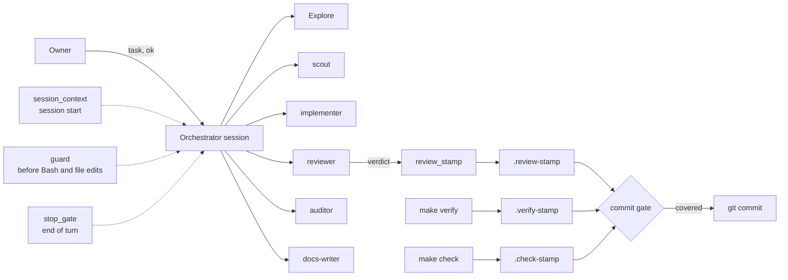

# How it was built with AI agents

## 1. What this is

The project ([README](../README.md)) was written by AI coding agents working for one engineer. The
owner decides the architecture, approves every risky action and accepts each result against recorded
evidence. The agents write code, tests and documents. This page describes the harness around them:
roles, hooks, stamps, approvals and what the process cost. The rules live in
[AGENTS.md](../AGENTS.md) and [docs/planning/13-harness.md](planning/13-harness.md). Everything in
`docs/planning/` is written in Russian.

## 2. Diagram



Hooks are registered in [`.claude/settings.json`](../.claude/settings.json). The three stamps are
files in the working tree; the gate compares them with the tree being committed.

## 3. Roles

One orchestrator session (Opus) plus six roles in [`.claude/agents/`](../.claude/agents). No role can
start another one.

| Role | Model | Writes | Forbidden tools | Turn limit |
|---|---|---|---|---|
| `Explore` | haiku | nothing | `Edit`, `Write`, web, `mcp__*`, `Agent` | 30 |
| `scout` | sonnet | nothing | `Edit`, `Write`, `Agent` | 40 |
| `implementer` | sonnet | files named in the brief | `Agent` | 100 |
| `reviewer` | opus | nothing, verdict only | `Edit`, `Write`, `Agent` | 100 |
| `auditor` | opus | its report in a scratchpad | `Edit`, `Agent` | 100 |
| `docs-writer` | sonnet | public documents named in the brief | `Agent` | 50 |

## 4. Action classes and approvals

The class follows the most dangerous effect; doubt goes to the higher class
([13-harness, section 2](planning/13-harness.md)).

- **A, agent alone.** Reads, `git log`, read-only `make` targets, tests, lint, `select` in Trino and
  Postgres, the session routine of a verify cycle.
- **B, agent alone, with review and full checks before the commit.** Docker files, CI, dependencies,
  alerts, dashboards, DAG logic, contracts, migrations.
- **C, only after the owner's "ok".** Replay, chaos runs, starting or recreating containers,
  pushes outside the routine, Kafka topics, Lakekeeper, writes to source tables and slots, changes
  to agent roles and rules.

Hard stops (deletes, `DROP`, `reset --hard`, force push, silver writes) are listed in
[AGENTS.md](../AGENTS.md). The request for an "ok" has a fixed form:

```text
"ok" for: <exact command, variables expanded>
Why: <package, step>
Touches: <tables, containers, files>; reversible: yes | no (<how to roll back>)
Before: <numbers, command>
Check after: <command and expected output>
Plan review: <reviewer verdict> (if "reversible: no")
```

The "ok" covers that text only; a changed command or order is a new request. Every "ok" goes into
the approval log in `docs/HANDOFF.md`.

## 5. Numbers

As of 2026-11-21, commit `3bd4633`.

| Number | Command |
|---|---|
| 180 commits, first 2026-09-19, last 2026-11-21 | `git rev-list --count HEAD`; `git log --reverse --format=%ad --date=short \| head -1`; `git log -1 --format=%ad --date=short` |
| By commit prefix: docs 71, infra 29, lake 17, orchestrate 11, obs 8, ci 7, stream 6, cdc 6, harness 5, dbt 5, oltp 4, rest 2 or fewer | `git log --format=%s \| sed 's/:.*//' \| sort \| uniq -c \| sort -rn` |
| 0 attribution lines in commit messages | `git log --format=%B \| grep -ci 'co-authored-by'` |
| 126 owner approval rows (55 in `docs/HANDOFF.md`, 71 in the archive) | `grep -chE '^\| [0-9]{2}\.[0-9]{2}' docs/HANDOFF.md docs/planning/archive/HANDOFF-*.md` |
| Verdict mentions in planning docs: "return" 55, "accept with remarks" 106 (mentions, not a count of reviews) | `git grep -ohE '«(вернуть\|принять с замечаниями)»' -- docs/HANDOFF.md docs/planning \| sort \| uniq -c` |
| Guard hook: 1 056 lines (1 063 before its rewrite) | `wc -l .claude/hooks/guard.py` |
| Hook tests: 893 passed | `uv run pytest tests/unit/test_agent_hooks.py -q \| tail -1` |
| All unit tests: 2 233 passed, 149 skipped | `uv run pytest tests/unit -q \| tail -1` |
| 7 324 command forms in the corpus used to test the guard rewrite | `git show 7e5af85:docs/planning/15-audit-p5-review/corpus.json` |
| 13 auto-mode classifier refusals recorded: 7 before the final audit, 1 during it, 5 after; 3 turn-limit hits, none after 2026-11-13 | counted by hand: [audit report](planning/21-final-audit-2026-11-13/reports/HR.md) "Трение по журналам" (7 and 3), [shell report](planning/21-final-audit-2026-11-13/reports/IN.md) (1), `grep -n классификатор docs/HANDOFF.md` (5 rows dated after 2026-11-13; the sixth is in the 7) |
| Audits and reviews: files 12, 15, 16, 18, 19 and folder 21 in `docs/planning`; the final audit had 12 agent reports and 14 fix packages | `ls docs/planning` |

## 6. What review caught

A separate `reviewer` in a fresh context returned work before it was accepted. Records are in
[the closeout spec](planning/14-closeout-spec.md) and the [archived HANDOFF](planning/archive/HANDOFF-2026-10-27-to-2026-11-10.md) (Russian).

- Dashboard: order counts doubled when summed over states (96 650 against 96 163 real orders). Fixed
  by taking orders from `fct_orders`; see [evidence](evidence.md#dashboard).
- `dq_checks` while CDC runs: the first version switched value reconciliation off on any source
  write, which weakened the check, and the DAG wiring had no tests. The detector was redesigned to
  watch the replication slot; 25 mutations of the new code were killed by tests.
- First live maintenance: catalog rows pointed to snapshots from before a catalog switch, so expire
  and orphan removal would have deleted the rollback point silently. Result: take a copy of
  `warehouse/` as the first step.
- Harness: a late "return" verdict without a tree id left an earlier "accept" valid. Fixed in the
  next round ([archived HANDOFF](planning/archive/HANDOFF-2026-10-27-to-2026-11-10.md)).
- Memory limits: the orchestrator called Grafana and the exporter healthy because page cache sat at
  the limit, and missed swap; the reviewer caught it and the limits were raised
  ([archived HANDOFF](planning/archive/HANDOFF-2026-10-27-to-2026-11-10.md)).

## 7. What did not work

- **The guard grew too much.** It reached 1 063 lines, and much of it only caught deliberate
  bypass forms. The rewrite removed that parsing and kept the rule against bypassing, but the size
  barely moved: safer here-doc parsing and a fallback to checking the whole text added code back
  (1 056 lines now). The commit gate now has levels by path (Markdown and `docs/` need nothing;
  tests, CI and `.claude/` need `make check` and a reviewer verdict; stack code also a verify
  stamp; `streaming/` and `contracts/` a full `make verify`).
- **Agent documents grew to about 227 KB** with the same rule in four to six files, and the
  wording drifted. Now there is one canon per rule and a byte-budget test,
  `tests/unit/test_agent_docs.py`.
- **A fast verify overwrote the full stamp.** That forced extra verify cycles. Now a fast verify
  leaves a covering full stamp alone.
- **Classifier refusals.** Auto mode refused 13 recorded commands, among them four commits of the
  hook package. The rule is that a refusal is a stop, and the owner runs or re-approves the command.
- **Turn limits.** `implementer` and `reviewer` hit 60 turns on a long task; the limit went to
  100 ([archived HANDOFF](planning/archive/HANDOFF-2026-10-27-to-2026-11-10.md)).
- **Review missed some defects.** A test with a fixed clock broke CI after a day
  ([evidence](evidence.md#ci-and-smoke)). CI went red when `ubuntu-latest` moved to a new image;
  the final audit found it and the runner is now pinned
  ([package](planning/21-final-audit-2026-11-13/P01-ci-green.md)).
- **The approval log is not signed.** The agents write it with the owner's answer quoted or
  paraphrased. In production this would be a pull request approval and branch protection.

## 8. Reuse

To take this to another project, copy:

- the role files in [`.claude/agents/`](../.claude/agents), with the tool limits and turn limits;
- the [`/task` skill](../.claude/skills/task/SKILL.md), which fixes the order of a task;
- the approval request template (section 4) and the reviewer verdict format
  ([13-harness, section 4](planning/13-harness.md));
- the hooks in [`.claude/hooks/`](../.claude/hooks) together with
  [`tests/unit/test_agent_hooks.py`](../tests/unit/test_agent_hooks.py). The hooks without their
  tests are not worth copying.
