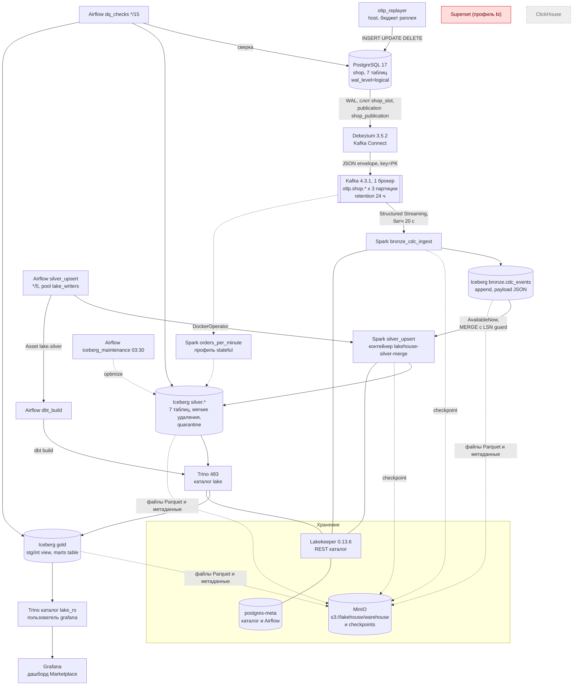

# Фактическая архитектура и путь данных

Часть аудита 06.11.2026 (`AUDIT_REPORT.md`). Схема построена по коду, compose и живому стеку на
HEAD `f7eede8`, а не по описанию из задания. Доказательства к каждой связи в разделе 3.

## 1. Карта проекта

| Область | Где | Назначение | Состояние 06.11 |
|---|---|---|---|
| Инфраструктура | `docker/compose.yaml` (25 сервисов, 8 профилей), `Makefile`, `scripts/bootstrap.sh` | запуск по профилям `core`, `query`, `orchestrate`, `obs`, `stateful`, `jobs`, `bi`, `tools` | 18 контейнеров healthy; `bi` и `tools` не запущены |
| Источник | `oltp/migrations/*.sql`, `oltp/init/01-debezium.sh`, `oltp/replayer/` | Postgres 17, схема `shop` (7 таблиц), реплей Olist по виртуальным часам | `virtual_now` 2026-07-18 00:06:35, 77 422 события |
| CDC | `connect/shop-connector.json`, `connect/register.sh`, `docker/connect/Dockerfile` | Debezium 3.5.2 (worker Kafka Connect 4.2.0), `pgoutput`, слот `shop_slot` | коннектор и задача RUNNING |
| Kafka | compose `kafka`, топики создаёт `connect/register.sh` | 1 брокер KRaft 4.3.1, `oltp.shop.*` по 3 партиции, RF 1, retention 24 ч | healthy, consumer groups Spark нет (offsets в checkpoint) |
| Spark | `streaming/spark_jobs/` (`bronze_cdc_ingest`, `silver_upsert`, `orders_per_minute`, `maintenance`), `streaming/Dockerfile` | Spark 3.5.9 local[2], Iceberg 1.11.0 | bronze и orders_per_minute работают; silver запускает Airflow |
| Iceberg и каталог | Lakekeeper 0.13.6 (REST), `scripts/lakekeeper/` | warehouse `lake`, namespaces bronze, silver, gold, demo | 1 + 9 + 9 + 3 (demo) таблиц, warehouse active |
| Объектное хранилище | `docker/minio/` (собран из исходников, ADR-026) | бакет `lakehouse`: `warehouse/`, `checkpoints/` | 4 033 объекта warehouse, 487 checkpoint, 608 МБ |
| Trino | `docker/trino/etc/` | движок dbt и SQL; каталоги `lake` (запись) и `lake_ro` (чтение), file ACL | healthy, SELECT по всем слоям |
| dbt | `dbt/` | 7 staging (view), 2 intermediate (view), 8 marts (table, `mart_daily_sales` incremental), 65 тестов | `dbt test` PASS=61 WARN=4 |
| Airflow | `airflow/dags/`, `airflow/Dockerfile`, `docker/airflow/airflow.env` | Airflow 3.3.2 LocalExecutor: `silver_upsert`, `dbt_build`, `dq_checks`, `iceberg_maintenance`, `iceberg_orphans` | 4 DAG активны, `iceberg_orphans` на паузе по решению |
| ClickHouse | нет | осознанно отсутствует (`ARCHITECTURE.md`, What is deliberately absent; ADR-015) | N/A |
| Superset | compose `superset`, профиль `bi` | необязательный BI (ADR-014) | не запускается: нет `docker/superset/superset_config.py` |
| BI фактически | `observability/grafana/dashboards/marketplace.json` | Grafana + плагин Trino, 4 панели над `lake_ro.gold` | SQL панелей выполняется (`queries ok: 39`) |
| Наблюдаемость | `observability/` | Prometheus, 15 правил, Grafana Pipeline health и Infra, экспортёры | 8 из 8 targets up, алертов 0 |
| Тесты | `tests/unit/` (42 файла), `.github/workflows/ci.yml`, `smoke.yml` | unit, Spark-тесты в образе, reconcile на Postgres в CI, smoke с чистого клона | 1801 passed, 145 skipped на хосте; CI HEAD success |
| Документация | `README.md`, `ARCHITECTURE.md`, `OPERATIONS.md`, `DECISIONS.md` (ADR-001..026), `docs/evidence.md`, `docs/runbooks/` | архитектура, эксплуатация, решения, доказательства | в целом актуальна, неточности в реестре находок |
| Правила агентов | `AGENTS.md`, `CLAUDE.md`, `docs/agent-rules.md`, `docs/planning/13-harness.md`, `.claude/` | роли, классы действий, хуки guard, stop_gate, review_stamp | работают (guard дважды остановил команды аудита по тексту) |

## 2. Схема

Сплошная линия: связь подтверждена в этом аудите живыми данными. Пунктир: связь есть в коде,
живьём в этом аудите не прослежена. Красный: не работает или отсутствует.

## 3. Связи и доказательства

| Связь | Механизм | Статус | Доказательство (06.11) |
|---|---|---|---|
| Реплеер -> Postgres | SQL в транзакциях по расписанию `replay.schedule` | работает | 157 событий 12:05:31-12:06:00 UTC: 88 `order_insert`, 67 `order_status`, 1 `review_insert`, 1 `review_delete` |
| Postgres -> Debezium | логический слот `pgoutput`, REPLICA IDENTITY FULL | работает | `pg_replication_slots`: `shop_slot` active, retained 6856 kB; `pg_stat_replication` streaming; offset Connect `lsn 1872557608` = `confirmed_flush_lsn 0/6F9CF628` |
| Debezium -> Kafka | JSON без схемы, ключ PK | работает | заказ `1723f84b...`: `op=c` offset 77464 и `op=u` offset 77465 в `oltp.shop.orders` p0; удаление отзыва `op=d` offset 61261 в `oltp.shop.reviews` p0 |
| Kafka -> Spark bronze | Structured Streaming, checkpoint в MinIO | работает | те же offsets в `bronze.cdc_events`, `ingest_ts` 12:06:00 и 12:06:20 (через 9-19 с); по 21 партиции `count = count(distinct offset)`, диапазоны без дыр, max = конец Kafka - 1 |
| bronze -> silver | Airflow `silver_upsert`, DockerOperator, MERGE по PK с `_last_lsn` | работает | `silver.orders`: статус `approved`, `_last_lsn 1870783760` = LSN update, одна строка; отзыв `_is_deleted=true`; `make reconcile` 7 из 7 ok; Variable `silver_upsert_last_bronze_snapshot` = последний снапшот bronze |
| silver -> gold | Asset `lake.silver` -> `dbt_build` на Trino | работает, с оговоркой | `gold.fct_orders` для заказа: `approved`, `payment_value 106.76`; GMV `mart_daily_sales` 13 112 715.70 = Postgres; но последнее событие Asset (12:11:49) не создало run `dbt_build` (DAG был на паузе), gold пересобран руками (F-01) |
| gold -> Trino `lake_ro` -> Grafana | плагин trino-datasource, пользователь `grafana` | SQL работает, рендер не проверен | `check_dashboards.py`: `queries ok: 39`; `system.runtime.queries` показывает 4 запроса Marketplace от `grafana` |
| Postgres, silver, gold -> `dq_checks` | Airflow каждые 15 мин | работает | run 13:15: 13 пар `reconcile_values_differing=0`, GMV source-gold 0, `gold_not_compared_runs=0` |
| Kafka -> `orders_per_minute` -> silver | Structured Streaming с watermark | не прослежено в этом аудите | контейнер healthy, Spark UI :4043; работает на образе, которого нет под тегом (F-10) |
| Iceberg метаданные -> файлы MinIO | Lakekeeper + S3 | согласованы | 169 файлов `$files` у bronze.cdc_events, silver.orders, silver.reviews, gold.fct_orders, gold.mart_daily_sales: 0 отсутствующих на диске MinIO |
| Superset | профиль `bi` | не работает | `docker/superset/` пуст, compose монтирует `./superset/superset_config.py` (F-02) |
| ClickHouse | нет | отсутствует осознанно | `ARCHITECTURE.md`, What is deliberately absent |

## 4. Отклонения от целевой схемы задания

Задание описывает `PostgreSQL -> Debezium -> Kafka -> Spark -> Iceberg -> MinIO -> Trino / dbt ->
аналитическое хранилище -> Superset` плюс Airflow и ClickHouse. Фактически:

1. Аналитический слой это Iceberg `gold` в том же lake, читаемый через Trino; отдельного
   хранилища (ClickHouse) нет, и проект это заявляет.
2. BI это Grafana с плагином Trino, а не Superset; Superset заявлен как необязательный и сейчас
   не стартует.
3. Spark пишет потоково только bronze; silver это пакетный MERGE каждые 5 минут
   (`Trigger.AvailableNow`) из Airflow. Это решение ADR-007, а не недоделка.
4. Airflow оркестрирует только пакетную часть (silver, gold, проверки, обслуживание). CDC и
   bronze это долгоживущие сервисы compose вне Airflow; регистрация коннектора делается скриптом
   `make bootstrap`.
5. В схеме есть звено, которого нет в задании: REST-каталог Lakekeeper с собственной БД в
   `postgres-meta`; без него недоступны все таблицы.

## 5. Точки отказа

| Что | При отказе | Заявлено ли HA |
|---|---|---|
| 1 брокер Kafka, RF 1, retention 24 ч | CDC и bronze стоят; простой дольше 24 ч: bronze с `failOnDataLoss=true` уходит в цикл рестартов, нужен `make cdc-snapshot` | нет, ограничение описано (OPERATIONS) |
| `postgres-meta` (Lakekeeper и Airflow) | недоступны все таблицы Iceberg и Airflow | нет |
| MinIO, один том | потеря тома = потеря lake и checkpoint; восстановление из копии не проверялось | нет |
| Слот `shop_slot`, `max_slot_wal_keep_size=-1` | стоящий коннектор копит WAL без предела | нет, есть алерты `SlotWal*` и раннбук |
| Ноутбук, WSL2 | сон хоста останавливает всё | нет |
| Порядок старта после рестарта Docker | `depends_on` не действует при автоподъёме демоном: 06.11 kafka-exporter 8 рестартов, lakekeeper 1, затем healthy | нет, самовосстанавливается |
