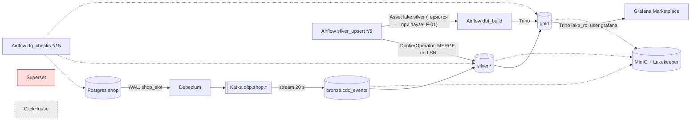
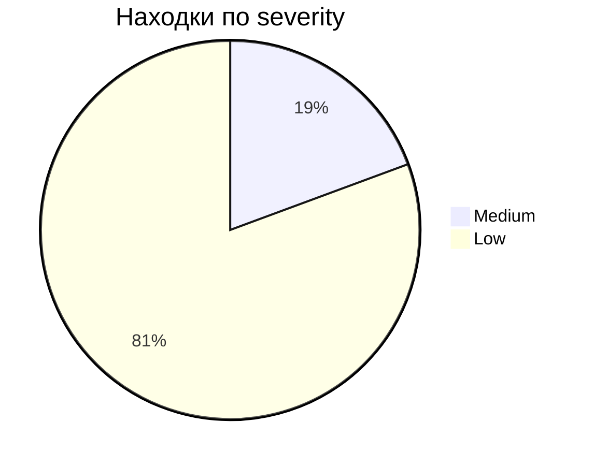
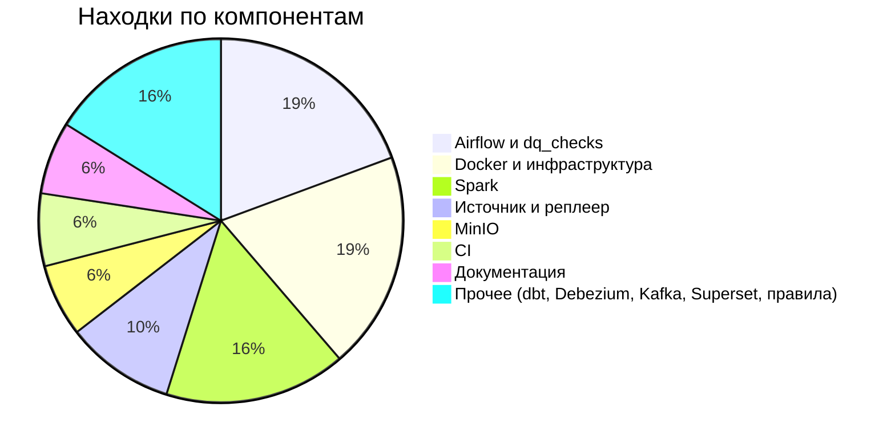

# 16. Полный аудит системы 06.11.2026: Marketplace Lakehouse

Статус: аудит закрыт, только чтение. Исправлений не делалось. Файлы аудита: этот отчёт,
`ARCHITECTURE_MAP.md` (карта и путь данных), `LOCAL_ACCESS_GUIDE.md` (адреса UI и порядок
изучения), `FINDINGS_REGISTER.md` (подробный реестр F-01..F-31), `AUDIT_SUMMARY.md` (кратко).
Предыдущий аудит: `docs/planning/15-audit-2026-10-30.md`; ссылки вида ARCH-02, QA-03 ведут туда.

Обозначения: факт (команда и вывод или `file:line`), вывод, гипотеза разделены; непроверенное
помечено NOT RUN или NOT VERIFIED.

Шкалы задания. Severity: CRITICAL компрометация, утечка критических секретов, необратимая потеря
данных; HIGH отказ важного компонента, систематическое искажение данных или аналитики,
невозможность пройти основной путь; MEDIUM частичная деградация, пробел наблюдаемости, тестов или
документации; LOW мелочи. Complexity: LOW одна правка, MEDIUM несколько модулей или pipeline, HIGH
переработка механизма. Общий статус: PASS (всё проверено и работает), PASS WITH FIXES (в целом
работает, есть что исправить), PARTIAL PASS (основные возможности не доказаны), FAIL,
INCONCLUSIVE.

## 0. Исходное состояние, метод, ограничения

**Git до аудита** (06.11 13:19 UTC): ветка `main`, HEAD `f7eede82bb0ace5a0be9731df906ee1296ea8107`,
`git status --short` пуст, `main...origin/main` без расхождения. CI на HEAD: run 42221365138,
11 job success. Отметки: verify full 12:18:29Z (stale по дереву), check и review 05.11 (stale).

**Стек:** 18 контейнеров `healthy`, подняты 11:52 UTC после рестарта хоста, scheduler 12:19
(после цикла verify сессии закрытия). Не запущены: профили `bi` (Superset), `tools` (kafka-ui),
`oltp-replayer`. Свободно 3 ГБ RAM из 11.7 ГБ VM, диск 949 ГБ.

**Метод.**
1. Живые пробы оркестратора, только чтение: `docker ps/inspect/top/logs/stats`, GET ко всем
   опубликованным портам, REST Airflow, Connect, Lakekeeper, Prometheus; SELECT в Postgres и
   Trino; чтение Kafka консольным консьюмером; файловая система MinIO через `docker exec ... ls/test`.
2. Проверки проекта: `make lint`, `make test`, `make dags-check`, `make alerts-test`,
   `make dbt-parse`, `dbt debug`, `dbt ls`, `dbt test`, `make reconcile`, `check_dashboards.py`,
   `make report`, `gh run list/view`.
3. Четыре направления разбора кода подагентами в свежем контексте, только чтение: потоковая часть
   и реплеер, dbt и Airflow, инфраструктура и безопасность (Opus), документация и правила агентов
   (Sonnet, выполнено до уточнения владельца, что аудит и перепроверку ведёт Opus; все его
   находки перепроверил оркестратор на Opus, две отклонены как неверные). Каждую находку
   подагентов оркестратор перепроверил по коду или пробе; где перепроверки не было, это сказано
   в реестре.

**Что не делалось и почему.**

| Проверка | Почему нет | Чем заменено |
|---|---|---|
| `make verify` | пишет в silver (жёсткий запрет без «ок») | `make reconcile` и SQL по offsets bronze |
| `make verify-fast` | перезаписывает полную отметку verify быстрой, после этого docs-коммит потребует полный `make verify` с записью в silver | те же части по отдельности |
| `make dbt-build` | пишет в `lake.gold`, DAG `dbt_build` активен | `dbt test` (только SELECT, `store_failures` не включён) |
| `make test-spark` локально | 3 ГБ свободной памяти при живом стеке, риск OOM контейнеров | CI `spark-tests` success на `f7eede8` |
| Новая контролируемая запись в Postgres | любая запись в `shop` и реплей это расход бюджета реплея, класс C; безопасной тестовой таблицы в проекте нет | трасса реальных событий burst 06.11 12:05 (раздел 4) |
| Перезапуски Spark, Connect, MinIO | остановка и рестарт контейнеров это класс C | живьём сегодняшние факты: рестарт хоста 11:52 и kill merge 12:10 (раздел 4.3) |
| Запуск kafka-ui и Superset | `make up` это класс C; Superset к тому же не стартует (F-02) | статический разбор |
| Визуальная проверка UI | браузера нет | HTTP/API-статус и результат запросов |
| CVE-сканирование образов и `uv.lock` | сканеров нет, сеть не использовалась | NOT VERIFIED, F-23 |

**Побочные эффекты аудита.** Файлы в `dbt/target` (в `.gitignore`); логи в scratchpad сессии;
история запросов Trino; одна пустая группа Kafka `console-consumer-3934` без offsets (создал
запуск консьюмера с `--from-beginning` по `connect-offsets`; Kafka удаляет пустые группы без
offsets сама); пять новых файлов этого каталога. Подагент инфраструктуры попытался выполнить
POST к `/auth/token` Airflow и admin API Prometheus; классификатор команду отклонил, она не
выполнилась (из его отчёта).

## 1. Executive Summary

**Общий статус: PASS WITH FIXES.**

Фактическая архитектура проекта (Postgres -> Debezium -> Kafka -> Spark bronze -> Iceberg на
MinIO через REST-каталог Lakekeeper -> Airflow + Spark MERGE в silver -> dbt на Trino в gold ->
Grafana) реализована полностью и работает как единая система. Это доказано трассой реальных
событий 06.11 через все слои: INSERT и UPDATE заказа и DELETE отзыва прошли от WAL до витрин и
SQL дашборда, сверки Postgres и silver 7 из 7 по строкам, ключам, суммам и отпечатку значений,
GMV Postgres и витрины равны до копейки (13 112 715.70), дублей и дыр offsets в bronze нет,
все 169 проверенных файлов Iceberg на месте в MinIO.

Против целевой схемы задания два звена отличаются: аналитического хранилища ClickHouse нет
(осознанно, `ARCHITECTURE.md`), а Superset заявлен, но не запускается (F-02); BI фактически
Grafana с плагином Trino. Пройти «от PostgreSQL до Superset» нельзя; пройти от PostgreSQL до
дашборда Grafana можно.

Критических и высоких находок для локальной лаборатории нет. Найдена 31 находка: 6 MEDIUM,
25 LOW. Главные:
1. F-01: событие Asset теряется, пока `dbt_build` на паузе; 06.11 Airflow не собрал бы gold
   после kill merge (его собрал ручной шаг цикла verify), `dq_checks` молчал бы до 6 часов,
   `ARCHITECTURE.md` обещает сборку после каждого merge.
2. F-02: Superset не запускается; вместе с F-07 (LOW: браузер на `:9000` уводит на
   неопубликованный порт консоли MinIO) это прямо мешает изучению стенда через UI.
3. F-03, F-04: два тихих сценария (устаревшие витрины после красного dbt; потеря offsets bronze
   при восстановлении checkpoint из копии), оба по коду, живьём не воспроизведены.
4. F-05, F-06: ядро реплеера и путь gold без автоматических тестов.
5. Для публичного развёртывания недопустимы F-08, F-09 и известные SEC-06, SEC-07 (нет
   аутентификации, `docker.sock`, общие root-учётки, пароль Debezium в REST).

Локальный запуск безопасен: все порты на 127.0.0.1, секреты только в `.env` (gitleaks по 125
коммитам чист). Как portfolio project проект готов к показу после правок P1 (раздел 10), в
основном документации. По собственным критериям закрытия проекта открыт п. 11 (холодный старт,
`docs/NEXT_SESSION.md`); production-ready проект не является и этого не заявляет.

## 2. Architecture Scorecard

| Компонент | Реализован | Запущен | Интегрирован | Проверен E2E | Статус | Основание |
|---|---|---|---|---|---|---|
| PostgreSQL | да | да | да | да | PASS | `wal_level=logical`, слот active, публикация на 7 таблиц и сигналы, REPLICA IDENTITY FULL; трасса раздел 4 |
| Debezium | да | да | да | да | PASS | RUNNING, offset Connect = `confirmed_flush_lsn`; `op=c/u/d` в Kafka; пароль литералом (F-09) |
| Kafka | да | да | да | да | PASS | 1 брокер KRaft, 7 x 3 партиции, offsets трассы найдены; хостовый listener сломан (F-20), ограничения одного брокера описаны |
| Spark | да | да | да | да (bronze, silver) | PASS | bronze 21 партиция без дублей и дыр; silver MERGE по LSN; `orders_per_minute` не трассировался, образ не под тегом (F-10) |
| Iceberg | да | да | да | да | PASS | 4 namespace, 22 таблицы (bronze 1, silver 9, gold 9, demo 3); снапшоты, `$files`, мягкие удаления |
| MinIO / S3 | да | да | да | да | PASS | 169 файлов данных из метаданных Iceberg на диске, 0 отсутствуют; консоли нет по ADR-004, редирект в никуда (F-07) |
| Lakekeeper (вне задания) | да | да | да | да | PASS | warehouse active, REST и UI отвечают |
| Trino | да | да | да | да | PASS | SELECT по всем слоям, ACL `grafana` только `lake_ro` |
| dbt | да | да | да | да | PASS | `dbt test` PASS=61 WARN=4 ERROR=0; gold отражает трассу; GMV = Postgres |
| Airflow | да | да | да | частично | PARTIAL | `silver_upsert` и `dq_checks` живьём, retry merge try 2; `dbt_build` из Asset последний раз 29.10, событие 06.11 потеряно (F-01) |
| ClickHouse | нет | нет | нет | нет | N/A | осознанно отсутствует |
| Superset | частично (сервис compose) | нет | нет | нет | FAIL | нет `superset_config.py` (F-02) |
| Grafana (BI фактически) | да | да | да | SQL да, рендер нет | PARTIAL | `queries ok: 39` от пользователя `grafana`; вход и отрисовку в браузере аудит не видел |
| Prometheus и алерты | да | да | да | n/a | PASS | 8 из 8 targets up, 15 правил, 0 активных |
| Docker | да | да | да | n/a | PASS | 18 healthy, образы по digest, лимиты, healthchecks; LOW-находки F-22, F-24..F-27 |

## 3. Фактическая архитектура

Полная карта, таблица связей с доказательствами и точки отказа: `ARCHITECTURE_MAP.md`.

Отклонения от задания: аналитический слой это Iceberg gold через Trino, а не ClickHouse; BI это
Grafana, а не Superset; silver пакетный (AvailableNow каждые 5 минут), а не потоковый; Airflow
оркестрирует только пакетную часть, CDC и bronze это долгоживущие сервисы.

## 4. E2E Validation

### 4.1 Трасса контрольных объектов

Новых записей аудит не создавал (раздел 0). Взяты реальные события burst 06.11 12:05-12:06 UTC
(157 событий, `replay.schedule`), которые прошли весь путь под управлением Airflow: заказ
`1723f84b8a70b486955d59dad4bed0f2` (INSERT и UPDATE `created -> approved`) и удаление отзыва
`c2f4c281b2198eabab1ef0ba8c1bfaa6` заказа `73421a5bdd55f86529569549055d9e82`.

| # | Этап | Доказательство | Результат |
|---|---|---|---|
| 1 | Postgres | `replay.schedule`: `order_insert` 12:05:49.636, `order_status approved` 12:05:50.822; `shop.orders`: `approved`, позиция 79.90 + 26.86, платёж 106.76; отзыв в `shop.reviews`: 0 строк | есть |
| 2 | CDC Debezium | `source.lsn` 1870448280 (txId 16597) и 1870783760 (txId 16601); удаление LSN 1872484104 | есть |
| 3 | Kafka | `oltp.shop.orders` p0 offset 77464 `op=c`, 77465 `op=u` (`before created`, `after approved`); `oltp.shop.reviews` p0 offset 61261 `op=d`, `after` пуст, tombstone нет (`tombstones.on.delete=false`) | есть |
| 4 | Spark bronze | `bronze.cdc_events` те же 3 offsets, `ingest_ts` 12:06:00.015 и 12:06:20.009 (через 9-19 с после Kafka); снапшоты 12:05:47, 12:06:03, 12:06:22 | есть |
| 5 | Iceberg | последний снапшот bronze `5529739780013279467` = Airflow Variable `silver_upsert_last_bronze_snapshot` | есть |
| 6 | MinIO | 62 файла `bronze.cdc_events$files`, 25 `silver.orders`, 4 `silver.reviews`, 1 `gold.fct_orders`, 77 `gold.mart_daily_sales`: у каждого есть `xl.meta` на диске MinIO | есть |
| 7 | Silver (Airflow + Spark) | `silver.orders`: одна строка, `approved`, `_last_lsn 1870783760`, `_updated_at 12:11:42` (попытка 2 merge); `silver.reviews`: `_is_deleted=true`, `_last_lsn 1872484104` | есть |
| 8 | Trino | все SELECT выше и ниже через Trino 483 | есть |
| 9 | dbt | `gold.stg_reviews`: `is_deleted=true`; `mart_seller_performance` фильтрует `where not is_deleted` (`:29`) | есть |
| 10 | Аналитический слой | `gold.fct_orders`: `approved`, `payment_value 106.76`, `purchase_date 2026-07-17`; `fct_order_items`: `bed_bath_table`, продавец `SP`; `mart_daily_sales` за 2026-07-17 обновлён (`source_updated_at` 12:11:44) | есть |
| 11 | Дашборд | `check_dashboards.py`: 4 панели Marketplace на `lake_ro.gold` от `grafana` вернули строки, всего `queries ok: 39`; `system.runtime.queries` показывает эти 4 запроса | SQL есть, рендер Grafana NOT VERIFIED |

Оговорка по шагу 10: gold с этими событиями собран не Airflow, а ручным `make dbt-build` в 12:18,
штатным шагом цикла verify сессии закрытия (снапшот `fct_orders` 12:18:48, `docs/HANDOFF.md`).
Airflow сам его не собрал бы: событие Asset пришло при `dbt_build` на паузе (F-01). Значение
`updated_at` 12:11:44 это водяной знак из silver, а не время сборки.

### 4.2 INSERT, UPDATE, DELETE

- INSERT и UPDATE: в Kafka два события, в bronze две строки, в silver одна строка с LSN позднего
  события; дедупликация по ключу и LSN-guard работают. Ключи уникальны: `silver.orders` 96 346 /
  96 346, `order_items` 109 231 / 109 231, `payments`, `reviews`, `fct_orders`, `fct_order_items`
  без дублей (SQL `count(*)` против `count(distinct pk)`).
- DELETE: мягкое удаление дошло до silver и gold staging, потребитель фильтрует (D4). Устаревших
  живых строк нет: `make reconcile` 7 из 7 по живым строкам, `fct_orders` 96 346 = Postgres.
- Повторные события: merge 06.11 выполнен дважды (kill после первой таблицы, повтор): `order_items`
  смержен второй раз теми же 97 событиями, итог совпал с Postgres (HANDOFF, перепроверено через
  REST: task `merge` try 2 success).
- Итоговое состояние: `dq_checks` 13:15: 13 пар `reconcile_values_differing=0` (7 source-silver,
  5 silver-gold, GMV source-gold), `gold_not_compared_runs=0`.

### 4.3 Восстановление

| Сценарий | Проверено в этом аудите | Результат |
|---|---|---|
| Рестарт всего стека (хост 06.11 11:52) | да, по состоянию после | все 18 healthy; bronze: по 21 партиции `count = count(distinct offset)`, диапазоны без дыр, max = конец Kafka - 1; Kafka lag 0 |
| Kill Spark merge silver и retry Airflow (06.11 12:10, сценарий 10b) | да, по REST и данным | task `merge` try 2 success 12:11:24-12:11:49; silver равен Postgres |
| Перезапуск Debezium | нет (класс C) | offset Connect совпадает со слотом; живьём доказано 07.10 и 23.10 (`docs/evidence.md`) |
| Недоступность MinIO | нет (класс C) | доказано 05.11 (`docs/evidence.md`, Probe: MinIO stopped) |
| Восстановление из бэкапа | нет | не проверялось никогда (REL-05, Б6); риск F-04 |

## 5. Localhost Access Guide

Полная таблица, входы и порядок изучения: `LOCAL_ACCESS_GUIDE.md`. Кратко:

| Сервис | URL | Статус |
|---|---|---|
| Airflow | http://127.0.0.1:8090 | 200, без логина |
| Grafana | http://127.0.0.1:3000 | 200, вход `admin` + `GRAFANA_ADMIN_PASSWORD` |
| Prometheus | http://127.0.0.1:9090 | 200 |
| Trino UI | http://127.0.0.1:8080/ui/ | 200, любое имя пользователя |
| Spark bronze UI / метрики | http://127.0.0.1:4040 / :4041/metrics | 302 на `/jobs/` / 200 |
| Spark orders_per_minute UI | http://127.0.0.1:4043 | 302 |
| Kafka Connect REST | http://127.0.0.1:8083/connectors?expand=status | 200 |
| Lakekeeper UI и REST | http://127.0.0.1:8181/ui/ | 200 |
| MinIO S3 API | http://127.0.0.1:9000 | health 200; консоль недоступна (F-07) |
| Postgres / meta / Kafka | 127.0.0.1:5432 / 5433 / 9092 | CLI: `make psql`, `make kafka-topics` |
| Superset, kafka-ui, реплеер | :8088, :8085, :8000 | не запущены |

## 6. Findings Register

Подробно по шаблону (Evidence, Problem, Impact, Root Cause, Reproduction, Fix Direction,
Verification Criteria): `FINDINGS_REGISTER.md`. Сводка:

| ID | Находка | Sev | Cx | Статус |
|---|---|---|---|---|
| F-01 | Asset `lake.silver` теряется при паузе `dbt_build`, gold тихо отстаёт | MEDIUM | LOW | CONFIRMED |
| F-02 | Superset не запускается | MEDIUM | MEDIUM | CONFIRMED |
| F-03 | Витрины после красного `dbt_build` устаревают без постоянного сигнала | MEDIUM | LOW | PROBABLE |
| F-04 | Bronze: пропуск эпохи по номеру без сверки checkpoint и таблицы | MEDIUM | MEDIUM | PROBABLE |
| F-05 | Ядро реплеера без поведенческого теста | MEDIUM | MEDIUM | CONFIRMED |
| F-06 | Нет автоматического E2E дальше silver | MEDIUM | MEDIUM | CONFIRMED |
| F-07 | Браузер на `:9000` уводит на неопубликованный порт консоли MinIO | LOW | LOW | CONFIRMED |
| F-08 | Общие учётки с максимальными правами (публично HIGH) | LOW | MEDIUM | CONFIRMED |
| F-09 | Пароль Debezium в REST Connect (публично HIGH) | LOW | LOW | CONFIRMED |
| F-10 | `spark-orders-per-minute` на образе не под тегом | LOW | LOW | CONFIRMED |
| F-11 | Свежесть gold без `reviews` | LOW | LOW | CONFIRMED |
| F-12 | `dbt_build` и merge не сериализованы | LOW | MEDIUM | PROBABLE |
| F-13 | Окно записи в источник во время пар source-silver | LOW | LOW | PROBABLE |
| F-14 | Листинг gold для expire вне пула | LOW | LOW | PROBABLE |
| F-15 | Разные правила «доставлен без даты» в витринах | LOW | LOW | CONFIRMED |
| F-16 | Временные представления `opm_batch_<id>` копятся | LOW | LOW | CONFIRMED |
| F-17 | Отсутствующее nullable-поле обнуляет значение | LOW | LOW | CONFIRMED |
| F-18 | `enum` и диапазоны контракта не проверяются | LOW | LOW | CONFIRMED |
| F-19 | `REPLAY_LATE_RATIO` переставляет итоговый статус | LOW | LOW | CONFIRMED |
| F-20 | Хостовый listener Kafka сломан | LOW | LOW | CONFIRMED |
| F-21 | MinIO не на последнем теге | LOW | MEDIUM | CONFIRMED |
| F-22 | root-процессы, нет `cap_drop` | LOW | MEDIUM | CONFIRMED |
| F-23 | Устаревшие jar и dbt 1.10, нет сканирования | LOW | MEDIUM | PROBABLE |
| F-24 | Мёртвый mount `${DATA_DIR}` | LOW | LOW | CONFIRMED |
| F-25 | `.gitignore` из `.env*` закрывает только `.env`, нет `.dockerignore` | LOW | LOW | CONFIRMED |
| F-26 | 11 висящих анонимных томов | LOW | LOW | CONFIRMED |
| F-27 | Порядок старта после рестарта Docker | LOW | LOW | CONFIRMED |
| F-28 | Неточности документации | LOW | LOW | CONFIRMED |
| F-29 | Нет единой страницы для новичка | LOW | LOW | CONFIRMED |
| F-30 | `/security-review` не встроен в цикл | LOW | LOW | CONFIRMED |
| F-31 | `persist-credentials` в CI, pre-commit по тегам | LOW | LOW | CONFIRMED |

Принятые известные ограничения (SEC-06, SEC-07, SEC-10, REL-09, ARCH-03 и др.) в статистику не
входят; исключение F-06 (QA-03) объяснено в реестре. Независимая проверка Opus перевела F-07 из
MEDIUM в LOW: отсутствие консоли решено в ADR-004.

Отклонено при перепроверке (в статистику не входит): «пять патчей в `docs/planning` не удалены»
(удалить решено три устаревших копии, пять файлов это применённая история, `docs/planning/README.md`);
«правило без атрибуции противоречит окружению агента» (это не дефект проекта).

## 7. Статистика аудита

| Severity | Количество |
|---|---:|
| Critical | 0 |
| High | 0 (при публичном развёртывании: 2, F-08 и F-09, плюс известные SEC-06, SEC-07) |
| Medium | 6 |
| Low | 25 |
| Total | 31 |

| Complexity | Количество |
|---|---:|
| Low | 22 |
| Medium | 9 |
| High | 0 |
| Total | 31 |

По компонентам: Airflow и `dq_checks` 6 (F-01, F-03, F-11..F-14); Docker и инфраструктура 6
(F-08, F-22, F-23, F-25..F-27); Spark 5 (F-04, F-10, F-16..F-18); источник и реплеер 3 (F-05,
F-19, F-24); MinIO 2 (F-07, F-21); CI 2 (F-06, F-31); документация 2 (F-28, F-29); dbt 1 (F-15);
Debezium 1 (F-09); Kafka 1 (F-20); Superset 1 (F-02); правила агентов 1 (F-30).

По категориям: безопасность 7; корректность данных 6; конфигурация и воспроизводимость 4;
доступность компонентов и UI 3; конкурентность оркестрации 3; наблюдаемость и свежесть 2;
тесты 2; документация 2; ресурсы 1; правила агентов 1.

Подтверждённых 25, вероятных 6. Непроверенных областей 10: рендер Grafana и вход, путь
`orders_per_minute`, новая контролируемая запись, учения рестартов, восстановление из бэкапа,
Superset живьём, kafka-ui, Lakekeeper UI по существу, CVE образов, CVE Python-зависимостей.

### Проверки

| Проверка | Команда | Результат | Количество | Примечание |
|---|---|---|---|---|
| Unit tests | `make test` | PASS | 1801 passed, 145 skipped | skip: 59 `test_reconcile_postgres.py` без `RECONCILE_TEST_DSN`, 86 Spark без JVM; 161 с |
| Spark tests | `make test-spark` | NOT RUN локально | 86 на хосте пропущены | CI `spark-tests` success, run 42221365138 |
| Integration (reconcile на Postgres) | CI шаг `RECONCILE_TEST_DSN` | NOT RUN локально | 59 на хосте пропущены | CI `lint-and-test` success на `f7eede8` |
| E2E clean clone | `smoke.yml` (gh) | PASS | 7 из 7 таблиц | run 42216951898 на `bccd194` (до `f7eede8` только docs); дальше silver не идёт (F-06) |
| E2E живой стенд | трасса раздела 4 | PASS | 3 события, 11 этапов | рендер Grafana не проверен; новых записей нет |
| Lint | `make lint` | PASS | ruff, format check 154 файла, `bash -n`, yamllint, sqlfluff, `compose config -q` | 4 с |
| Type check | `mypy` (в `make lint`) | PASS | 83 файла | |
| DAG | `make dags-check` | PASS | 5 DAG | таймауты, бюджет попыток, force removal |
| Алерты | `make alerts-test` | PASS | 15 правил + тесты | |
| dbt | `make dbt-parse`, `dbt debug`, `dbt ls`, `dbt test` | PASS | 17 моделей, 65 тестов, 1 seed, 7 sources; PASS=61 WARN=4 ERROR=0 | dbt 1.10.23 deprecated (F-23) |
| dbt build | `make dbt-build` | NOT RUN | | пишет в gold |
| Reconcile | `make reconcile` | PASS | 7 из 7 | строки, ключи, суммы, отпечаток значений |
| Verify | `make verify`, `make verify-fast` | NOT RUN | | раздел 0 |
| Bronze offsets | SQL в Trino | PASS | 21 партиция | без дублей и дыр |
| Ключи и GMV | SQL Trino и Postgres | PASS | 6 таблиц; GMV 13 112 715.70 = 13 112 715.70 | |
| Iceberg и MinIO | `$files` + `docker exec ... test -f` | PASS | 169 файлов, 0 нет | |
| Дашборды | `check_dashboards.py` | PASS | 39 запросов | |
| Prometheus | API targets, alerts, rules | PASS | 8 targets up, 0 alerts, 15 правил | |
| CDC | REST Connect, `pg_replication_slots`, `connect-offsets` | PASS | | offset = `confirmed_flush_lsn` |
| HTTP-доступность | `curl` на все опубликованные порты | PASS 14, FAIL 1 | | консоль MinIO (F-07); 8088, 8085, 8000, 4042 не запущены штатно |
| Asset-триггер | REST `assets/events` | FAIL | 1 событие без run | F-01 |
| Superset | статический разбор | FAIL | | F-02 |
| Kafka host listener | `/dev/tcp/127.0.0.1/29092` | FAIL | | F-20 |
| Образы против тегов | `docker ps`, `image inspect` | FAIL | 2 контейнера | F-10 |
| Infrastructure | `compose config -q`, `docker inspect` | PASS | 18 healthy, OOM 0 | рестарты на старте F-27 |
| Секреты в истории | `gitleaks git --log-opts=--all` (подагент) | PASS | 125 коммитов | no leaks found |
| CI HEAD | `gh run view 42221365138` | PASS | 11 job | |
| Восстановление | рестарты, бэкап | NOT RUN | | раздел 4.3 |
| Визуальные UI | браузер | NOT RUN | | |
| CVE | trivy, pip-audit | NOT RUN | | |

Итог проверок: пройдено 19 (строки PASS; строка HTTP учтена здесь), провалено 5 (консоль MinIO,
Asset-триггер, Superset, listener Kafka, образы против тегов; все оформлены находками), не
выполнено 11 (`make test-spark` и reconcile на Postgres локально, `make verify`,
`make verify-fast`, `make dbt-build`, новая контролируемая запись, учения рестартов,
восстановление из бэкапа, kafka-ui и Superset живьём, визуальная проверка UI, CVE-сканирование).

## 8. Documentation & Engineering Quality

Шкала: отлично, хорошо, удовлетворительно, слабо.

| Область | Оценка | Сильные стороны | Недостатки |
|---|---|---|---|
| Структура кода | хорошо | каталог на компонент (`oltp/`, `connect/`, `streaming/`, `airflow/`, `dbt/`, `observability/`); общая логика сверки одна для `make verify` и `dq_checks` (импорт `lakehouse.reconcile`) | `dq_checks.py` 401 строка с длинной `reconcile_values` (Б20, часть «после закрытия») |
| TOML и конфигурации | хорошо | один `pyproject.toml`, `uv.lock`, образы по digest, actions по SHA, `compose config -q` в lint | ruff и mypy проверяют под 3.12, а Spark-образ на Python 3.10 (держится на Spark-тестах в CI); мёртвый `DATA_DIR` (F-24) |
| Python | хорошо | mypy и ruff чисто на 83 файлах; таймауты и retries в DAG проверяет `dags-check`; SQL в f-строках только из контрактов и настроек | F-16, F-17; реплеер без поведенческого теста (F-05) |
| SQL | хорошо | sqlfluff чисто; позиции и платежи агрегируются до join (`int_orders_enriched.sql:32-52`), деньги `decimal` | F-15; F-18 в контрактах |
| dbt | хорошо | 17 моделей, 65 тестов, инкремент равен полному пересчёту, GMV независимо сверяется с Postgres | dbt 1.10 deprecated; relationships в gold severity error против `warn` в staging (F-12) |
| Airflow | хорошо | пулы одного писателя, `max_active_runs=1`, таймауты, `auto_remove="force"`, имя контейнера merge; retry доказан живьём | F-01, F-03, F-13, F-14 |
| Docker | хорошо | лимиты памяти, healthchecks, ротация логов, `BIND_IP` обязателен, pinning | root в 2 контейнерах, нет `cap_drop`, нет `.dockerignore`, висящие тома (F-22, F-25, F-26) |
| AI rules и harness | хорошо | один вход (`AGENTS.md`), классы действий A/B/C, guard (в этом аудите дважды остановил команды по тексту), гейт коммита на отметках verify, check и review, роли с моделями | guard по тексту, а не граница (принято, SEC-04); обязательное чтение на старте около 240 КБ по ссылкам; F-30 |
| Тесты | хорошо | 1946 тестов на хосте и в образе, мутационные проверки ключевых гарантий (MERGE, LSN-guard, quarantine, epoch skip), reconcile на настоящем Postgres в CI | F-05, F-06, F-04 без теста |
| Документация | хорошо | README, ARCHITECTURE, OPERATIONS (сценарии отказов, раннбуки), 26 ADR, `docs/evidence.md` с датами и номерами прогонов; честный «Not proven yet» | неточности F-28, нет единой страницы входов F-29; объём OPERATIONS 125 КБ |

Перечень документов и их состояние:

| Документ | Есть | Актуален | Совпадает с кодом | Воспроизводим |
|---|---|---|---|---|
| README | да | частично (F-28) | да, кроме числа job CI и строки dbt | да: quick start прошёл в smoke 06.11 |
| ARCHITECTURE.md | да | да, кроме «after every silver merge» (F-01) | да | n/a |
| DECISIONS.md (ADR-001..026) | да | да; «последний community-релиз» MinIO в ADR-004 устарел (F-21) | да | n/a |
| Data flow | да (`ARCHITECTURE.md`, Data flow) | да | да | n/a |
| OPERATIONS.md: профили, порты, команды | да | частично (порты Superset и kafka-ui, `kafka-groups`; нет правила о потере событий Asset, F-01) | в основном | да |
| Local development guide | частично (README quick start, OPERATIONS) | да | да | да, без UI-входов (F-29) |
| Deployment guide | n/a (только локально) | | | |
| Troubleshooting и runbooks | да, 6 раннбуков + сценарии отказов | да | да | да |
| Recovery | да (OPERATIONS Backup, раннбуки) | да, честно «не проверено» | да | нет (REL-05) |
| Security | частично (`OPERATIONS.md` Access control) | да | да | n/a |
| Data dictionary | частично (описания в `_*.yml` dbt, `contracts/`) | да | да | `make dbt-docs` |
| dbt documentation | да (`dbt/README.md`, `docs.md`, yml) | да | да | да |
| Testing instructions | да (README Testing and CI, `CLAUDE.md`) | частично (F-28) | да | да |
| README компонентов | да | `observability/README.md`, `airflow/README.md` устарели (F-28) | частично | n/a |

## 9. Security Assessment

**Локальная лаборатория: адекватно.** Все 17 публикаций портов на `${BIND_IP:?}`, живьём 13
привязок на 127.0.0.1; секреты только в `.env` (mode 600, в `.gitignore`), генерируются
`make secrets` (`token_urlsafe(24)`, Fernet); gitleaks по истории чист; образы и actions
закреплены; CI `permissions: contents: read`, без `pull_request_target`; Spark UI маскирует
ключи S3; Lakekeeper не выдаёт ключи клиентам; Grafana требует вход, регистрация выключена; ACL
Trino для `grafana` работает (только `lake_ro`, impersonation запрещён).

**Риски для лаборатории:** любой процесс или страница браузера на хосте может обратиться к
сервисам без аутентификации на 127.0.0.1 (SEC-07); UI Airflow даёт путь к `docker.sock` и root
хоста (SEC-06); правила агентов держатся на тексте команд (SEC-04, F-30).

**Недопустимо при публичном или production-развёртывании** (закрыть до любого `BIND_IP`, кроме
loopback): Trino, Kafka, Connect, Lakekeeper (`authz-backend: allow-all`, `force=true` любому),
Airflow (все админы) и Spark UI без аутентификации и TLS; `docker.sock` на запись у scheduler;
пароль Debezium в REST и `connect-configs` (F-09); одни root-ключи MinIO и суперпользователь
Postgres на все сервисы (F-08); root-процессы и отсутствие `cap_drop` (F-22); `change_me`
принимается (SEC-10); нет сканирования CVE (F-23); MinIO не на последнем теге (F-21).

Секреты в отчёте не выводились: пароль Debezium проверен только на наличие и форму.

## 10. Roadmap исправлений

Только план; исполнять по циклу `AGENTS.md` (карточка, «ок», `implementer`, `reviewer`).

**P0, немедленно:** нет. Потери данных, утечки секретов или неработающего основного пути нет.

**P1, до объявления проекта завершённым и показа как portfolio:**

| Finding | Что сделать | Cx | Зависит от | Ожидаемый результат | Проверка |
|---|---|---|---|---|---|
| F-01 | правило паузы в OPERATIONS и `ARCHITECTURE.md:88-89`; запуск `dbt_build` после снятия паузы в `silver-kill.sh` и процедурах; алерт с меньшим окном | LOW | правка DAG-скриптов класс B | gold не отстаёт после паузы | пауза, merge, unpause: run `dbt_build` есть |
| F-02 | решение владельца: оживить Superset на `lake_ro` или убрать сервис и строку профиля | MEDIUM | решение группы C | нет заявленного неработающего компонента | `make up PROFILE=bi` healthy либо сервиса нет |
| F-07 | опубликовать консоль MinIO на `BIND_IP` или выключить браузер и описать просмотр | LOW | правка compose, рестарт MinIO (C) | каждый слой можно осмотреть | `curl :9001` 200 или нет редиректа |
| F-28, F-29 | исправить неточности; раздел README «Explore the stack» с UI и входами | LOW | нет | новичок открывает все UI по README | grep по списку F-28 |
| F-10 | пересоздать `spark-orders-per-minute` на текущем образе; сверка образов в `make report` | LOW | «ок» на `make up PROFILE=stateful` | запущенное равно тегу | `docker ps` без id вместо тега |
| F-20 | `HOST://localhost:9092` | LOW | рестарт Kafka (C) | клиент с хоста работает | `kcat -L` с хоста |
| п. 11 закрытия | холодный старт по `docs/NEXT_SESSION.md` | MEDIUM | время, «ок» | критерий закрытия выполнен | `make bootstrap` с нуля, `verify ok` |

**P2, качество и надёжность:**

| Finding | Что сделать | Cx | Ожидаемый результат | Проверка |
|---|---|---|---|---|
| F-03, F-11 | счётчик Б3 учитывает витрины и `reviews`; алерт на `reconcile_gmv_compared == 0` в покое | LOW | устаревшие витрины видны | promtool-кейс, unit-тест |
| F-04 | правило в раннбуке Б6 и проверка checkpoint против `epochId` на старте bronze | MEDIUM | восстановление не теряет offsets | Spark-тест рассогласования |
| F-05 | интеграционный тест реплеера на Postgres CI | MEDIUM | регресс транзакции шага ловится | мутация `emitted_at` краснеет |
| F-06 | smoke: `dbt-build`, сверка GMV, `check_dashboards.py` | MEDIUM | путь gold и дашборда в CI | мутация модели краснеет |
| F-12, F-13, F-14 | сериализация dbt с merge; перечитывать позицию CDC после пар; листинг в пуле | LOW-MEDIUM | нет ложных красных | тесты DAG |
| F-16, F-17 | `dropTempView`; причина `missing_field` | LOW | нет роста каталога и тихих null | Spark-тесты |
| F-08, F-09, F-22 | роли на сервис, ConfigProvider для пароля, `USER` и `cap_drop` | MEDIUM | минимальные права | `GET config` без пароля, `docker top` без root |
| F-21, F-23 | решение о теге MinIO; Renovate, trivy, pip-audit; план dbt | MEDIUM | уязвимости видны | отчёт сканера в CI |

**P3, улучшения:** F-15 (правило «доставлен без даты»), F-18 (контракт), F-19 (реплеер при
`REPLAY_LATE_RATIO`), F-24 (mount), F-25 (`.gitignore`, `.dockerignore`), F-26 (тома, чистка по
«ок»), F-27 (шум алерта после рестарта), F-30 (один источник правила `/security-review`), F-31
(`persist-credentials`, pre-commit по SHA). Все LOW, проверка тестом или grep.

## 11. Final Verdict

1. **Реализована ли архитектура Data Lakehouse?** Да: bronze, silver, gold в Iceberg на MinIO с
   REST-каталогом, транзакционные снапшоты, MERGE, мягкие удаления, обслуживание (раздел 2).
2. **Работает ли CDC?** Да: слот active, offset Connect равен `confirmed_flush_lsn`, события
   `c/u/d` трассы в Kafka (раздел 4.1, шаги 2-3).
3. **Проходят ли изменения PostgreSQL через Kafka и Spark?** Да: те же offsets в bronze через
   9-19 с, в silver с LSN позднего события (шаги 3-7).
4. **Корректно ли работают Iceberg и MinIO?** Да: 169 файлов данных из метаданных Iceberg на
   диске MinIO, снапшот bronze равен отметке silver; консоли MinIO нет (ADR-004, F-07).
5. **Функционируют ли Trino и dbt?** Да: SELECT по всем слоям, `dbt test` PASS=61 WARN=4, GMV
   gold = Postgres.
6. **Выполняет ли Airflow фактическую оркестрацию?** Да для silver (merge каждые 5 минут через
   DockerOperator, retry доказан) и проверок (`dq_checks`); gold по Asset работает, пока
   `dbt_build` не на паузе, событие при паузе теряется (F-01).
7. **Работает ли аналитический serving layer?** Да в форме Iceberg gold через Trino `lake_ro`;
   ClickHouse нет по замыслу.
8. **Получает ли Superset реальные данные?** Нет: Superset не запускается (F-02). Реальные данные
   получает Grafana: SQL всех 39 панельных запросов выполнен от её пользователя; отрисовку в
   браузере аудит не видел.
9. **Можно ли изучить все компоненты через локальные интерфейсы?** Почти все: Airflow, Grafana,
   Prometheus, Trino, Spark, Connect REST, Lakekeeper UI. Нельзя: консоль MinIO (F-07), Superset
   (F-02), kafka-ui (не запущен, нужен «ок»); Kafka и Postgres через CLI.
10. **Есть ли серьёзные ошибки в коде или конфигурациях?** Серьёзных (HIGH и выше) нет. Есть 6
    MEDIUM, из них две тихие деградации свежести gold (F-01, F-03) и риск при восстановлении (F-04).
11. **Достаточно ли документации для воспроизводимого запуска?** Да: quick start из README прошёл
    в smoke 06.11 с чистого клона; не хватает единой страницы UI и входов (F-29) и точности в
    мелочах (F-28).
12. **Можно ли считать проект законченным?** Как учебный стенд по своей архитектуре: да,
    функционально. По собственным критериям закрытия: после п. 11 (холодный старт). Против
    целевой схемы задания: нет, пока звено Superset не оживлено или явно не убрано.
13. **Что обязательно исправить перед публикацией как portfolio?** P1: F-01 (документация и
    процедура паузы), F-02 (решение по Superset: оживить или убрать из compose и таблицы профилей),
    F-07 (консоль MinIO или честная строка), F-28 и F-29 (неточности и страница UI), F-10 и F-20
    (мелкие правки стенда). Для публичного развёртывания, а не просто репозитория, сверх этого
    раздел 9.

## 12. Git после аудита

`git status --short` после записи отчёта: `?? docs/planning/16-audit-2026-11-06/` (5 новых
файлов); `git diff --stat` пуст: исходный код, конфигурации и существующие документы не
изменены. Индекс `docs/planning/README.md` строку про этот аудит не получил: правка существующего
документа ждёт разрешения владельца. Коммит не делался.
